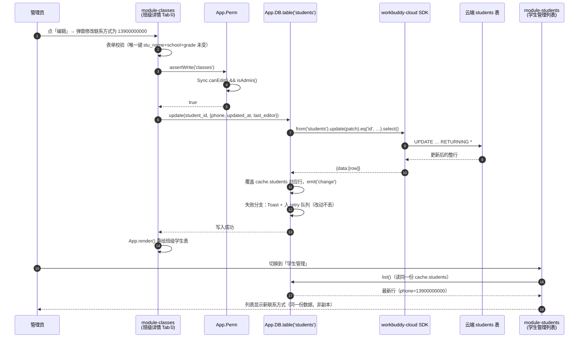
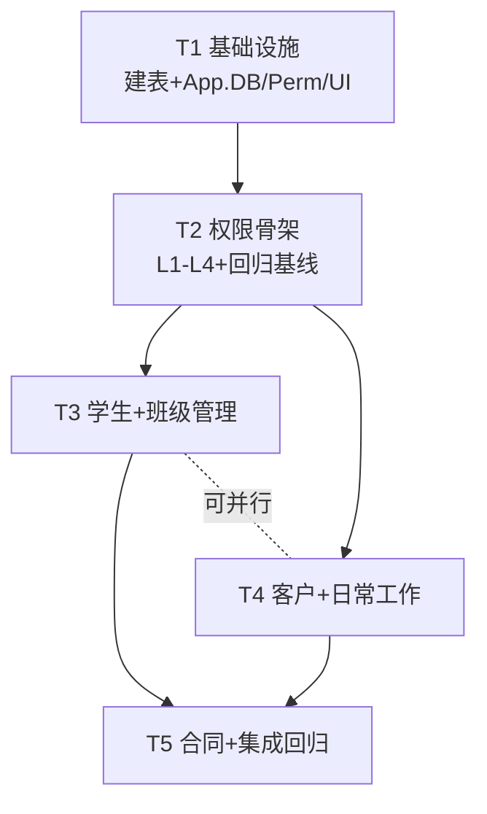

# ARCH v2 — 教务管理平台增量架构设计 + 任务分解

| 项目 | 内容 |
|---|---|
| 依据 | `docs/PRD-v2.md`（828 行）+ 现有代码只读分析（`core.js` / `app.js` / `sync.js` / `module-users.js` / `module-score.js` / `index.html` / `build-single.py`） |
| 性质 | 增量架构：**只新增，不重构成绩**。`score_records` 表结构、业务键、`Score.*` 算法、4 Tab 交互零改动 |
| 已定口径 | 单管理员（`profile.role==='admin'`）；教师只见「成绩管理」（`home` 为 adminOnly）；全云端无本地模式；合同按 `姓名+年级` 唯一；学生↔班级多对多桥表；客户与学生零关联；学生唯一键 `姓名+学校+年级` |

---

## 1. 实现方案（难点与选型）

### 1.1 核心技术挑战

| # | 难点 | 结论 |
|---|---|---|
| 1 | 在「不改 sync.js 成绩同步机制」的前提下给 7 张新表提供通用云端 CRUD | 新建 `js/db.js`（`App.DB`）：sync.js 只加 **1 行** `db()` 暴露 cloud 实例；成绩同步（指纹 diff 写穿 / deletedKeys / 冲突回滚）原封不动 |
| 2 | 四层权限（L1 导航 / L2 路由回退 / L3 直达 403 / L4 写入校验）且现有代码只有 `adminOnly` 一态 | 新建 `js/perm.js`（`App.Perm`）统一出口 + `app.js` 三处改造 + 每个模块 `render()` 首行自检 + 所有保存入口 `assertWrite()` |
| 3 | 纯前端应用，表必须真实存在于云端 | 用 **workbuddy-cloud-service MCP（`db_exec_sql`）** 执行 DDL 建表（见 §2.2），前端 SDK 只做读写、不动态建表 |
| 4 | 合同计价精度（一次性取整、资料费不折、结余封顶；T11 多方案聚合、各方案优惠独立） | `priceContract(input)` / `priceContractMulti(plans, balance)` 纯函数 + PRD §6.4 单方案十算例与多方案算例表作为自动断言（`tools/smoke-v2-contracts.js`） |
| 5 | 班级 → 成绩弱关联（姓名+学校）且不能动成绩口径 | 只读消费 `Store.data.records`，复用 `Score.stat/rankByRate/totalRate`，绝不回写 |

### 1.2 架构模式（沿用现状，不引入构建工具）

- IIFE + `window.App` 命名空间 + `App.registerModule({id, name, icon, ready, order, adminOnly, teacherOnly, render, bind})`。
- 模块内范式沿用 `module-score.js`：模块级 `state` 对象 + `render()` 返回 HTML 字符串 + `bind(host)` 绑事件 + `App.render()` 整体重绘。
- Tab 沿用「toolbar 按钮切换 + state.tab + App.render()」。
- 视觉完全复用 `.card/.grid/.kpi/.toolbar/.tbl-wrap/.chip/.modal/.empty`，仅少量补充样式。

### 1.3 新增第三方依赖

**无**。继续使用现有 CDN `@tencent-ai/workbuddy-cloud-sdk@dev`。无 npm、无构建步骤。

---

## 2. 数据层设计

### 2.1 表清单总览

新增 **7 张表**（`customer_referrals` 与 `contract_items`/`contract_prices` 明细拆表的取舍见下方结论），`score_records`、`user_profiles` 不动。

| 表 | 角色 | 唯一索引（DB 级） | 关联方式 |
|---|---|---|---|
| `students` | adminOnly | `(stu_name, school, grade)` | 被 `class_members` 逻辑引用；与 `score_records` 按 `stu_name+school` **弱关联**（只读） |
| `classes` | adminOnly | `(class_name)` | 被 `class_members` 逻辑引用 |
| `class_members` | adminOnly | `(class_id, student_id)` | 多对多桥表；**无数据库外键**，一致性由应用层双写维护 |
| `customers` | adminOnly | **不建**（软查重，见待明确 #1） | **零关联**（与学生完全隔离） |
| `daily_tasks` | adminOnly | 无（允许同标题） | 无 |
| `contract_prices` | adminOnly | `(year, grade, plan_name)`（T9） | 被 `contracts` 逻辑引用（合同存快照，不实时依赖） |
| `contracts` | adminOnly | `(stu_name, grade)` | 与 `students` 弱关联（仅登记页姓名联想，不建外键） |

**三个拆表取舍结论：**

1. **转介绍 → 内嵌 `customers` 表**（`referral_name / referral_grade / referral_amount / referral_claimed` 四列）。理由：与客户 1:1 可选属性，无独立生命周期、无独立查询场景，拆表徒增一次 join。**不建 `customer_referrals` 表**。
2. **价目 → 单表 `contract_prices`**，不拆 header/detail。理由：T9 之后一行 = 一个报读方案（方案名 + 单价 + 阶段配置 jsonb + 方案级优惠），阶段明细是方案内部的属性、不单独成行，更没有「价目册」实体，`contract_price_books` + `contract_prices` 两表是伪聚合。**只建一张 `contract_prices`**。
3. **合同科目行 → 内嵌 `contracts.items`（jsonb 数组）**，不建 `contract_items` 表。理由：科目行永远随合同整体读写（保存=整单重算重写，查看=整单复现快照），明细单语义要求快照不可变，jsonb 天然满足。

### 2.2 建表方式与验证（结论：MCP 静态建表，前端不建表）

- **建表通道**：通过 `workbuddy-cloud-service` MCP 的 `db_exec_sql` 执行 `docs/ddl-v2.sql`（DDL 见 §2.3）。前端 SDK 不执行任何 DDL——表结构是系统资产，必须先于代码存在、可审计、可重建。
- **前置验证（建表前必做）**：
  1. `workbuddy_cloudservice_db_list_tables` → 必须能看到现有 `score_records`、`user_profiles`（证明 MCP 连接的云服务实例 == 前端 endpoint `student-scores-36336.app.workbuddy.host` 的库；若看不到，说明连错实例，DDL 必须改到应用所属实例执行，见待明确 #3）。
  2. `workbuddy_cloudservice_db_describe_table('score_records')` → 实测既有列风格（平台是否自动生成 `id/created_at/owner_name` 等），新表 DDL 据此微调。
  3. `workbuddy_cloudservice_db_list_rls('score_records')` → 查看现行 RLS 策略，新表复制同一策略（登录用户共享读写、无 owner 隔离），否则多人共享会被行级隔离挡住。
- **建表后验证**：
  1. `db_list_tables` → 出现 7 张新表；
  2. `db_describe_table` 逐表核对列与索引；
  3. 探针：`db_exec_sql` 执行 `SELECT count(*) FROM <表>` → 各表为 0；写入探针 `INSERT INTO students(...) VALUES (...) RETURNING *` 后 `DELETE`，确认读写通道与 RLS 放行；
  4. T1 完成后前端控制台 `App.DB.table('students').insert({...}) / update / remove` 全链路跑通即视为「表已建好」的最终确认。

### 2.3 DDL（`docs/ddl-v2.sql`，Postgres 方言）

> 列风格沿用 `score_records`：业务列 snake_case、`stu_name`/`class_name` 命名、`updated_at` + `last_editor` 追踪。若 §2.2 第 2 步实测发现平台自动生成 `id/created_at`，则删除对应列定义。

```sql
-- ① 学生档案
CREATE TABLE IF NOT EXISTS students (
  id           uuid        PRIMARY KEY DEFAULT gen_random_uuid(),
  stu_name     text        NOT NULL,
  school       text        NOT NULL,
  grade        text        NOT NULL,                    -- 枚举：小学一~六/初一~三/高一~三（App 层校验）
  phone        text        NOT NULL DEFAULT '',         -- /^[0-9\-]{7,20}$/，11 位须 1 开头
  subjects     jsonb       NOT NULL DEFAULT '[]',       -- 上课科目（9 科 + 其他）
  teachers     jsonb       NOT NULL DEFAULT '[]',       -- 上课老师（昵称数组，手填值不落账号）
  created_at   timestamptz NOT NULL DEFAULT now(),      -- 系统录入时间，只读永不变更
  updated_at   timestamptz NOT NULL DEFAULT now(),
  last_editor  text        NOT NULL DEFAULT ''
);
CREATE UNIQUE INDEX IF NOT EXISTS uk_students_key ON students (stu_name, school, grade);

-- ② 班级
CREATE TABLE IF NOT EXISTS classes (
  id           uuid        PRIMARY KEY DEFAULT gen_random_uuid(),
  class_name   text        NOT NULL,                    -- 全局唯一
  teachers     jsonb       NOT NULL DEFAULT '[]',
  room         text        NOT NULL DEFAULT '',
  schedules    jsonb       NOT NULL DEFAULT '[]',       -- [{weekday:1..7,start:'18:30',end:'20:30'}]
  grade        text        NOT NULL DEFAULT '',
  subject      text        NOT NULL DEFAULT '',
  created_at   timestamptz NOT NULL DEFAULT now(),
  updated_at   timestamptz NOT NULL DEFAULT now(),
  last_editor  text        NOT NULL DEFAULT ''
);
CREATE UNIQUE INDEX IF NOT EXISTS uk_classes_name ON classes (class_name);

-- ③ 学生↔班级 多对多桥表（无外键；删除=仅删本表行）
CREATE TABLE IF NOT EXISTS class_members (
  id          uuid        PRIMARY KEY DEFAULT gen_random_uuid(),
  class_id    uuid        NOT NULL,
  student_id  uuid        NOT NULL,
  joined_at   timestamptz NOT NULL DEFAULT now(),
  created_by  text        NOT NULL DEFAULT ''
);
CREATE UNIQUE INDEX IF NOT EXISTS uk_members_pair ON class_members (class_id, student_id);

-- ④ 客户（与学生零关联；转介绍内嵌，不拆表；软查重故不建唯一索引）
CREATE TABLE IF NOT EXISTS customers (
  id                  uuid         PRIMARY KEY DEFAULT gen_random_uuid(),
  stu_name            text         NOT NULL,
  school              text         NOT NULL DEFAULT '',
  phone               text         NOT NULL,            -- /^1\d{10}$/
  grade               text         NOT NULL DEFAULT '',
  resource_type       text         NOT NULL,            -- 转介绍/上门咨询/电话咨询/网络留资/地推/老生续报/其他
  created_at          timestamptz  NOT NULL DEFAULT now(),   -- 录入时间：只读，总资源数周期基准
  intended_product    text         NOT NULL DEFAULT '',      -- 一对一/班课
  intended_subjects   jsonb        NOT NULL DEFAULT '[]',
  appointment_at      timestamptz,
  visited             boolean      NOT NULL DEFAULT false,
  visit_at            timestamptz,
  test_status         text         NOT NULL DEFAULT '未测评',
  suggested_class_type text        NOT NULL DEFAULT '',
  paid                boolean      NOT NULL DEFAULT false,   -- 签单判定
  paid_at             timestamptz,
  paid_amount         numeric(12,2),
  yellow_form         boolean      NOT NULL DEFAULT false,
  referral_name       text         NOT NULL DEFAULT '',
  referral_grade      text         NOT NULL DEFAULT '',
  referral_amount     numeric(12,2) NOT NULL DEFAULT 0,
  referral_claimed    boolean      NOT NULL DEFAULT false,
  note_makeup         text         NOT NULL DEFAULT '',      -- 补课经历
  note_progress       text         NOT NULL DEFAULT '',      -- 学校授课进度
  note_relation       text         NOT NULL DEFAULT '',      -- 亲子关系
  note_scores         text         NOT NULL DEFAULT '',      -- 平时成绩
  note_schedule       text         NOT NULL DEFAULT '',      -- 建议排课时间和班级
  note_other          text         NOT NULL DEFAULT '',
  updated_at          timestamptz  NOT NULL DEFAULT now(),
  last_editor         text         NOT NULL DEFAULT ''
);

-- ⑤ 日常工作
CREATE TABLE IF NOT EXISTS daily_tasks (
  id          uuid        PRIMARY KEY DEFAULT gen_random_uuid(),
  title       text        NOT NULL,
  priority    text        NOT NULL DEFAULT 'mid' CHECK (priority IN ('high','mid','low')),
  due_at      timestamptz NOT NULL,                     -- 预期完成时间（允许过去，补录用）
  status      text        NOT NULL DEFAULT 'todo' CHECK (status IN ('todo','done')),
  done_at     timestamptz,
  remark      text        NOT NULL DEFAULT '',
  created_by  text        NOT NULL DEFAULT '',
  created_at  timestamptz NOT NULL DEFAULT now(),
  updated_at  timestamptz NOT NULL DEFAULT now()
);

-- ⑥ 合同价目（单表，不拆 header/detail；T9：一个报读方案一行）
--    权威版本见 docs/ddl-v2.sql §⑥（bigint 主键 + owner_id/owner_name + RLS + GRANT），
--    这里只保留结构草图。
CREATE TABLE IF NOT EXISTS contract_prices (
  id             uuid         PRIMARY KEY DEFAULT gen_random_uuid(),
  year           integer      NOT NULL CHECK (year BETWEEN 2000 AND 2100),
  grade          text         NOT NULL,
  plan_name      text         NOT NULL,                          -- 如「寒春连报」
  unit_price     numeric(12,2) NOT NULL CHECK (unit_price > 0),   -- 元/科目/次课
  stages         jsonb        NOT NULL DEFAULT '[]',              -- [{stage,sessions,material_fee}]
  discount_type  text         NOT NULL DEFAULT 'none',            -- none|pct|amount
  discount_value numeric(12,2) NOT NULL DEFAULT 0,                -- pct: 系数(0.85)；amount: 元
  remark         text         NOT NULL DEFAULT '',                -- T11 方案备注（选填 ≤200 字，只展示不参与计价）
  updated_at     timestamptz  NOT NULL DEFAULT now(),
  last_editor    text         NOT NULL DEFAULT ''
);
CREATE UNIQUE INDEX IF NOT EXISTS uk_prices_key ON contract_prices (year, grade, plan_name);
-- T11：已存在的库就地补列（幂等、非破坏性；线上已执行并实测备注往返）
ALTER TABLE contract_prices ADD COLUMN IF NOT EXISTS remark text NOT NULL DEFAULT '';

-- ⑦ 合同（科目行内嵌 items jsonb；金额为签订时快照）
CREATE TABLE IF NOT EXISTS contracts (
  id               uuid         PRIMARY KEY DEFAULT gen_random_uuid(),
  stu_name         text         NOT NULL,
  grade            text         NOT NULL,
  year             integer      NOT NULL,
  plan             text         NOT NULL,                -- T9：存价目方案的 plan_name；T11 多方案用 + 拼接（「寒春连报+暑期班」）
  items            jsonb        NOT NULL DEFAULT '[]',  -- 明细快照（T11 为 {plans:[…]}；T9 为 {plan,planName,stages,lines}；更早为 {lines}）
  original_amount  numeric(12,2) NOT NULL DEFAULT 0,    -- O
  discount_type    text         NOT NULL DEFAULT 'none',-- none|pct|amount；T11 各方案优惠不同时为 mixed（该列无 CHECK，已实测写入）
  discount_value   numeric(12,2) NOT NULL DEFAULT 0,    -- 系数(0.8/0.85)或直接金额
  discount_amount  numeric(12,2) NOT NULL DEFAULT 0,    -- D
  material_amount  numeric(12,2) NOT NULL DEFAULT 0,    -- M
  account_deduction numeric(12,2) NOT NULL DEFAULT 0,   -- C
  payable_amount   numeric(12,2) NOT NULL DEFAULT 0,    -- P
  balance_remain   numeric(12,2) NOT NULL DEFAULT 0,    -- R（仅提示用快照）
  created_at       timestamptz  NOT NULL DEFAULT now(),
  updated_at       timestamptz  NOT NULL DEFAULT now(),
  created_by       text         NOT NULL DEFAULT ''
);
CREATE UNIQUE INDEX IF NOT EXISTS uk_contracts_key ON contracts (stu_name, grade);
```

### 2.3.1 实测校准（2026-11-10 T1 建表时回写，以此为准）

按 §2.2 前置验证顺序实测后的结论与调整（`docs/ddl-v2.sql` 已按本节落地）：

| 项 | 实测结果 | 落地调整 |
|---|---|---|
| `db_list_tables` | 可见 `score_records`(40 行)、`user_profiles` | MCP 连接的实例 == 前端 endpoint，DDL 就地执行 ✅ |
| `score_records.id` | **`bigint GENERATED ALWAYS AS IDENTITY`**（不是 uuid） | 7 张新表主键统一 `bigint GENERATED ALWAYS AS IDENTITY`，删掉 `gen_random_uuid()` |
| 平台自动列 | `owner_id text DEFAULT auth.uid()`、`owner_name text`、`last_editor text`、`created_at/updated_at timestamptz DEFAULT now()` | 新表补 `owner_id`（可空，默认 `auth.uid()`）、`owner_name`、`last_editor`，与既有表风格一致；`class_members.class_id/student_id` 类型随之改为 **bigint** |
| `db_list_rls('score_records')` | 4 条策略：`score_read_team`(SELECT `is_viewer()`)、`score_insert_team`(INSERT WITH CHECK `is_editor()`)、`score_update_team`(UPDATE `is_editor()`)、`score_delete_team`(DELETE `is_editor()`)，**Roles 为空 = PUBLIC、无 owner 隔离** | 7 张新表各复制同名形态的 4 条策略（`<table>_read_team` 等），不自创 owner 隔离 |
| 既有授权 | `anon`=SELECT；`authenticated`=SELECT/INSERT/UPDATE/DELETE；序列 `*_id_seq` 对 anon/authenticated 有 `rwU` | 新表同样两行 GRANT + 显式 `GRANT USAGE, SELECT ON SEQUENCE <table>_id_seq TO authenticated`（漏则 insert 报 42501） |
| 唯一冲突错误码 | 实测返回 `DATABASE_23505` + `duplicate key value violates unique constraint "uk_students_key"` | `App.DB` 的唯一冲突判定同时认 `23505` / `unique_violation` / 消息含 `23505`（与 `sync.js isUniqueViolation` 同口径并加宽） |

**建表后验证（全部通过）**：`db_list_tables` 出现 7 张新表且 `RLSOn=true`；
`select count(*)` 各表 = 0、`score_records` = 40（不变）；
`INSERT INTO students(...) RETURNING *` → 回读 → 重复插入触发 `uk_students_key` 23505 → `DELETE` 成功，写读删通道全通。

### 2.4 通用数据访问层 `App.DB`（`js/db.js`）与 sync.js 的边界

现有 `sync.js` 与 `score_records` 强耦合（指纹 diff、`deletedKeys` 删除队列、`settleConflict` 回滚）。**不重构它**，新表走「直接写 + 回读 + 失败重试队列」的更简单模型（新表数据量为数十~数百行，全量拉取可行）。

**边界契约（谁负责什么）：**

| 职责 | 归属 |
|---|---|
| 登录态 / 会话探测 / 换号防串号 / 账号状态门控 / 登录页 | `sync.js`（独占，零改动） |
| `user_profiles` 读写（建档 / 状态 / 删除账户） | `sync.js`（独占，`App.DB` 禁止注册该表） |
| `score_records` 读写（指纹写穿 / 删除队列 / 冲突回滚 / 拉取） | `sync.js`（独占，`App.DB` 禁止注册该表；读成绩一律走 `Store.data.records`） |
| cloud 实例暴露 | `sync.js` **新增 1 行**：`App.Sync` 上加 `db: function () { return cloud; }`（本次改版对 sync.js 的唯一侵入点） |
| 7 张新表 CRUD / 内存缓存 / 失败重试 / 定时拉取 / 变更通知 | `js/db.js`（`App.DB`） |
| 角色判定 / 写入守卫 / 403 卡片 | `js/perm.js`（`App.Perm`，调用 `App.Sync.isAdmin/canEdit`） |

**`App.DB` API（可直接编码）：**

```js
/* js/db.js —— 通用表 CRUD（全部新表 adminOnly，守卫在 mutation 入口统一做） */
(function (App) {
  var defs = {};    // { students:{adminOnly:true, unique:['stu_name','school','grade']}, ... }
  var cache = {};   // { students:[row,...] } —— 渲染层同步读，云端为唯一权威
  var retry = [];   // 失败队列 [{kind:'insert'|'update'|'remove', table, payload, id}]
  var listeners = [];

  function db() { /* App.Sync.db()；未就绪时 throw（调用方都在登录后触发） */ }

  // 建模块加载时集中注册 7 张表（表名、角色、唯一键——唯一键供 UI 查重提示）
  function define(name, opts) { defs[name] = opts; cache[name] = cache[name] || []; }

  function table(name) {
    return {
      list:   function () { return cache[name] || []; },          // 缓存同步读（渲染用）
      get:    function (id) { /* cache 查找 */ },
      insert: function (row) { /* ①App.Perm.assertWrite(defs[name]) ②补 updated_at/last_editor
                                 ③ db().from(name).insert(row).select() 回读
                                 ④ 成功→写 cache→emit('change',name)→App.render()
                                 ⑤ 失败(非23505)→Toast+入 retry 队列 */ },
      update: function (id, patch) { /* 同上，.update(patch).eq('id',id).select() 回读覆盖 cache 行 */ },
      remove: function (id) { /* .delete().eq('id',id) 成功后从 cache 移除 */ },
      findBy: function (uniqueVals) { /* 按唯一键在 cache 查重，返回命中行或 null */ }
    };
  }

  function refreshAll() { /* 登录后/45s 定时/visibilitychange：
                             逐表 db().from(name).select('*') 全量覆盖 cache → emit → App.render()。
                             last-write-wins，与成绩拉取同一语义 */ }
  function flushRetry() { /* 重放 retry 队列；online/visibilitychange/45s tick 触发 */ }
  function onChange(fn) { listeners.push(fn); }

  App.DB = { define: define, table: table, cache: cache,
             refreshAll: refreshAll, flushRetry: flushRetry, onChange: onChange };
})(window.App);
```

要点：
- **写穿策略**：mutation 直接调云端并 `.select()` 回读（沿用 `sync.js` `insertRow/updateByCid` 的回读模式），成功才更新 cache——内存永远不超前于云端；失败保留在 retry 队列（不丢改动）并 toast「同步失败 · 请重试」（状态灯复用 `App.Sync.state`）。
- **拉取**：`refreshAll()` 挂在登录成功后 + 既有 45s 定时循环之后 + `visibilitychange`（与 `sync.js` 现有三处触发点对齐，独立函数不侵入其代码）。
- **唯一冲突**：识别 `code 23505 / unique_violation`（与 `sync.js isUniqueViolation` 同判定），向上抛给模块层做「已存在，请前往修改」提示，**不静默回滚**（新表场景查重已在 UI 先行）。
- **删除学生/班级 → 清 `class_members`**：应用层顺序双写（先删桥表行、再删主行；无事务，失败进 retry 队列，桥表残留行在 `refreshAll` 后以「孤儿清理」补偿：拉取后删 `class_id/student_id` 无对应的行）。

### 2.5 `score_records` 零改动回归校验方法（G1）

改版前后各执行一次，结果必须完全一致：

1. **行数**：MCP `db_exec_sql` → `SELECT count(*) FROM score_records;`
2. **全量指纹**（浏览器控制台，或做成 `tools/qa-regression.js` 中的 Node 脚本经 MCP 跑）：
   ```js
   // 控制台版本：对全量云端行做排序哈希
   App.Sync.db().database.from('score_records').select('*').then(function (res) {
     var rows = (res.data || []).map(function (r) {
       return [r.stu_name, r.school, r.class_name, r.exam,
               (r.scores || []).join(','), (r.ranks || []).join(','),
               r.total_rank, r.entered_at].join('|');
     }).sort();
     console.log('count =', rows.length);
     console.log('fingerprint =', rows.join('\n').length, 'chars'); // 或简单 hash 函数
     copy(rows.join('\n'));   // 落盘到 docs/baseline-score.txt
   });
   ```
   改版后重跑，`count` 与逐行内容 diff 为空。
3. **业务口径**：UI 抽查——成绩总表任取 5 条逐字段比对；任选一场考试核对排名与及格率与改版前截图一致。
4. **G2（无越权写入）**：管理员会话控制台调用 `App.ScoreModule` 保存入口 → toast「无操作权限」，`db_exec_sql` 查 `count(*)` 不变。

---

## 3. 前端结构设计

### 3.1 文件清单与拆分结论

| 文件 | 类型 | 职责 |
|---|---|---|
| `js/db.js` | 新增 | `App.DB` 通用表 CRUD（§2.4） |
| `js/perm.js` | 新增 | `App.Perm`：`isAdmin()` 转发、`allowed(mod)`、`canEdit()`、`assertScoreAction()` / `assertWrite(moduleId)` / `assertAdminWrite(moduleId)`、`forbiddenCard(mod)`（403 卡片） |
| `js/ui-kit.js` | 新增 | `App.UI`：`money/round2/periodRange/pct`、`MultiSelect`（多选+手填 chips）、`TimeRow`（星期+起止时间行）、`dateInput`、排序表头、状态 chip |
| `js/module-students.js` | 新增 | 学生管理（§3.2 PRD） |
| `js/module-classes.js` | 新增 | 班级管理：卡片网格 + 详情页 Tab①班级学生 / Tab②成绩分析 |
| `js/module-customers.js` | 新增 | 客户管理：Tab①列表 / Tab②统计分析 |
| `js/module-tasks.js` | 新增 | 日常工作：Tab①待办看板 / Tab②汇总 |
| `js/module-contracts.js` | 新增 | 合同确认：Tab①登记 / Tab②台账 / Tab③价目维护 |
| `js/core.js` | 修改（≤5 行） | `registerModule` 归一化默认值：`order = m.order ?? 100`、`teacherOnly = !!m.teacherOnly`。**Score/Store 算法零改动** |
| `js/app.js` | 修改 | `navHTML()`/`navList()` L1 过滤 + `navCompare` 严格反对称排序；`pickModule()` L2 回退；`hashchange` 传递；顶栏 4 按钮分组裁剪（T6 前三按钮 `canEdit()`、T8 清空按钮 `isAdmin()&&canEdit()`）+ 事件守卫 |
| `js/sync.js` | 修改（1 行） | `App.Sync` 暴露 `db: function () { return cloud; }` |
| `js/module-home.js` | 修改 | `adminOnly: true` + `home: true` + `order: 0`（教师找不到概览） |
| `js/module-score.js` | 修改（极小） | 注册对象 `order: 5`（**无 `teacherOnly`** —— T6 反转后管理员与教师同权）；保存动作入口加 `App.Perm.assertWrite('score')`。**4 Tab 与报告逻辑不动** |
| `index.html` | 修改 | 新增 8 个 script 标签（§3.2） |
| `build-single.py` | 修改 | `JS_ORDER` 同步新增文件（**已确认**：该脚本按硬编码清单拼接，漏加则单文件版缺模块） |
| `assets/style.css` | 修改（少量） | 看板分组、价目分组表格、明细单等少量补充 |
| `docs/ddl-v2.sql` | 新增 | §2.3 建表脚本 |
| `tools/qa-regression.js` | 新增 | G1 基线采集与比对 |
| `tools/qa-v2.js` | 新增 | 合同算例 1–4 + 客户统计/任务汇总口径断言 |

**拆分结论**：按板块一模块一文件（`module-<板块>.js`）；公共件放 `js/ui-kit.js`（`App.UI`），**复用**现有 `App.Modal / App.U / App.Toast / App.Chart`，不重复造弹窗/toast；只有多选、时间行、金额、周期区间、排序表头是新组件。

### 3.2 脚本加载顺序（依赖先于使用；运行时才用 `App.Sync` 的文件放哪都行，但保持稳定顺序）

```
sdk(CDN) → core.js → db.js → perm.js → ui-kit.js
  → data-locator.js → locator.js → data-gradesize.js → gradesize.js
  → analysis.js → study-plan.js → charts.js → export.js
  → module-home.js → module-score.js
  → module-students.js → module-classes.js → module-customers.js
  → module-tasks.js → module-contracts.js
  → module-users.js → module-login.js
  → sync.js → app.js
```

`db.js/perm.js/ui-kit.js` 加载期只依赖 `core.js` 的 `window.App`（`App.Sync` 全部运行时惰性取）；`build-single.py` 的 `JS_ORDER` 按同一顺序插入（新文件插在 `export.js` 之后、`module-home.js` 之前与各模块对应位置）。

**缓存击穿版本号（T14）**：沙箱服务器对静态资源不发 `Cache-Control` / `ETag`，浏览器会按
「last-modified 的 10%」启发式缓存 `index.html` 与 js（旧 index.html + 旧 js 组合 → 命中已删除列报错）。
对策有两层：`index.html` 加 `<meta http-equiv="Cache-Control" content="no-store">`（文档本身不缓存）；
`build-single.py` 每次构建把全部本地资源（23 个 js + style.css）的 `?v=` 统一刷成构建时刻
（`YYYYMMDDHHmm`，幂等替换、CDN 那行不碰）——URL 变了浏览器必然重新拉取。
**铁律：每次发布前必须跑一次 `python3 build-single.py` 刷新 index.html 版本号**，否则用户可能
在数小时内拿到旧 js（单文件版全部内联，不受 `?v=` 影响）。

### 3.3 `registerModule` 扩展与导航/路由改造点

**注册字段**：`{ id, name, icon, ready, order, adminOnly, teacherOnly, hidden, visible, title, subtitle, render, bind }`
- `order`：数字，导航排序（`home:0, score:5, students:10, classes:20, customers:30, tasks:40, contracts:50`；`users` 未设 order → 按默认 100 排最后）。
- `teacherOnly: true`：仅教师可见。**T6 反转后已无模块声明它**（`score` 改为一律放行），机制与 `App.Perm.isTeacherOnly()` 兜底保留，供将来新增教师专属模块时使用。
- **`score` 的当前注册**：`{ id:'score', ready:true, order:5 }` —— 既非 `adminOnly` 也非 `teacherOnly`，因此管理员与教师都可见可用，写入门槛只剩 `App.Perm.canEdit()`。
- 既有 `adminOnly / hidden / visible / home` 语义保留。

**`app.js` 三处改造（L1/L2/L3）**：

```js
/* L1 导航（navList 内） */
function allowed(m) {
  var admin = App.Sync && App.Sync.isAdmin && App.Sync.isAdmin();
  if (m.adminOnly && !admin) return false;     // 管理员专属 → 教师不可见
  if (m.teacherOnly && admin) return false;    // 教师专属 → 管理员不可见（T6 后无模块命中）
  return true;
}
// 过滤：!m.hidden && m.ready && allowed(m) && (!m.visible || m.visible())
// 排序：home 优先 → order 升序 → ready 优先
// 「更多模块（规划中）」区块：仅管理员渲染（教师导航只有「成绩管理」一项，符合口径）

/* L2 路由回退（pickModule 内） */
var mod = find(currentId);
if (mod && !allowed(mod)) {
  mod = null;
  // 回退到当前角色允许的第一个模块（按导航顺序）：教师→score，管理员→home
}
if (!mod || !mod.ready) mod = find('home') || App.modules[0];

/* L3 直达拦截 */
// hashchange 处理器保持现状（pickModule 已兜底）；
// 每个模块 render() 首行：if (App.Perm.denied(this)) return App.Perm.forbiddenCard(this);
// 403 卡片复用 .card + .empty，文案按 PRD §2.2 统一
```

**顶栏 4 按钮裁剪（T6 / T8 最终口径）**：
- `#btn-demo / #btn-backup / #btn-restore`：`App.Perm.canEdit()` 为真才显示（管理员与 `active` 教师都显示），handler 首行 `assertScoreAction()`。
- `#btn-clear`：`App.Perm.isAdmin() && App.Perm.canEdit()` 才显示（管理员专属）。handler 首行 `assertAdminWrite('score')`，并通过 `App.UI.formModal` 要求手动输入确认词「清空」才执行。
- 两组都只是视觉裁剪，DOM 隐藏挡不住控制台 `click()`，真正的拦截在 handler 首行。

**L4 写入校验（统一出口，三档）**：

```js
/* js/perm.js —— T6 / T8 之后的实际签名 */
App.Perm.assertScoreAction();        // 只判 canEdit()：顶栏 demo / backup / restore
App.Perm.assertWrite(moduleId);      // canEdit() + 角色；score 只看 canEdit()（T6 反转）
App.Perm.assertAdminWrite(moduleId); // canEdit() + isAdmin()，用于不可撤销操作（如清空数据）
// 所有模块保存动作入口（表单提交 / 行内更新 / 删除确认 onOk）第一行调用，false 即中止
```

### 3.4 模块内状态与事件范式（沿用 module-score）

```js
(function (App) {
  var state = { tab: 'list', filters: {...}, editing: null, sortKey: 'created_at', sortDesc: true };
  App.registerModule({
    id: 'students', name: '学生管理', icon: ICON, ready: true, adminOnly: true, order: 10,
    title: '学生管理', subtitle: '...',
    render: function () {
      if (App.Perm.denied(this)) return App.Perm.forbiddenCard(this);   // L3
      /* KPI 行 + 筛选 toolbar + .tbl-wrap 表格（读 App.DB.table('students').list()） */
    },
    bind: function (host) { /* data-act 事件委托 + U.onCommitted 筛选 + 表头排序 */ }
  });
})(window.App);
```

---

## 4. 关键算法（可直接编码的函数签名）

### 4.1 金额与周期（`js/ui-kit.js`）

```js
App.UI.round2 = function (n)   // Math.round(n*100)/100 —— round half up，一切金额取整唯一入口
App.UI.money = function (n)    // 展示：(round2 后).toFixed(2)，如 '7230.00'
App.UI.pct = function (num, den)  // den<=0 → 返回 null（渲染层输出 '—'，禁止 0%/NaN）；否则 1 位小数字符串
/**
 * 周期区间（本地时区，含首含尾）：
 *   'week'  → 本周一 00:00:00.000 – 本周日 23:59:59.999（周一为周首）
 *   'month' → 当月 1 日 00:00:00.000 – 月末 23:59:59.999
 *   'year'  → 1/1 00:00:00.000 – 12/31 23:59:59.999
 * returns {start: Date, end: Date}
 */
App.UI.periodRange = function (kind, now)
```

### 4.2 客户统计（`module-customers.js`，口径 PRD §6.1）

```js
/**
 * rows: App.DB.table('customers').list() 全量；range: App.UI.periodRange(...) 结果
 * 指标归属字段（不可混用）：
 *   总资源数   → created_at ∈ range
 *   上门资源数 → visited===true && visit_at ∈ range
 *   签单学生数 → paid===true && paid_at ∈ range
 *   签单金额   → 上述签单行的 paid_amount 求和（round2）
 * returns {
 *   total, visited, signed, signedAmount,
 *   byType: [{ type, total, visited, signed, signedAmount }]   // 按 resource_type 分组，逐组同口径
 * }
 * 渲染层比率：上门率=pct(visited,total)；签单率=pct(signed,total)；上门签单率=pct(signed,visited)
 * 自检断言：ΣbyType.total===total && ΣbyType.signedAmount===signedAmount（D6）
 */
function customerStats(rows, range) { ... }
```

### 4.3 任务汇总（`module-tasks.js`，口径 PRD §6.2）

```js
/**
 * tasks: 全量；granularity: 'day'|'week'|'month'；periods: 14|12|12（从当前周期向前取）
 * 周期归属一律用 due_at；周=周一~周日，月=自然月，日=自然日
 * 每周期：planned = due_at∈区间；done = 其中 status==='done'；undone = planned-done；
 *          overdue = 其中 status!=='done' && due_at < now（now=汇总执行时刻）
 *          rate = pct(done, planned)（分母 0 → null → '—'）
 * 跨周期完成计入 due_at 所属周期（分母一致，完成率不超 100%）
 * returns [{label, start, end, planned, done, undone, overdue, rate}]
 */
function taskSummary(tasks, granularity, now, periods) { ... }

/** 看板分组：'已逾期'(todo且due_at<now) → '今天' → '明天' → '本周' → '以后' → '已完成'(折叠)
 *  组内排序：priority 高>中>低 → due_at 升序；已完成组按 done_at 降序
 *  空分组不渲染 */
function taskGroups(tasks, now) { ... }
```

### 4.4 合同计价（`module-contracts.js`，口径 PRD §6.3–6.4）

> **T9 改造**：价目由「年份×年级×阶段×方案」细粒度行改为**一个报读方案一行**
> （`plan_name` + `stages jsonb` + 方案级优惠）。`priceContract` 因此不再查价目表，
> 而是接收**已归一的一个方案**；价目匹配退化成「年份+年级+方案名称」命中一行（`findPlan`）。
>
> **T11 改造**：一张合同可报**多个**方案。单方案算法原样保留（`priceContract`，价目预览仍在用），
> 新增**聚合入口** `priceEntry(input)`：`input.plans` 是数组时走 `priceContractMulti`，
> 否则仍走 `priceContract` —— 渲染层只认这一个入口，避免两条路径算出的金额不一致。
> `entryPlanList` 负责把「多方案 `plans:[…]`」与「单方案平铺 `{planName, subjects, discount}`」
> 归一成同一种结构，`validateContract` 也借此复用同一套逐方案判据。
>
> 分层：纯函数（无 DOM，可单测）住 §4.4.1，DOM 渲染与交互住 Tab 级函数（`renderEntry` /
> `detailCardHTML` / `openPlanForm`），二者只通过 `state` 与返回值交互。

#### 4.4.1 纯函数层（`App.ContractsCore`，全部无副作用）

```js
/**
 * 方案归一：云端行 / 表单值 / 已归一对象 → 规范结构。
 * stages 可能是 jsonb（PostgREST 已解析成数组）或 JSON 字符串，统一按 A→D 排序、
 * 同阶段去重、次数夹 1–200、资料费非负；pct 折扣归一为系数（85 → 0.85）。
 * @returns {{unit_price:number, stages:Array<{stage,sessions,material_fee}>,
 *            discount_type:'none'|'pct'|'amount', discount_value:number}}
 */
function normalizePlan(src) { ... }

/** 折扣输入 → 系数（严格版，校验用）：≤1 视为系数，>1 视为 1–100 的整数百分数；非法返回 NaN */
function parseRate(v) { ... }
/** 折扣输入 → 系数（宽松版，展示/计价用）：非法值兜底为 1（不打折） */
function normRate(v) { ... }

/** 按 年份+年级+方案名称 命中一行；缓存偶发重复行时取 updated_at 较新、同刻 id 较大者 */
function findPlan(prices, year, grade, planName) { ... }
function plansFor(prices, year, grade) { ... }      // 某年份年级下的方案列表（中文排序）
function previewPlan(plan) { ... }                  // 价目表单预览：假设每阶段 1 科的试算

/**
 * input = {
 *   year, grade, planName,
 *   plan: { unit_price, stages:[{stage,sessions,material_fee}], discount_type, discount_value },
 *   subjects: { A: ['数学','英语'], B: [...] },   // 只含方案定义的阶段，每阶段 ≥1 科
 *   discount: { type:'none'|'pct'|'amount', value },  // 省略/未给则用方案预设
 *   balance                                              // 电子账户结余（≥0，选填）
 * }
 * 计算顺序（固定，折扣只作用课时费合计、一次性取整）：
 *   O = round2( Σ_阶段(unit_price × sessions_阶段 × 该阶段科目数) )
 *   T = type==='pct'    ? round2(O × k)                          // k 为系数（85 折 → 0.85）
 *     : type==='amount' ? round2(max(0, O − min(value, O)))      // 金额优惠超 O 截断为 O
 *     : O
 *   D = round2(O − T)
 *   M = round2( Σ_阶段(material_fee_阶段 × 该阶段科目数) )        // 资料费永不参与折扣与优惠抵扣
 *   S = round2(T + M)
 *   C = round2(min(balance || 0, S))                              // 结余抵扣 ≤ 小计
 *   P = round2(S − C)                                             // 下限 0，不出负数
 *   R = round2((balance || 0) − C)                                // 仅提示「剩余 X 元可下次使用」，不落台账
 * returns {
 *   subjectRows:   [{subject, stagesHit:{A:true,B:true}, sessionsTotal, amount}],  // 一科目一行（跨阶段合并）
 *   stageMaterial: [{stage, unitFee, count, amount}],             // 资料费按阶段，末尾合计
 *   missing:       [],                                            // 未选科目/无阶段的占位（ok=false 时为真）
 *   stageList:     [{stage, sessions, material_fee}],
 *   planName, unitPrice,
 *   original, discountAmount, tuition, materialAmount, subtotal,
 *   deduction, payable, balanceLeft,
 *   discountType, discountValue, subjectCount, ok
 * }
 * 边界：0 科 / 无阶段 → ok=false 且不抛错（提交由 validateContract 先行拦截）；
 *       重复科目 → uniqList 去重；折扣金额>O → 截断，D=O；结余>S → P=0 且 balanceLeft>0
 * QA：PRD §6.4 十算例（5900 / 11700 / 1730 / 9072 / 合并一行 25 次 / 截断 200 /
 *       封顶 0+剩 13800 / 默认优惠 5300 / 78699.38 / 空拒绝）逐条断言
 */
function priceContract(input) { ... }

/**
 * 多方案聚合（T11）。每个方案独立算 O_p / D_p / T_p / M_p（优惠_p 只作用该方案自己的课时费），
 * 再逐项求和；结余是**整单一个**，只在聚合层抵一次（不下沉到各方案）。
 *   O = ΣO_p、D = ΣD_p、T = ΣT_p、M = ΣM_p、S = T + M、C = min(结余, S)、P = S − C
 * 整单优惠类型：各方案一致 → 沿用；不一致 → 'mixed'（明细单逐方案展示，台账显示「多方案优惠」）
 * @param {Array<{planName, plan, subjects, discount, remark}>} plans
 * @returns 与 priceContract 同构，另加 plans[] / planNames / multi
 */
function priceContractMulti(plans, balance) { ... }

/** 统一计价入口：input.plans 是数组 → priceContractMulti；否则 priceContract */
function priceEntry(input) { ... }

/** 合同报读方案列表归一（多方案 plans[] / 单方案平铺 → 同一结构） */
function entryPlanList(input) { ... }
/** 多方案的科目行 / 资料费明细合并视图（台账列与老渲染路径用） */
function mergePlanViews(list) { ... }

/** 价目方案校验：年份区间、年级、方案名（1–20 且同年份年级内唯一）、备注（≤200）、单价、阶段配置、优惠 */
function validatePlan(form, prices, exceptId) { ... }
/** 合同校验：姓名/年级/年份/方案≥1 且不重复/每阶段 ≥1 科/方案外阶段/优惠原始值/结余/学生重复合同
 *  多方案时错误文案加「方案「X」：」前缀；单方案时文案与 T9 完全一致（老断言不失效） */
function validateContract(input, prices, opt) { ... }

/** 明细快照（落 contracts.items）：T11 输出 {plans:[{planName, unit_price, stages, subjects, discount,
 *  lines, subjectRows, stageMaterial, original, discountAmount, tuition, materialAmount, remark}], pricesVersion}
 *  同时保留 T9 平铺冗余字段（planName/plan/stages/lines/subjectRows/stageMaterial），单方案时逐字段等价 */
function itemsSnapshot(input, res) { ... }
/** 快照 → 结果对象：三格式分支（items.plans[] / items.plan / 仅 lines）；
 *  单方案时把该方案镜像到顶层字段，与 T9 快照完全同构 */
function snapshotResult(row) { ... }
/** 快照里「方案名 + 方案配置」清单（priceChanged 用，三格式通用） */
function snapshotPlanConfigs(row) { ... }

/* ---- T12：明细单合并横表的纯函数（渲染层，无副作用；不参与任何计价） ---- */

/** 计价结果 / 快照视图 → 方案视图列表（{plans:[]} 直接用；单方案镜像到顶层时退化成 1 条） */
function detailPlanViews(r) { ... }

/** 列模型：一个「方案 × 阶段」= 一列，顺序 = 方案顺序 → 阶段 A→D
 *  @returns {{cols:[{vi, planName, stage, sessions}], uniform:boolean}}  uniform = 各方案 unit_price 是否全同 */
function detailColumns(views) { ... }

/** 科目行并集：同名科目跨方案合并一行（hit 键 = '方案下标|阶段'），amount = 各方案该科金额之和
 *  排序取首次出现序（单方案时与 T9 行序逐行一致） */
function detailSubjectRows(views) { ... }

/** 明细单「优惠」行文案：单方案沿用 discountText；多方案按方案顺序拼「减免 50 + 300 元」/「减免 300 元 + 85折」 */
function detailDiscountText(views, r) { ... }

/** 整张合并横表（科目行 → 资料费行 → 方案小计行 → colspan 汇总块），超宽由外层容器横向滚动 */
function detailTableHTML(r) { ... }

/** 备注提示条（T13 起在表格下方，浅黄底 + 📌 备注，紧凑一行）；全同去重、全空不渲染 */
function remarkTipHTML(views) { ... }

/** 明细弹窗加宽：给 .mask > .modal 盖 inline max-width（1120px），只影响这一个弹窗 */
function widenDetailModal(mask) { ... }
```

**折扣校验的坑（实现约定）**：`normRate` 会把 `0 / 101 / 1.5` 全部兜底成 `1`（不打折），
所以校验**必须**走 `parseRate` 判原始输入；`resolveDiscount` 同样只做兜底、不做判断。
表单输入层（`readPlanForm` / `syncEntryFromDom` / pct input 监听）一律**保留原始输入**，
归一只发生在 `priceContract` 与展示层 —— 否则非法输入会在进校验前就被抹平，校验变成死代码。

#### 4.4.2 DOM 层（三个 Tab）

- `renderEntry()` → 姓名/年级/年份、**报读方案勾选框多选**（`planPickerHTML`，`planLabel` 生成标签，
  `data-plan-name` 承载方案名）、**每个已勾选方案一个方案块**（`planBlockHTML`：方案名 + 每阶段
  摘要 chip `A 阶段·7 次·资料费 100.00 元/科` + 逐阶段科目多选 + 该方案自己的优惠控件）、
  整单结余、`detailCardHTML` 明细单、保存按钮。
- 多方案的 `state`：`entry.plans = [{name, discount:{type,value}, discountTouched, subjects:{A..D}}]`，
  **优惠与 `discountTouched` 每方案一份**；`syncEntryPlans()` 每次 render 与当前价目对齐
  （移除失效方案并记进 `state.droppedPlans` → 页头提示重选；未手动改过的方案跟随预设）。
- 多选组件挂载键 `planMountKey(idx, stage) = 'plan<idx>-<stage>'`（`mounts` 是字典，不是固定 4 键），
  保存前 `syncEntryFromDom` 按 `#ct-pct-<idx>` / `#ct-off-<idx>` / `mounts` 逐方案回写。
- `detailCardHTML(input, res, opt)` → Excel 风格明细单；**T12 起整张明细单只有一张合并横表**
  （登记页实时明细与台账「查看明细」弹窗共用本函数，两处必然一致）：
  - 列模型 `detailColumns(views)`：`科目 |（单价）| 各方案各阶段的平铺列 | 小计(元)`，
    顺序 = 方案勾选顺序 → 阶段 A→D；`uniform = 所有方案 unit_price 相同`。
  - 行模型 `detailSubjectRows(views)`：科目并集，同名科目跨方案合并一行
    （`hit` 键为 `'方案下标|阶段'`），`小计` = 各方案该科金额之和；排序取**首次出现序**。
  - `uniform` 时列头为 `课时单价(元/次课)`、单元格 `✓`；否则不设单价列，列头 `方案名 · A 阶段(7次) · 240.00 元/科`，
    单元格 `240.00×7=1680.00`。
  - 资料费行按列 `单价×科目数=金额`；多方案再加一行「方案小计」（`colspan` = 该方案阶段数）。
  - 汇总行（`课时费原价合计 [→ 优惠] → 折后课时费 → 资料费合计 → 小计 [→ −结余] → 应付金额`）
    **并入同一张表**：行标签 `colspan` 跨掉除金额列外的所有列，`应付金额` 加粗 + 浅绿高亮。
    条件渲染规则不变（`discountAmount > 0` 才有优惠行、`deduction > 0` 才有结余行）。
  - 多方案优惠文案 `detailDiscountText(views, r)`：`减免 300 元 + 85折`（按方案顺序拼）；
    单方案仍用 `discountText`。
  - 备注 `remarkTipHTML(views)`：表格**下方**浅黄提示条（`#fff8e1` + 3px 琥珀竖条 + 粗体 `📌 备注`，
    紧凑一行：内边距 6px 11px、12.5px / 行高 1.5、与表格上间距 8px，长文自然换行，标签与正文 inline；T13 起在表格下方）；
    多方案备注全同 → 一条不带方案名，不同 → 逐条 `方案名：`；全空不渲染。
  - 外层 `div.ct-detail-wrap{overflow-x:auto}` + `table.ct-detail-table{min-width: 按列数算}`，
    列多时容器横向滚动；`openContractDetail` 用 `widenDetailModal` 把该弹窗 `maxWidth` 提到 1120px
    （只改这一个弹窗的 inline style，其它弹窗仍走 stylesheet 的 660px）。
- `openPlanForm(existing)` → 方案新增/编辑弹窗：年份、年级、方案名称、课时费原价、
  **阶段多行编辑器**（`#pl-rows` + `data-strow` 行、`+ 添加阶段`、行内删除，至少 1 行）、
  优惠三选（无 / 折扣百分数 / 减免金额）、**备注 textarea**（`#pl-remark`，`maxlength=200`）、
  **实时预览** `#pl-preview`。
- `bindEntry(host)` 里的多选组件需在容器上补 `click` / `keydown` 委托：`App.UI.multiSelect`
  的 chip 删除与 Backspace **不触发 `onChange`**，不补则 state 会落后于界面。

### 4.5 班级成绩分析（`module-classes.js`，口径 PRD §6.5）

```js
/**
 * classId: 当前班级；students = App.DB.table('students').list()；
 * records = App.Store.data.records（只读！绝不回写）
 * 匹配：本班学生 S ← class_members(class_id) → students；
 *       R(S) = records.filter(r.name===S.stu_name && r.school===S.school)（不限考试、不限行政班）
 *       同一学生同一考试多行（不同行政班）→ 取 entered_at 最新一行
 * 统计全部复用 App.Score.stat(rows,col) / Score.total / Score.totalRate / Score.rankByRate —— 不自造口径
 * returns {
 *   matched:   [{student, byExam: {exam → rec}}],
 *   unmatched: [student],                              // 单列「未匹配」名单
 *   perExam:   [{exam, count, avg, max, min, passRate, avgRate}],   // Score.stat(rows,'total')
 *   perSubject:[{idx, name, ...Score.stat(rows, idx)}],             // 9 科条形图（App.Chart）
 *   perStudent:[{student, last, prev, rate, rank, delta}]           // rank=Score.rankByRate(该考试本班全部行, rec)；
 *                                                                    // delta=最近两次 total 差 → ↑↓→
 * }
 * 空态：班内无学生 / 有学生无匹配成绩，按 PRD 文案，不出现 NaN
 */
function classScoreAnalysis(classId) { ... }
```

---

## 5. 类图（实体关系 + 服务层）

```mermaid
classDiagram
  class App_Sync {
    +state
    +isAdmin() bool
    +canEdit() bool
    +canView() bool
    +me() string
    +db() cloud
    +boot()
  }
  class App_DB {
    +cache Object
    +define(name, opts)
    +table(name) TableGateway
    +refreshAll()
    +flushRetry()
    +onChange(fn)
  }
  class TableGateway {
    +list() Array
    +get(id) row
    +insert(row) Promise
    +update(id, patch) Promise
    +remove(id) Promise
    +findBy(uniqueVals) row
  }
  class App_Perm {
    +allowed(mod) bool
    +denied(mod) bool
    +assertWrite(moduleId) bool
    +forbiddenCard(mod) string
  }
  class App_UI {
    +round2(n) number
    +money(n) string
    +pct(num, den) string
    +periodRange(kind, now) Range
  }
  class Store {
    +data
    +save(silent)
  }
  class Score {
    +stat(rows, col)
    +rankByRate(pool, ref)
    +totalRate(rec)
  }

  class students {
    +id uuid
    +stu_name text
    +school text
    +grade text
    +phone text
    +subjects jsonb
    +teachers jsonb
    +created_at timestamptz
    +updated_at timestamptz
    +last_editor text
  }
  students : unique(stu_name, school, grade)

  class classes {
    +id uuid
    +class_name text
    +teachers jsonb
    +room text
    +schedules jsonb
    +grade text
    +subject text
    +created_at timestamptz
  }
  classes : unique(class_name)

  class class_members {
    +id uuid
    +class_id uuid
    +student_id uuid
    +joined_at timestamptz
  }
  class_members : unique(class_id, student_id)

  class customers {
    +id uuid
    +stu_name text
    +phone text
    +resource_type text
    +created_at timestamptz
    +visited bool
    +visit_at timestamptz
    +paid bool
    +paid_at timestamptz
    +paid_amount numeric
    +referral_name text
    +referral_amount numeric
    +note_* text
  }
  class daily_tasks {
    +id uuid
    +title text
    +priority text
    +due_at timestamptz
    +status text
    +done_at timestamptz
  }
  class contract_prices {
    +id uuid
    +year int
    +grade text
    +plan_name text
    +unit_price numeric
    +stages jsonb        // [{stage, sessions, material_fee}]
    +discount_type text
    +discount_value numeric
    +remark text         // T11 方案备注（选填 ≤200 字）
  }
  contract_prices : unique(year, grade, plan_name)

  class contracts {
    +id uuid
    +stu_name text
    +grade text
    +year int
    +plan text           // T11 多方案用 + 拼接
    +items jsonb         // T11 {plans:[…]}；T9 {plan,…}；更早 {lines}
    +original_amount numeric
    +discount_type text  // T11 各方案不同时为 mixed
    +payable_amount numeric
    +balance_remain numeric
  }
  contracts : unique(stu_name, grade)

  class score_records {
    <<existing 不动>>
    +stu_name text
    +school text
    +class_name text
    +exam text
    +scores int[]
    +entered_at timestamptz
  }

  App_Sync ..> App_DB : 暴露 cloud 实例 db()
  App_DB --> TableGateway : table(name)
  TableGateway ..> App_Perm : mutation 前守卫
  App_Perm ..> App_Sync : isAdmin/canEdit
  class_members }o--|| students : student_id（逻辑引用，无FK）
  class_members }o--|| classes : class_id（逻辑引用，无FK）
  students ..> score_records : 弱关联 stu_name+school（只读）
  contracts ..> contract_prices : 签订时快照（逻辑引用）
  contracts ..> students : 弱关联（仅姓名联想）
  customers ..> students : 零关联（互不互通）
  App_DB ..> Store : 不触碰（score_records 归 sync.js）
  Score <.. Store : 成绩算法与内存
```

---

## 6. 时序图：班级详情内修改学生信息 → 同步学生管理（C3）



---

## 7. 任务列表（按实现顺序，串/并行已标注）

> **口径提示**：下表是 T1–T5 的**历史任务书**，保留原文以便追溯。其中三处已被后续任务覆盖，阅读时以下文为准：
> ① **T2 的「管理员不见成绩」已被 T6 反转** —— 成绩管理现对管理员与教师同权开放（§2.1、PRD §2.1）；
> ② **T2 的「顶栏 4 按钮角色隐藏」已被 T6/T8 分拆** —— 前三按钮对 `canEdit()` 可见，`清空数据` 管理员专属 + 确认词；
> ③ **T5 的「价目维护：年份×阶段×方案」已被 T9 方案化改造** —— 一个报读方案一行（§4.4、§2.3 ⑥）。

| ID | 任务 | 目标文件 | 做什么 | 验收点 | 依赖 | 复杂度 |
|---|---|---|---|---|---|---|
| **T1** | 项目基础设施：脚本清单 + 云端建表 + App.DB / App.Perm / App.UI | `index.html`、`build-single.py`、`js/db.js`(新)、`js/perm.js`(新)、`js/ui-kit.js`(新)、`js/sync.js`(1行)、`docs/ddl-v2.sql`(新) | ① index.html 增加 8 个 script 标签（§3.2 顺序）；② build-single.py `JS_ORDER` 同步（否则单文件版缺模块）；③ MCP 按 §2.2 流程执行 DDL 建 7 表 + 唯一索引 + RLS；④ db.js 注册 7 表（全 adminOnly）+ CRUD + 写穿 + retry + refreshAll；⑤ perm.js 四层守卫出口；⑥ ui-kit.js 金额/周期/多选/时间行/排序表头；⑦ sync.js 加 `db()` 一行 | `db_list_tables` 出现 7 新表且各 count=0；控制台 `App.DB.table('students')` insert/update/remove 全链路通且非 admin 被拒；单文件版打包含新文件 | 无 | **M** |
| **T2** | 权限骨架落地 + 概览/成绩裁剪 + 成绩回归基线 | `js/core.js`(≤5行)、`js/app.js`、`js/module-home.js`、`js/module-score.js`(极小)、`tools/qa-regression.js`(新) | ① core.js registerModule 归一 order/teacherOnly；② app.js：navHTML L1 过滤+order 排序、pickModule L2 回退（教师→score、管理员→home）、顶栏 4 按钮角色隐藏+handler 守卫、「规划中」区块仅管理员；③ 各模块 render() 首行 L3 自检；④ module-home 改 adminOnly + 管理员版剥离成绩内容；⑤ module-score 加 teacherOnly + 保存入口 assertWrite（G2）；⑥ qa-regression.js 采集改版前 count+指纹基线落盘 | **A1–A6 全绿**（管理员/教师/只读三账号实测：管理员不见成绩、教师只见成绩、直达回退、控制台写入被拦）；G1 基线文件生成 | T1 | **M** |
| **T3** | 学生管理 + 班级管理（含班级成绩分析） | `js/module-students.js`(新)、`js/module-classes.js`(新)、`assets/style.css`(补充) | ① 学生 CRUD：字段全集、`姓名+学校+年级` 查重、改名失联确认（统计 `姓名+旧学校` 匹配成绩条数）、删除清 class_members；② 班级卡片网格 + 详情 Tab①（添加入班/新建并加入/班内编辑写回 students/仅删桥表）+ Tab② classScoreAnalysis（弱关联、同考试取最新 entered_at、复用 Score.stat/rankByRate、未匹配单列、空态） | **B1–B3、C1–C5** 全绿；空态与确认文案逐字按 PRD §3.2/§3.3 | T1, T2；**可与 T4 并行**（不同文件；style.css 变更统一收口在本任务，T4 复用） | **L** |
| **T4** | 客户管理 + 日常工作 | `js/module-customers.js`(新)、`js/module-tasks.js`(新) | ① 客户表单分区（基础/意向跟进/成交/转介绍/备注）+ 条件必填联动（是否上门/缴费）+ 电话签名提示 + 与学生零关联；② 筛选 + 周期选择；③ 统计 Tab：customerStats（4KPI + 3 比率 + 资源类型分类表 + 合计自检）；④ 任务看板分组排序 + 完成撤销 + 快捷新增；⑤ taskSummary 日/周/月汇总 | **D1–D6、E1–E4** 全绿；分母 0 显示「—」；分类合计=总 KPI | T1, T2；**可与 T3 并行** | **M–L** |
| **T5** | 合同确认 + 全局集成回归 | `js/module-contracts.js`(新)、`tools/qa-v2.js`(新)、`README.md` | ① 价目维护 Tab（唯一键查重/行内编辑/年份可新增）；② 合同登记 Tab（方案×阶段校验、价目匹配标红禁存、priceContract、优惠明细单、结余边界提示）；③ 台账 Tab（`姓名+年级` 唯一、明细快照复现、修改重算、删除）；④ qa-v2.js 断言 PRD §6.4 算例 1–4 + D4/E4 口径；⑤ 全模块联调走查 + **G1 终验**（count+指纹 diff 为空）+ 重新打包单文件版 | **F1–F8、G1、G2** 全绿；单文件版功能与多文件一致 | T3, T4（合同模块编码可提前开工，集成验收必须在最后） | **L** |

**并行/串行结论**：T1 → T2 →（T3 ∥ T4）→ T5。唯二串行约束：① 写同一文件的任务不并行（T3 与 T4 都不改 `app.js/core.js`，`style.css` 收口在 T3 避免冲突）；② T5 的集成验收等全部业务模块就绪。

### 任务依赖图



---

## 8. 共享约定（Shared Knowledge，工程师必读）

```
- 角色唯一判定：App.Sync.isAdmin()（profile.role==='admin'）；写入守卫唯一出口 App.Perm 的三档 assert：
  assertScoreAction()（只判 canEdit）/ assertWrite(id)（canEdit + 角色，score 只看 canEdit）/ assertAdminWrite(id)（canEdit + isAdmin）。
- 权限四层缺一不可：L1 navList 过滤 / L2 pickModule 回退 / L3 render() 首行 403 卡片 / L4 保存入口 assert。
  DOM 隐藏（顶栏按钮、导航）一律视为装饰，事件 handler 内必须再守卫一次。
  当前口径（T6 / T8）：score 对管理员与教师同权；顶栏 demo/backup/restore 看 canEdit()；清空数据 = isAdmin()&&canEdit() + 确认词「清空」。
- score_records 与 user_profiles 只归 sync.js：新代码禁止经 App.DB 访问；读成绩一律 Store.data.records。
- 所有新表写入统一补 updated_at = new Date().toISOString()、last_editor = App.Sync.me()（class_members 例外：只有 joined_at）。
- 时间落库 ISO 8601 UTC（timestamptz 列直接收字符串）；统计区间在本地时区计算（含首含尾，周一为周首）。
- 金额：内部元为单位，取整一律 App.UI.round2（round half up）；展示 toFixed(2)；比率 1 位小数、分母 0 → '—'。
- 折扣输入两种写法都认（0.85 系数 / 85 百分数）：**校验走 parseRate（严格）、展示与计价走 normRate（兜底）**，不得混用；
  表单层只存原始输入，归一发生在计价与落库前。
- 弱关联：无外键、无级联。删学生/班级由应用层顺序双写清 class_members（先桥表后主行），refreshAll 后做孤儿清理。
- 唯一冲突识别：error.code 23505 / unique_violation（与 sync.js isUniqueViolation 同判定）。
- 中文输入法安全：一切筛选输入用 U.onCommitted，不用裸 input 事件。
- 空态 / 二次确认 / 403 文案逐字采用 PRD §3（QA 按字面比对）。
- 模块范式：state + render() + bind(host) + App.render()；Tab 用 toolbar 切换 state.tab。
- 新表数据渲染读 App.DB.table(x).list()（缓存同步读），写后回读更新缓存并整页重绘。
- **合同可报多个方案（T11）**：计价唯一入口 `priceEntry(input)`（`input.plans` 是数组 → `priceContractMulti`，否则单方案
  `priceContract`）。各方案优惠**相互独立**，结余是**整单一个**、只在聚合层抵一次；`contracts.plan` 用 `+` 拼接方案名。
  `contracts.items` 写 `plans[]`，同时保留 T9 平铺冗余字段（单方案时逐字段等价）。
- **快照三格式并存**：`items.plans[]`（T11）/ `items.plan`（T9 单方案，线上 id=2/id=3 即此格式）/ 仅 `items.lines`（更早）。
  明细渲染与「修改」回填都必须分支兼容，不得只认新格式。
- **明细单只写数字与短标签**：不出现 `（O）`、`（M，不参与任何优惠）`、`S =` 这类公式注释，也没有底部「口径：…」块；
  「电子账户结余抵扣」行只在真的抵扣（>0）时渲染，「优惠（…）」行只在优惠金额 > 0 时渲染（无则整行不出现，不是显示「—」）。
- 价目方案备注 `remark`：选填、`trim` 后 ≤200 字，只展示（价目列表 + 合同明细）**不参与任何计价**；
  随合同快照进 `items.plans[].remark`，无备注不渲染备注行，多方案备注完全相同可合并显示一次。
- **明细单是「一张合并横表」（T12）**：列 = 科目 ｜（单价）｜ 各方案各阶段平铺 ｜ 小计；行 = 科目并集 →
  资料费 →（多方案）方案小计 → colspan 汇总块。渲染层只允许有一个出表函数（`detailTableHTML`），
  登记页实时明细与台账弹窗共用 `detailCardHTML`，禁止再出现第二种表结构。
- **明细层只读不写**：T12 的改动全部落在渲染层（`detailCardHTML` / `detailTableHTML` / `remarkTipHTML` /
  `widenDetailModal`），`priceContractMulti` / `priceEntry` / `itemsSnapshot` / 快照结构**零改动**；
  改渲染绝不允许顺手改计价或落库字段。
- 单价一致/不一致两种展示模式（`detailColumns().uniform`）：一致 → 单列 + ✓；不一致 → 无单价列、
  列头标 `· X 元/科`、单元格写 `单价×次数=金额`。两种模式都不得改变任何金额。
- 备注提示条在表格**下方**（T13）：`#fff8e1` + 3px 琥珀竖条 + 粗体 `📌 备注`，紧凑一行、长文换行，
  仍要保持醒目（不是 muted 小字）；多方案去重规则不变；
  多方案去重规则不变。
- 明细弹窗宽度 1120px 只对「合同明细」生效（inline max-width），其它弹窗保持 stylesheet 的 660px；
  表格超宽靠外层 `overflow-x:auto` 横向滚动，不允许把弹窗撑破。
```

---

## 9. 待明确事项（≤5 条，附建议）

| # | 事项 | 建议 |
|---|---|---|
| 1 | **`customers` 唯一键 `phone+name`（PRD §4）与「同手机号多次咨询允许」（§3.4）边界冲突**：同姓名+同电话的二次咨询会被硬唯一索引阻止 | **不建 DB 唯一索引，App 层软提示**（保存时提示「该手机号已有 N 条客户记录」，允许保存）。若产品坚持硬约束需明确「同姓名同电话不可重复咨询」 |
| 2 | ~~**价目阶段枚举 A/B/C/D，但连报方案只有 单A/单B/A+B（仅消费 A、B）**~~ **T9 已消解**：价目不再有「连报方案」枚举，阶段由方案自己声明（`stages` 可含 A–D 任意组合），合同登记按方案阶段渲染，不再存在「有价目但无方案可引用」的死行 | — |
| 3 | **workbuddy-cloud-service MCP 所连云服务实例是否即前端 endpoint（student-scores-36336.app.workbuddy.host）** | 建表前先 `db_list_tables`：必须能看到 `score_records`/`user_profiles`。若看不到则连的是别的实例，DDL 必须改在应用所属实例执行 |
| 4 | **新表 RLS 策略**：需与 `score_records` 现行策略一致（登录用户共享读写、无 owner 隔离），否则多人共享被行级隔离挡住 | 先 `db_list_rls('score_records')` 查看现行策略并复制到 7 张新表；建表后用两个账号做写穿互见探针 |
| 5 | **`score_records` 实际列集合未实测**（`fromRow` 引用了 `owner_name`，平台可能自动生成 `id/created_at` 等列） | `db_describe_table('score_records')` 实测后微调 `docs/ddl-v2.sql` 的 id/默认列定义，保持与既有表风格一致 |

---

## 10. 红线（与 PRD §10 一致，架构层面重申）

1. `score_records` 表结构 / 业务唯一键零变更；`core.js` 的 `Score.*` 算法零改动（registerModule 仅加默认值归一，不触算法）。
2. 已登记成绩一条不丢（G1：改版前后 count + 全量指纹 diff 为空）。
3. **成绩写入的角色口径（T6 / T8 最终版）**：管理员与 `active` 教师都可经 UI 正常登记成绩；**不可撤销的「清空数据」管理员专属**，且必须手动输入确认词「清空」才执行；`readonly` / `blocked` / `deleted` 账号任何写入（含清空）一律被 `canEdit()` 拦下。任何路径都必须过 L4 守卫 —— DOM 隐藏只是装饰。
4. **教务数据（学生/班级/客户/日常/合同）只归管理员**：教师既看不到也写不进（`assertWrite` / `assertAdminWrite` 兜底）。
4. 客户与学生数据互不互通：任何一侧变更不得触发另一侧写入。
