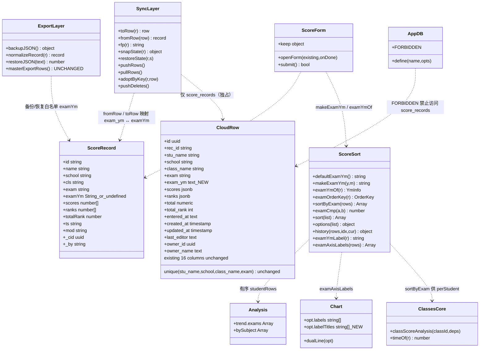
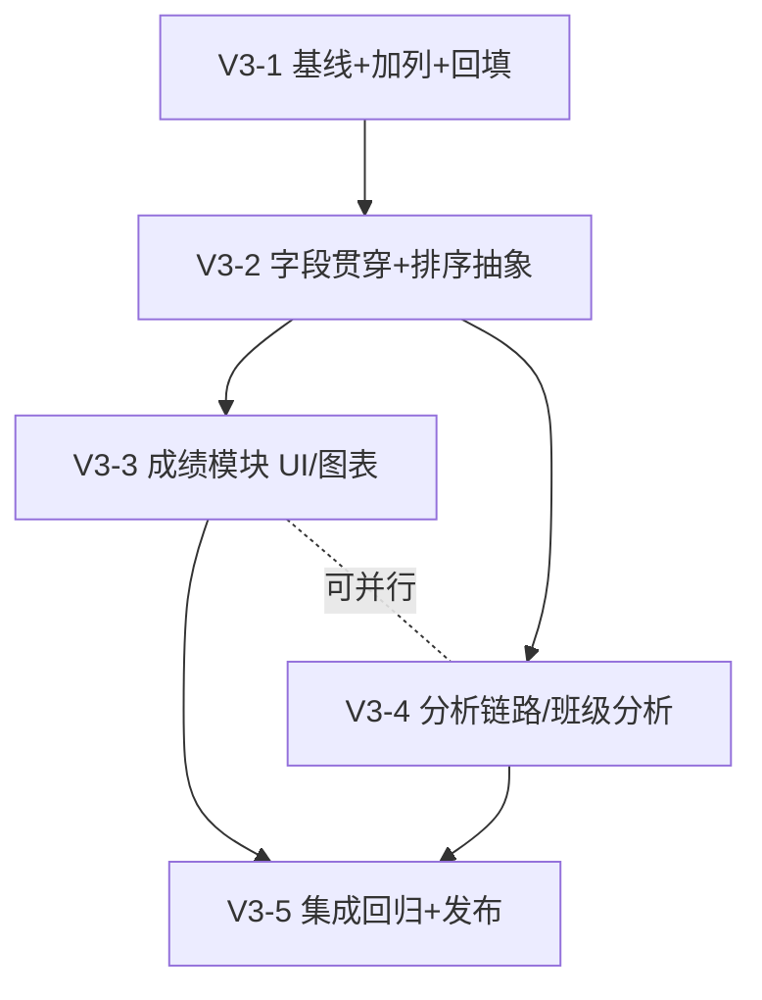

# ARCH v3（增量）— 考试年月字段与全站按考试年月排序 · 架构设计 + 任务分解

| 项目 | 内容 |
|---|---|
| 唯一权威规格 | **team-lead 下发的任务消息**（D1–D8 锁定口径 + 11 条实测事实 + 7 项交付要求）。PM 直发消息仅作背景参考，不作任务指令 |
| 上位文档 | `docs/PRD-v3-exam-ym.md`、`docs/ARCH-v2.md`、`docs/PRD-v2.md`、`docs/ddl-v2.sql`、`README.md` |
| 落地范围 | 纯前端原生 JS（IIFE + `window.App`，`index.html` 顺序加载 23 个 js）+ 云端 PostgREST 风格库；本文**只做设计与拆解，架构侧不改代码、不执行 DDL/回填**（生产加列/回填由 team-lead 本人执行，V3-1 已验收通过，见 §4.2.1） |
| 数据现状 | `score_records` 线上 **42 行**；改造前云端 16 列无年月字段，**V3-1 已执行完成后为 17 列**（新增可空 `exam_ym TEXT NULL / 无默认值`，42 行已定点回填，见 §4.2.1）；G1 基线两者并用：口径 A `n=42 / fp=d08aab5b7f0aa8028873f67bd0248859`（跨版本权威基准）+ 口径 C `n=42 / fp=4120b89db2e0df7be40c564f7e41b70b`（V-H1/V-H2 强制补充指纹），ADD/回填前后逐字节一致 |
| 红线 | 42 行零丢失、既有 16 列零改写、`score_records_unique_stu` 唯一索引零改动、CSV/Excel **26 列（既存笔误，v3 零改动）**契约零改动（表头 `5 + 2×9 + 3 = 26`，列名/顺序实测见 §0 D7 / §1.3 #25；初版「27 列」为既存笔误） |
| 语言 | 简体中文 |
| 文档地位 | **v3 唯一实现契约**：工程实现以本文为准（PRD 由 PM 自行对齐）；`V3-1~V3-5` 任务编号沿用 |

---

## 0. 锁定口径确认（不推翻，直接落地）

| 口径 | 架构落实要点 |
|---|---|
| D1 | 云端列 `exam_ym TEXT`（可空、无 DB 默认值、严格 `YYYY-MM`）；**前端记录对象字段一律 `r.examYm`**（camelCase）。二者映射只发生在 `sync.js toRow/fromRow` 两处 |
| D2 | 排序键 `year*12+month` 数值；非法/缺失 → `null`；UI 区分「未标注年月」（空）与「年月异常」（非空但格式非法） |
| D3 | 唯一键 4 字段不动；`Score.key` / `rowKey` / `delKeyOf` / `pushDeletes` / `adoptByKey` / `restoreJSON` **键构成零改动**；同键不同年月 → 覆盖确认 |
| D4 | 42 行定点 `UPDATE exam_ym` 一列；`exam` 抓 `N月` + `entered_at` 年份；抓不到用 `entered_at` 年月；跨年补录修正 `m > em+1 → y−1`；禁止全列 upsert |
| D5 | 全序列缺年月 → **byte-for-byte 沿用现有 `Score.sort` 按 `ts`**；混合序列无年月排末尾且不参与首/末与趋势 |
| D6 | 总表、考试下拉、班级统计、班级分析、分析报告「四、趋势」、历史趋势图全按数值键；**记录级 / 分组级两层分离**；同年月多场 `U.zh(exam) → ts → id` |
| D7 | CSV/Excel **26 列（既存笔误，v3 零改动）**，结构与顺序零改动。实测 `js/module-score.js:662 masterExportRows()` 表头 = `['序号','姓名','学校','班级','考试名称']`（**5**）+ `S.forEach` 每科 2 列 × 9 科（**18**）+ `['总分','总分排名','录入时间']`（**3**）= **26**；`js/core.js:20 NUM_SUBJECTS=9`。源码注释 `:661`「与原 Excel 27 列结构完全一致」及初版 ARCH 各处「27 列」均为**既存笔误**，v3 未改也不应改；**V-F1 按 26 断言，且导出表头中无「考试年月」列**。`exam_ym` 只进云端 + JSON 备份 + 恢复白名单；页面总表新增一列（仅 UI） |
| D8 | `ts/entered_at` 保留原值且不再决定顺序；`Score.upsert` 保留 `ts` 的**代码行为不变**，仅注释语义作废 |

> **本版修订索引（V3-2 / V3-3 交付后，team-lead 逐条独立核实并裁决；供 V3-5 集成验收引用）**
> 1. **事实更正三处**：① `masterExportRows()` **只定义在 `js/module-score.js:662`**（`:633/:638` 调用、`:661` 注释），`js/export.js` 里**根本没有该函数**，只提供 `toCSV / downloadCSV / buildXLSX / downloadXLSX / backupJSON / normalizeRecord / restoreJSON` 等**序列化器、不生成表头**；② CSV/Excel 实测 **26 列（既存笔误，v3 零改动）**，表头 `5 + 2×9 + 3`（列名分解见 §0 D7 / §1.3 #25），V-F1 验收口径改为「改造前后 `masterExportRows()` 输出的 **26 列列名/顺序逐字一致、无「考试年月」列**」；③ `:490/:494` 在旧文件里指向 `masterExportRows()` **导出构造器**（不是显示表），禁止在那里插 UI 列；**行号随改动位移，以函数名定位**。详见 §1.3 #17 / #25、§6.1、§8 V-F1。
> 2. **§6.2 #2 补例外**：`Score.examYmOf` 兼容读取云端风格 `r.exam_ym` 属明确要求，非违规。
> 3. **8 条实现裁决**记录于 **§9.2**；**V3-3 两条实现事实**（覆盖确认采用 `App.Modal.open` 原生 `okText` / `cancelText`，DOM 文案改写已移除；`examAxisLabels` 不内部排序 + 长度对齐保护）写入 §1.2 覆盖确认行 / §2.1 / §8 V-A1、V-B3 / §9.2 附注；**D5 全缺年月 x 轴 label golden diff 护栏**写入 §7（另见 §6.2 #17、§8 V-D1）。
>
> 以上**不改变 D1–D8 锁定口径、V-A1~V-H3 验收预期与 V3-1~V3-5 任务分解**，仅更正代码事实、收紧实现描述、补充裁决留证。

---

## 1. 增量实现方案

### 1.1 字段命名与格式契约

```
云端列      exam_ym  TEXT  NULL   'YYYY-MM'（补零）
内存字段    r.examYm String|undefined    —— 全站唯一叫法；除 Score.examYmOf 的兼容读取外，
                                             禁止出现 r.exam_ym（§2.1 / §6.2 #2 例外）
备份 JSON   records[].examYm（normalizeRecord 白名单；backupJSON 整对象透传）
```

**严格格式**：`/^(\d{4})-(0[1-9]|1[0-2])$/`。非法值（如 `2026-1`、`abc`）**原样保留、不自动改写、不阻断读取**，只在 UI 标「年月异常」（D2 / V-2 / V-D3）。

```js
/* js/core.js —— 新增纯函数（全部挂 Score，纯函数可单测，不新增 js 文件） */

/** 默认值：本地时间，不用 UTC */
Score.defaultExamYm = function () {
  var d = new Date();                       // 本地时区
  return d.getFullYear() + '-' + (d.getMonth() + 1 < 10 ? '0' : '') + (d.getMonth() + 1);
};

/** 拼装：窗体两个下拉值 → 'YYYY-MM'
 *  【B.4 / 裁决 1：采纳 V3-2 实测实现】年份须为 4 位整数 1000–9999、月份须为整数 1–12，
 *  非法一律返回 undefined。D1 正则 /^(\d{4})-(0[1-9]|1[0-2])$/ 是硬约束：初版骨架仅
 *  y>=1，会产出 '1-01' / '10000-01' / '2026.5-01'，写进记录立刻被 examYmOf 判「年月异常」，
 *  故已作废；严格版保证返回值必能被自身正则判 ok（V-E5 校验也依赖它）。 */
Score.makeExamYm = function (year, month) {
  var y = Number(year), m = Number(month);
  if (!Number.isInteger(y) || y < 1000 || y > 9999 ||
      !Number.isInteger(m) || m < 1 || m > 12) return undefined;
  return y + '-' + (m < 10 ? '0' : '') + m;
};

/** 解析（核心，见 §2.1 详述） */
Score.examYmOf = function (r) { /* → {raw, ym, y, m, valid, state} */ };
Score.examOrderKey = function (r) { /* → {has, num, exam, ts, id} */ };
Score.sortByExam = function (rows) { /* → Array */ };

/** 辅助 */
Score.examCmp = function (a, b) { /* 全序比较链 */ };
Score.examYmLabel = function (r) { /* → 'YYYY-MM' | '未标注年月' | '年月异常' */ };
Score.examAxisLabels = function (rows) { /* → [{label, title}]，8 全角字符上限 */ };
```

**默认值来源**：`Score.defaultExamYm()` 用 `new Date().getFullYear() / getMonth()+1`（**本地时间，禁止 `toISOString().slice(0,7)` 取 UTC**），窗体的年份下拉 `当前年−5 ~ 当前年+1`（7 项，升序）、月份 `01–12`，默认值 = 当前本地年月；无「未填写」选项（新建必填）。

### 1.2 校验与 UI 契约（落在 `module-score.js openForm`）

| 场景 | 实现 |
|---|---|
| 新建 | 两下拉默认 `defaultExamYm()` 拆出的 y/m；`submit()` 内 `rec.examYm = Score.makeExamYm(get('examYear'), get('examMonth'))`，未选 → `fail('请选择考试年份和月份！', '[name=examYear]')` |
| 编辑回显 | `existing.examYm` 合法 → 回显 y/m；**非法值**（范围外年份 / 脏值）→ 年份下拉自动扩展把该年加入选项、保留原值不强迫改；**缺年月** → 「请选择」占位 +「使用当前年月」按钮，**不自动写入** |
| 未来年月 | `examYm > 当前年月` → 黄条软提示，不拦截提交；下拉范围本身为当前年−5 ~ +1 |
| 连续录入 | `keep` 对象（`:287`）追加 `examYear / examMonth`，只清姓名/分数/排名/总分排名；使用说明文案（`:318`）补「考试年月也会保留」 |
| 覆盖确认 | `submit()` 内、调 `Score.upsert` **之前**：同键命中且 `String(hit.examYm) !== String(rec.examYm)` → `App.Modal.open({ title:'覆盖确认', body: el, okText:'覆盖并保存', cancelText:'返回修改', onOk: ... })`（V3-3 实测 `js/module-score.js:414-420`）；返回修改**不产生任何写入**（不调 `Store.save()`）。**V3-3 最终实现（team-lead 以源码裁决）**：按钮文案由 **`App.Modal.open` 原生 `okText` / `cancelText`** 渲染——已复核 `js/core.js:203-239` 的 `open(opts)` 签名（`okText` 默认「确定」、`=== null` 时不渲染确定按钮；`cancelText` 默认「取消」；`onOk(mask) !== false` 才 `close()`，故 `return false` 保持录入窗打开），返回 `mask`。取消回调 `return false` 不写库，V-B3 语义满足。**DOM 文案改写已移除、全文件无残留**；`App.Modal.confirm(msg, onOk, danger)` 确为 3 参数且文案固定，**仅用于 `js/module-score.js:652` 的删除成绩确认**，与覆盖确认无关。主录入窗 `module-score.js:427-429` 同样用 `Modal.open` 的 `okText`（`existing ? '保存修改' : '提交录入'`）/ `cancelText`（`'取消'`）。**V3-5 需 UI 走查确认文案与取消不写库**（见 §8 V-B3 / §9.2 附注） |
| 总表列 | 表头（**改造前**锚点 `:397-400`）「考试」后插「考试年月」；单元格用 `Score.examYmLabel(r)`，chip 两态。**V3-3 后实测**：显示表 = `renderMaster()`（`js/module-score.js:563` 表头、`:568-577` 行），新列 `<th class="ym-col">考试年月</th>` 已加在「考试」后；**⚠ `:490/:494` 在旧文件里指向 `masterExportRows()` 导出构造器、不是显示表，禁止在那里插 UI 列**。**行号体系说明**：本文 `:397-400` 等为改造前锚点，**行号随 V3-2/V3-3 改动位移**，工程师以函数名 `renderMaster()` / `masterExportRows()` 为准而非硬行号；新列**仅加显示表，`masterExportRows()` 零改动**——V3-3 按 §1.2 的 `:397-400` 做对了（详见 §1.3 #17 警示） |

### 1.3 `r.examYm` 内存 ↔ 云端 ↔ 备份完整贯穿路径（**12+ 改动点，精确行号**）

| # | 文件:行 | 改动内容 |
|---|---|---|
| 1 | `js/core.js:255-262` `newRecord` | 增加 `examYm: undefined` 占位（新记录由窗体赋值） |
| 2 | `js/core.js` `upsert`（**V3-2 实测 `core.js:939`**；改造前锚点 `:697-726`） | **【B.5 / 裁决 2：采纳实现】新值优先，仅当 `record.examYm === undefined && list[idx].examYm !== undefined` 才继承**：`record.examYm = list[idx].examYm;`。**为何不能照抄旧「继承模式」**：`id/ts` 是**无条件覆盖**、`_cid/_by` 是**旧值存在才覆盖**，两种语义都不同于 `examYm`；照抄会把「改年月」的新值顶回旧值，导致 V-E2 / V-E3 / V-B3 挂，故已作废。**附带好处**：V3-3 窗体未落地前，旧 `module-score.js` 提交的不带 `examYm` 记录，在本地编辑时也能**保住云端已回填的 42 行年月**。`Score.key` 4 字段构成**不变**；`record.mod` 与「保留 ts」行为**不变** |
| 3 | `js/core.js:522-548` `Score.sort` | 分组级排序改（§2.3）：**组内代表键按「最小有效 `examOrderKey(r).num` / 最早 `ts` / 字典序最小 `id` / 首个 `exam`」四项聚合**（与原 `examTs` 取最早录入时间同构，详见 §2.2 裁决 5 说明段与 §2.3 B.8）；抽出 `legacySortByTs(arr)` 保留原 27 行实现原文，供全缺年月回退 |
| 4 | `js/core.js:550-558` `Score.options` | `exams` 数组按「该 exam 的最小有效 ymNum」排序（同值 `U.zh`）；其余三数组不变 |
| 5 | `js/core.js:619-642` `Score.history` | **算法不改**（±2/±5 阈值不改），只要求调用方传入 `sortByExam` 排好的序列。**【裁决 8：知悉，非缺陷】** V3-2 未改调用方，调用方改造属 **V3-3 / V3-4** 范围，由 **V3-5 集成验证**（见 §9.2） |
| 6 | `js/core.js` 新增 | §1.1 七个纯函数（`defaultExamYm/makeExamYm/examYmOf/examOrderKey/sortByExam/examCmp/examYmLabel/examAxisLabels`） |
| 7 | `js/sync.js:62-64` `fp` | `JSON.stringify([...原 7 项, r.examYm == null ? '' : String(r.examYm)])` —— **漏改 = 只改年月不推送（V-E7 失败）**。**【裁决 7 / C.10 null-safe】** 边界由 `=== undefined` 放宽为 `== null`：**手工编辑过的旧 JSON 备份可能带 `examYm: null`**，写死旧判据会让 `fp` 产出字符串 `'null'`；`null` 与 `undefined` 同等对待、对 `undefined` 行为**零变化** |
| 8 | `js/sync.js:73-80` `snapState` | 增加 `examYm: r.examYm`（undefined 语义保留） |
| 9 | `js/sync.js:82-87` `restoreState` | 增加 `r.examYm = s.examYm;` —— 漏改 = 23505 冲突回滚把年月退回旧值 |
| 10 | `js/sync.js:114-127` `toRow` | **条件带上**：`if (r.examYm != null) row.exam_ym = r.examYm;`（**【裁决 7 / C.10 null-safe】** 由 `!== undefined` 放宽为 `!= null`：**手工编辑过的旧 JSON 备份可能带 `examYm: null`**，写死旧判据会写出 `exam_ym: null` 清空云端 42 行已回填值；`null` 与 `undefined` 同等对待、对 `undefined` 行为零变化）。禁止无条件写 `exam_ym: ''`：旧 JSON 备份恢复出的记录无该字段，无条件写会清空云端已回填的 42 行年月。注意 `toRow` 每次写入都无条件刷新 `updated_at: now / last_editor: me()`，这是**既有写穿行为**、与是否条件带上 `exam_ym` 无关；V-H2 只约束「回填」这一个动作，用户主动恢复备份导致这两列刷新不计违规（见下方执行语义补充）。`adoptByKey(r,row)`（`:1441-1455`）复用 `row`，键构成不变、payload 自动带上新列 |
| 11 | `js/sync.js:129-148` `fromRow` | `examYm: (row.exam_ym == null) ? undefined : String(row.exam_ym)` —— **容忍旧行缺列**、脏值原样进内存（不补零、不纠偏） |
| 12 | `js/export.js:229-246` `normalizeRecord` | 白名单增加 `examYm: (r.examYm == null) ? undefined : String(r.examYm)`；`backupJSON`（`:215-226`）整对象透传**无需改** |
| 13 | `js/app.js:221-253` `genDemo` | 3 场示例考试显式填 `examYm`：**本地当前年月往前 2 / 1 / 0 月三个递增值**（`第一次月考`=当前−2 月、`期中考试`=当前−1 月、`期末考试`=当前月，team-lead 裁决 R3-2）；`rec.ts` 生成逻辑不变。D5 全缺回退由 `smoke-v2-students-classes.js` 不改夹具的断言证明，不需 demo 再演示 |
| 14 | `js/analysis.js:214-266` | 不自行排序，消费调用方 `sortByExam` 排好的 `studentRows`；`exams[0]`/`last`、首末比较、`bySubject.dir` 语义不变 |
| 15 | `js/locator.js:226-246` | 「上次」= 有序序列倒数第二项（原 `for (i = length-2; ...)` 语义不变，只是序列来源变了） |
| 16 | `js/module-score.js:74-330` `openForm` | §1.2 全部 UI/校验/覆盖确认；`:280-300` `keep` 追加年月；`:318/:327` 说明文案同步 |
| 17 | `js/module-score.js:397-400`（**改造前**锚点；V3-3 后显示表 = `renderMaster()` `:563` 表头 / `:568-577` 行） | 总表表头 + 行内新增「考试年月」列（**仅 UI**）。**⚠ 行号警示（team-lead 实测）**：下发给 V3-3 的 spec 曾误引 `:490/:494`，那两个行号在**旧文件**里指向 `masterExportRows()` **导出构造器**、不是显示表；**禁止在那里插 UI 列**——会把 HTML 写进 CSV/XLSX、破 V-F1。**行号随 V3-2/V3-3 改动位移**：本文早期锚点 `:397-400` 与实测 `:563` / `:568-577` 是同一函数 `renderMaster()` 的不同版本位置，工程师**以函数名定位、不要硬套行号**。显示表与导出构造器是两个位置，**新列仅加显示表、`masterExportRows()` 零改动**，V3-3 **实现正确** |
| 18 | `js/module-score.js:509-520` `renderQuery` | `examList` 由 `.sort(U.zh)` 改为 `Score.sortByExam` 的年月序（选项文案仍为 `exam` 原文）；筛选栏灰字显示「考试年月：YYYY-MM」 |
| 19 | `js/module-score.js:643-663` | 趋势图 labels 改 `Score.examAxisLabels(studentRows)`，并传 `labelTitles` |
| 20 | `js/module-score.js:711-721` | 报告「四、趋势」图 labels 同上（用 `an2.trend.exams` 对应的有序序列） |
| 21 | `js/module-score.js:1250-1264` `renderStats` | 分组 `order.sort` 由 `U.zh(exam)` 改「组最小有效 ymNum」，缺年月组排末尾；分组标题加 `（YYYY-MM）` |
| 22 | `js/module-score.js:365 / 494 / 541 / 624` | `studentRows` / `masterRowsData()` 统一接 `sortByExam` / 改造后的 `Score.sort`；**新增辅助函数必须落在 `function locatorSection(` → `* Tab 4` 切片区间内**（§1.3 #24 / §5 V3-4 / §7 测试护栏 / 执行语义补充） |
| 23 | `js/charts.js:198-201` | 新增可选 `opt.labelTitles`：`<text>` 下挂 `<title>`（`U.esc`），`labels` 仍为字符串数组，API 向后兼容 |
| 24 | `js/module-classes.js:119 / 136 / 155-159 / 198-216` | `timeOf` **三用途分离**（本文 §1.3 #24、§5 V3-4）：去重仍按 `entered_at`；分组次序与 `perStudent` last/prev 改年月序 |
| 25 | **`js/module-score.js:662 masterExportRows()`**（`:633` downloadCSV 调用 / `:638` downloadXLSX 调用 / `:661` 注释 / `:662` 函数定义）+ `js/export.js` 的 `toCSV / downloadCSV / buildXLSX / downloadXLSX` | **两者均零改动**（**26 列（既存笔误，v3 零改动）**契约，V-F1）。**落点更正**：`js/export.js` 里**根本没有 `masterExportRows`**，只提供 `toCSV / downloadCSV / buildXLSX / downloadXLSX / backupJSON / normalizeRecord / restoreJSON` 序列化器、不生成表头；表头构造器**只定义在 `js/module-score.js:662`**：`['序号','姓名','学校','班级','考试名称']`（5）+ `S.forEach` 每科 2 列 × 9 科（18）+ `['总分','总分排名','录入时间']`（3）= **26**（`NUM_SUBJECTS=9`）。源码注释 `:661`「与原 Excel 27 列结构完全一致」与初版 ARCH「`js/export.js` 的 `masterExportRows`」「27 列」均为既存笔误，已更正；**导出表头无「考试年月」列** |
| 26 | `docs/baseline-score.txt`（team-lead 本人维护） | **追加**「v3 新基线」章节：口径 A `d08aab5b7f0aa8028873f67bd0248859` = G1 跨版本权威基准 + 口径 C `4120b89db2e0df7be40c564f7e41b70b` = V-H1/V-H2 强制补充指纹（**两者并用**）；旧 40 行 A/B 章节标注「历史留证，非本次基准」保留不删。`docs/baseline-score-42.txt` 保留为「v3 采集底稿/明细附件」，措辞降级并交叉引用主文档 |
| 27 | `index.html` / `学生管理系统-单文件版.html` | **不手改**：改完 js 跑 `python3 build-single.py` 自动刷 `?v=` 并重打包 |
| 28 | `tools/qa-v3-*.js` / `docs/QA-v3-report.md` | 新增回归脚本与报告（v3 验收，见 §5） |

**明确零改动**：`js/db.js`（`:26 FORBIDDEN` 黑名单确认 `score_records` 只归 sync.js）、`js/perm.js`、`js/ui-kit.js`、v2 的 7 张业务表、`user_profiles`、4 条 RLS 策略、云端唯一索引、`Score.key/delKey`、`rowKey/delKeyOf/pushDeletes/adoptByKey/restoreJSON` 的键构成。

**贯穿路径的执行语义补充（代码事实，防 QA 误判；不改变任何口径与验收预期）**：

1. `restoreJSON`（`export.js:253-280`）是**同键合并**：按 `Score.key` 命中则 `cur[j] = rec` **整体替换命中行**（并继承 `id/ts/_cid`），未命中才 `push`。因此恢复一份不含 `examYm` 的完整旧备份后，内存中被命中的行临时变为 `undefined`；若备份覆盖全部行则为「全序列缺年月」→ 走 D5/V-D1 回退；若备份只覆盖部分行则为**混合序列** → 走 V-D2（无年月排末尾、不参与趋势）。
2. `toRow`（`sync.js:114-127`）**每次** push 都无条件写 `updated_at: now / last_editor: me()`，与 `exam_ym` 是否条件带上无关。故「恢复备份后 `updated_at/last_editor` 被刷新」是现状行为，**不构成 V-H2 违规**；V-H2 只约束 §4.2 的定点回填动作。
3. `fp` 纳入 `examYm` 后，恢复旧备份时 `fp(local=undefined) ≠ snap('2026-10')`，会**比现状多触发一次 update**；正确实现下 `toRow` 省略 `exam_ym`，云端年月保住，仅这两列被刷一次。`pullChanges` 是 `Store.data.records = next` + `snap = snapshot()` 整体重置（`sync.js:1330-1332`），**不会形成 ping-pong 无限回写**。该「多一次 update」属预期，QA 不得据此报回归。
4. 结论：`undefined` 语义 + 条件带上列的唯一目的是**保住云端 `exam_ym` 不被清空**（V-F3），不是保住 `updated_at/last_editor`。**【裁决 7 补充】** `fp` / `toRow` 的边界已统一放宽为 `== null`（见 #7 / #10），把裸 `null` 与 `undefined` 同等对待，仅是防御性收紧，对上述 1–3 条调用链与 `undefined` 行为**零变化**；V-F3 仍成立（`null` 时同样省略 `exam_ym`）。

---

## 2. 统一排序抽象

### 2.1 三个签名与返回结构（全站唯一真源，全部在 `js/core.js` 的 `Score` 命名空间）

```js
/**
 * 解析一条记录（或裸字符串）的考试年月。
 * 容忍三种输入：内存记录 r.examYm / 云端风格 r.exam_ym / 'YYYY-MM' 字符串。
 * @returns {{
 *   raw:   string,                 // 原值（脏值原样保留）
 *   ym:    string|null,            // 合法时 'YYYY-MM'，否则 null
 *   y:     number, m: number,      // 合法时的年/月，否则 0
 *   valid: boolean,
 *   state: 'ok'|'missing'|'invalid'  // missing=空, invalid=非空但格式非法
 * }}
 */
Score.examYmOf = function (r) { ... };

/**
 * 排序主键（数值比较，禁止 U.zh / 裸字符串决定年份先后）。
 * @returns {{
 *   has:  boolean,        // false = 缺年月或年月异常，走回退/排末尾
 *   num:  number,         // year*12+month；has=false 时为 Number.POSITIVE_INFINITY（便于统一比较）
 *   exam: string,         // 同年月多场：U.zh(exam) 兜底
 *   ts:   number,         // 录入时间兜底
 *   id:   string          // 最终兜底，保证多次渲染稳定不抖动
 * }}
 */
Score.examOrderKey = function (r) { ... };

/**
 * 记录级稳定排序（学生考试序列 / 趋势 x 轴 / 报告「四、趋势」/ 班级分析 perStudent）。
 * 返回新数组，不修改入参；全序列缺年月时直接调用 legacySortByTs 逐字回退（D5）。
 * @param {Array} rows
 * @returns {Array} 升序序列；first=arr[0]、last=arr[n-1]、prev=arr[n-2]
 */
Score.sortByExam = function (rows) { ... };
```

**比较链**（`Score.examCmp(a,b)`，供 `sortByExam` 与分组级共用）：

```
1) has 优先于 !has                    // 混合序列无年月排末尾（D5 / OQ-3 A）
2) num 数值升序                       // year*12+month，跨年正确
3) U.zh(a.exam, b.exam) 升序          // 同年月多场稳定次序
4) ts 升序                            // 录入时间兜底
5) String(id) 升序                    // 最终稳定（V-C1 连续 3 次刷新不抖动）
6) 分组级组内：得分率降序 → 总分降序 → 姓名升序   // Score.sort 现状不变
```

**辅助**：`Score.examYmLabel(r)` → `ok: 'YYYY-MM'` / `missing: '未标注年月'` / `invalid: '年月异常'`；`Score.examAxisLabels(rows)` → `[{label, title}]`，同年无同年月多场保持 `exam` 原文一字不改，跨年 `YY年·` 前缀、同年月多场 `M月·` 前缀、缺年月 `未标注·`、**非法年月 `异常·` 前缀**（**【B.7 / 裁决 4】** 与 `examYmLabel` 的「年月异常」同调，落实 D2「UI 区分未标注 / 年月异常」；**`未标注·` 与 `异常·` 两者都 `has=false`、均排末尾、不参与首/末与趋势计算**），**8 个全角字符上限** + 省略号，`title = 'YYYY-MM · exam 原文'`；非法值的 `title` 写「年月异常 · exam 原文」。

- **【B.9 / 裁决 6】8 个全角字符上限按 code point 计数**：用 `Array.from(label)` 取长度，超长 `Array.from(label).slice(0, 7).join('') + '…'`（共 8 字）；**ASCII 也按 1 字计，未按显示宽度折算**，不按 UTF-16 code unit 截断（避免代理对/全角组合被切半）。QA 请用 `Array.from(...).length` 断言、**不要用像素/显示宽度算**。实测 `25年·期末考`（7 字）/ `26年·一模`（6 字）与 V-B1 文档示例逐字一致。
- **【V3-3 实现事实】`Score.examAxisLabels` 不内部排序**，按入参数组顺序 **1:1 产出**，排序一律由调用方 `sortByExam` 负责。V3-3 在两处趋势图都加了「`an2.trend.exams` 与 `studentRows` 不等长时回退 `exam` 原文」的**长度对齐保护**（V-D2 过滤无年月行会致两者不等长），避免 x 轴 label 与 score 数组错位。见 §8 V-A1 / §7 D5 golden diff 护栏。

### 2.2 两个层级如何复用同一把键

| 层级 | 入口 | 消费点 | 规则 |
|---|---|---|---|
| **记录级** | `Score.sortByExam(rows)` → `examCmp` → `examOrderKey` | `studentRows`（`module-score.js:541/624`）、趋势图 x 轴（`:643-663`、`:711-721`）、`analysis.js trend.exams`、`Score.history`、`locator.js` 上次、`module-classes.js perStudent` | 按**每条记录自身**年月数值排序；缺年月排末尾且**不参与**首/末与进退计算 |
| **分组级** | `Score.sort(list)`（`:522-548`）内部按 `学校\|班级\|考试` 分组，组代表键 = **【裁决 5】组内四项聚合：最小有效 `examOrderKey(r).num` / 最早 `ts` / 字典序最小 `id` / 首个 `exam`**（与原 `examTs` 同构） | 成绩总表（`:494`）、`masterRowsData` 行序、班级统计分组（`:1250-1264`）、总表导出行序 | 组间按代表年月数值升序，`U.zh(exam) → ts → id` 兜底；组内仍按得分率↓→总分↓→姓名↑ |
| **下拉级** | `Score.options(list).exams`（`:550-558`） | 查询分析考试下拉、班级统计筛选 | 每个 exam 取其在传入集合中的最小有效年月；同值 `U.zh` |

> **易错点**：`Score.sort` 是分组排序（先按 school/cls 分组编序号），**不能**拿它当「某学生的考试序列」用——这正是「只改总表那一层、趋势仍错」的根因。所有 `studentRows` 必须走 `sortByExam`。

> **【裁决 5：采纳 V3-2 实现】分组级 `ts/id` 兜底聚合**：`Score.sort` 的代表键不取单条记录，而是在组内聚合出「最小有效 `num` + 最早 `ts` + 字典序最小 `id` + 首个 `exam`」四项，与原 `examTs` 结构同构；组内无有效年月时 `num = +Infinity` 排末尾。这样缺年月组、同年月多场组在多次 `App.render()` 中次序稳定（V-C1），且全序列缺年月时仍能与 `legacySortByTs` 逐字对齐（D5 / V-D1）。

### 2.3 缺年月回退如何保证与旧行为逐字一致（D5 / V-D1）

```js
Score.sortByExam = function (rows) {
  var arr = (rows || []).slice();
  var hasAny = arr.some(function (r) { return Score.examOrderKey(r).has; });
  if (!hasAny) return legacySortByTs(arr);   // ← 原 core.js:522-548 的 27 行实现，原文抽出，一字不改
  return arr.sort(Score.examCmp);
};
```

- `legacySortByTs` = 把现有 `Score.sort` 的 `examTs / bySc / order` 三段逻辑**原样搬进私有函数**，新 `Score.sort` 在全序列缺年月时直接 `return legacySortByTs(list)`；有年月时才走新分组逻辑。
- **【B.8 / 裁决 5】分组级 `Score.sort` 的组内代表键聚合口径**：组内取「**最小有效 `examOrderKey(r).num` / 最早 `ts` / 字典序最小 `id` / 首个 `exam`**」，与原 `examTs`「取最早录入时间」同构（文档此前未写明，已按实现补齐）。组内无有效年月时 `num = +Infinity` 排末尾；缺年月组、同年月多场组在多次 `App.render()` 中次序稳定（V-C1），且全序列缺年月时仍与 `legacySortByTs` 逐字对齐（D5 / V-D1）。另见 §2.2 裁决 5 说明段。
- 验收护栏：`tools/smoke-v2-students-classes.js:203-207,257-259` 的夹具**全部不带 `examYm`**，其 `:274`「perExam 顺序 = 最早录入升序」与 `:290`「perStudent 最近一次 = 期末考试」断言必须**原样通过、不改夹具**——这是「回退逐字一致」的机器证明。
- 另加一份 golden JSON：对 42 行生产快照（改造前的内存形态）分别跑旧版 `Score.sort` 与新版 `sortByExam(全缺)`，逐行 diff 必须为空。

---

## 3. 数据结构与接口 / 程序调用流程

### 3.1 字段表

| 对象 | 字段 | 类型 | 说明 |
|---|---|---|---|
| 云端 `score_records` | `exam_ym` | `text NULL` | 新增第 17 列，严格 `YYYY-MM`，无默认值、无 CHECK、不入唯一索引 |
| 内存 `record` | `examYm` | `String \| undefined` | 全站唯一叫法；`undefined` = 缺年月（禁止用 `''` 表示） |
| JSON 备份 `records[]` | `examYm` | 同上 | `backupJSON` 透传、`normalizeRecord` 白名单恢复 |
| UI 下拉 | `examYear` / `examMonth` | `select` | 当前年−5 ~ +1 / 01–12，默认本地当前年月 |
| 排序键 | `examOrderKey.num` | `number` | `year*12+month`；缺失为 `+Infinity` |
| 展示 | `examYmLabel` / `examAxisLabels` | `string` / `[{label,title}]` | chip 两态 / x 轴 8 字上限 |

### 3.2 类图



> **⚠ 类图归属更正（V3-2 实测；按「不动图」要求，图形代码块本身保持不变）**：图中 `ExportLayer` 下早期标注的 `+masterExportRows() UNCHANGED` 是抽象层写法——该方法**实际实现于 `js/module-score.js::masterExportRows()`**（`:662` 定义，`:633/:638` 调用），`js/export.js` 只提供 `toCSV / downloadCSV / buildXLSX / downloadXLSX / backupJSON / normalizeRecord / restoreJSON` 等**序列化器、不生成表头**。表头与行由 `module-score.js` 产出后交给 `js/export.js` 序列化，共 **26 列**（V-F1）。**以 §1.3 #25 / §6.1 的文字为准**；独立图文件 `docs/class-diagram-v3.mermaid` 本次不动。

### 3.3 时序图：插入记录 → 写穿 → 排序 → 趋势图 / 报告（覆盖 V-A1 / V-E7）

```mermaid
sequenceDiagram
  autonumber
  participant U as 教师
  participant F as module-score openForm
  participant S as Score.upsert / Store
  participant SY as sync.js (fp/toRow)
  participant C as 云端 score_records
  participant P as pull / snapshot()
  participant Q as Score.sortByExam
  participant V as 趋势图 / 分析报告 / 班级分析

  U->>F: 补录 10月段考（81%），选 2026 / 10月
  F->>F: 默认本地年月 → 可改；同键命中且年月不同 → 覆盖确认
  F->>S: rec.examYm='2026-10'; Score.upsert(rec)
  S->>S: 保留 ts、_cid；Score.key 仍 4 字段
  S->>SY: Store.save() → afterSave → pushRows()
  SY->>SY: fp(r) 含 examYm → 与 snap 不同 → 判定有改动
  SY->>C: toRow 条件带上 exam_ym → update by _cid
  C-->>SY: ok → snap[k]=fp(r), synced[k]=snapState(r)
  Note over SY,C: 用户主动编辑更新 updated_at/last_editor 属正常，不违反 V-H2
  U->>P: 刷新 / 45s 定时拉取
  P->>C: select *（含 exam_ym）
  C-->>P: 42 行（11月先录、10月后补）
  P->>P: fromRow 映射 examYm；snap=snapshot()
  P->>Q: studentRows（2 条）
  Q->>Q: examOrderKey: 2026-10=24322 < 2026-11=24323
  Q-->>V: [10月段考(81%), 11月段考(40.96%)]
  V->>V: Score.history 相邻比较 → 结论「明显下滑」
  V-->>U: x 轴 10月段考 → 11月段考；截图数值倒置问题修复
```

---

## 4. 云端 DDL + 回填 SQL（**已由 team-lead 本人执行完成、V3-1 验收通过**；架构侧给出确切方案，工程师只做基线留证与校验脚本、不碰生产数据）

### 4.1 前置（事务外，只读/留证）

> **执行状态（已更新）**：`V3-1` **已执行完成并通过全部验收**（生产加列/回填由 team-lead 本人执行，工程师未碰生产数据）。云端现为 **17 列**、`exam_ym TEXT NULL / 无默认值`；42 行已定点回填。实测留证见 §4.2.1、§9.1 与 `docs/v3-postflight-snapshot.json`；`js/` 侧 V3-2 起由 software-engineer 继续实现。以下 §4.1/§4.2 保留为可复跑的规范方案。

1. **先备份**：前端 `App.X.backupJSON()` 导出归档 `docs/backup-pre-v3.json`；MCP `db_exec_sql` 导出全量 16 列快照。
2. **口径 A —— G1 跨版本权威基准**（8 列，team-lead 已重采）：
   ```sql
   SELECT count(*) AS n, md5(string_agg(k,'|' ORDER BY k)) AS fp
   FROM (
     SELECT stu_name||'~'||coalesce(school,'')||'~'||coalesce(class_name,'')||'~'||coalesce(exam,'')||'~'
         ||coalesce(scores::text,'')||'~'||coalesce(ranks::text,'')||'~'
         ||coalesce(total_rank::text,'')||'~'||coalesce(entered_at::text,'') AS k
     FROM score_records
   ) t;
   -- 期望：n=42, fp=d08aab5b7f0aa8028873f67bd0248859
   ```
   主文档 `docs/baseline-score.txt` 由 team-lead **追加**「v3 新基线」章节；旧 40 行 A/B 章节标注「历史留证，非本次基准」保留不删。**该拼串不含 `exam_ym`**，因此 `ADD COLUMN` 与定点回填前后 `n/fp` 必须逐字节不变——这是「只改新列、没碰既有列」的强证明（team-lead 实测事实 #9）。
3. **口径 C —— V-H1/V-H2 强制补充指纹**（全 16 列；**两者并用，不是二选一**，R2 裁决）：
   ```sql
   SELECT count(*) AS n, md5(string_agg(t, E'\n' ORDER BY t)) AS fp
   FROM (
     SELECT concat_ws('|', id::text, coalesce(owner_id,''), coalesce(owner_name,''),
                           coalesce(last_editor,''), coalesce(rec_id,''), coalesce(stu_name,''),
                           coalesce(school,''), coalesce(class_name,''), coalesce(exam,''),
                           coalesce(scores::text,''), coalesce(ranks::text,''),
                           coalesce(total::text,''), coalesce(total_rank::text,''),
                           coalesce(entered_at,''), coalesce(created_at::text,''),
                           coalesce(updated_at::text,'')) AS t
     FROM score_records
   ) s;
   -- 期望：n=42, fp=4120b89db2e0df7be40c564f7e41b70b
   ```
   - **R2b 缺陷修正（会误触发 ROLLBACK）**：旧稿的 `concat_ws('~', …)` + `string_agg(k,'|' ORDER BY k)` 形式生产实测得到**第三个指纹** `e921c0705b192253d4ebaa31d73518ed`，与留证值不符，照抄必然假失败。**禁止使用旧形式**；以 `docs/ddl-v3-exam-ym.sql` 第 4 段的 `concat_ws('|', …coalesce…)` + `string_agg(t, E'\n' ORDER BY t)` 为唯一规范。
   - 理由：口径 A 拼串不含 `updated_at / last_editor`，单独无法证明 V-H2「三列未改写」，故口径 C 为 **V-H1/V-H2 强制**补充指纹。
   - `docs/baseline-score-42.txt` 保留为「v3 采集底稿/明细附件」，「口径 C（全 16 列，v3 权威）」「本文件是 v3 权威基准」等措辞降级并交叉引用 `docs/baseline-score.txt`（该文件由 team-lead 本人修改）。
4. **V-H2 三列专项底稿**：
   ```sql
   SELECT json_agg(x ORDER BY x.id) FROM (
     SELECT id, entered_at, updated_at::text AS updated_at, last_editor FROM score_records
   ) x;
   ```
   与 `docs/backup-pre-v3.json` 逐行比对 `entered_at / updated_at / last_editor`，前后必须完全一致。
5. **权限 / 触发器 / RLS 预检**（事实 #10、R3-3、R6）：
   ```sql
   SELECT tgname, tgtype FROM pg_trigger WHERE tgrelid='score_records'::regclass AND NOT tgisinternal;
   SELECT grantee, privilege_type FROM information_schema.column_privileges
     WHERE table_name='score_records' AND column_name='exam_ym';
   SELECT policyname, cmd, qual, with_check FROM pg_policies WHERE tablename='score_records';
   ```
   - 预检实测：`pg_trigger = []`（无自定义触发器）、既有 16 列无列级 REVOKE、4 条 permissive RLS 策略齐全。**V3-1 执行后复核通过**：`exam_ym` 自动继承表级 GRANT（`anon=SELECT`；`authenticated=INSERT,REFERENCES,SELECT,UPDATE`；`service_role` 同），无列级 REVOKE；结构仍为触发器 0 / RLS 4 条 / 索引 2 个（见 §4.2.1）。
   - **ADD COLUMN 后必须额外核对 `exam_ym` 对 `authenticated / anon` 的列权限**（表级 GRANT 应自动覆盖新列）；本项写进 §5 V3-1 验收。
   - **R6 留证，不在 v3 里「修」它**：`db_describe_table` 报 `RLSOn=false`，但 `pg_policies` 确有 4 条 permissive 策略。这是既存状态，v3 只要求「4 条策略不变」，**不改 RLS 开关**，避免范围蔓延。
   - 若查出 `BEFORE UPDATE` 自动改写 `updated_at` 的触发器或列级 REVOKE 异常 → **暂停回填**交 team-lead 裁决；当前实测无异常。
6. **回填分布 dry-run 留证（R3-5）**：team-lead 已按 §4.2 SQL 做 dry-run，结果恰好 `2026-10 = 41 / 2026-11 = 1`，无多月份 / 非 ISO 异常行，**无需暂停**；V3-1 实测分布与 dry-run 精确一致，并已留证 `SELECT exam, entered_at, exam_ym FROM score_records ORDER BY exam_ym, exam, id;` 回填明细（无异常行，见 §4.2.1）。

### 4.2 事务内执行（`docs/ddl-v3-exam-ym.sql`）

```sql
BEGIN;

-- ① 唯一允许的表结构变更：可空、无默认值、无 CHECK、不动唯一索引
ALTER TABLE score_records ADD COLUMN IF NOT EXISTS exam_ym text;

-- ② 42 行一次性物理回填：仅 SET exam_ym，WHERE exam_ym IS NULL（幂等）
--    entered_at 是 text，用 substring 取年月；exam 抓 /(\d{1,2})月/
WITH calc AS (
  SELECT id, exam, entered_at,
         NULLIF(substring(exam FROM '([0-9]{1,2})月'), '')::int AS m,
         substring(entered_at FROM 1 FOR 4)::int                 AS y,
         substring(entered_at FROM 6 FOR 2)::int                 AS em
  FROM score_records
  WHERE exam_ym IS NULL
), resolved AS (
  SELECT id,
         CASE WHEN m IS NULL OR m < 1 OR m > 12 THEN lpad(em::text,2,'0')
              ELSE lpad(m::text,2,'0') END                       AS mm,
         CASE WHEN m IS NULL OR m < 1 OR m > 12 THEN y
              WHEN m > em + 1 THEN y - 1     -- 跨年补录修正（D4）
              ELSE y END                                          AS yy
  FROM calc
)
UPDATE score_records s
SET exam_ym = r.yy || '-' || r.mm
FROM resolved r
WHERE s.id = r.id AND s.exam_ym IS NULL;

-- ③ 事务内校验（任一不符 → ROLLBACK）
-- 3.1 口径 A：n / fp 必须与 §4.1 第 2 步逐字节一致（G1 跨版本权威基准）
SELECT count(*) AS n, md5(string_agg(k,'|' ORDER BY k)) AS fp FROM ( /* 同 §4.1② */ ) t;
-- 3.2 口径 C：必须用 §4.1③ 规范 SQL（concat_ws('|') + string_agg(t, E'\n' ORDER BY t)），
--     n=42 / fp=4120b89db2e0df7be40c564f7e41b70b；禁止用旧稿 concat_ws('~') 形式
SELECT count(*) AS n, md5(string_agg(t, E'\n' ORDER BY t)) AS fp FROM ( /* 同 §4.1③ */ ) s;
-- 3.3 格式：非法值必须为 0
SELECT count(*) AS bad_ym FROM score_records
 WHERE exam_ym IS NOT NULL AND exam_ym !~ '^[0-9]{4}-(0[1-9]|1[0-2])$';
-- 3.4 分布核对：期望 2026-10 = 41 条、2026-11 = 1 条
SELECT exam_ym, count(*) FROM score_records GROUP BY 1 ORDER BY 1;
-- 3.5 V-H2 三列专项：与 docs/backup-pre-v3.json 逐行比对，必须完全一致
SELECT json_agg(x ORDER BY x.id) FROM (
  SELECT id, entered_at, updated_at::text AS updated_at, last_editor FROM score_records
) x;

COMMIT;   -- 任一断言失败：ROLLBACK;
```

### 4.2.1 V3-1 执行留证（team-lead 生产实测，全部通过）

| 项 | 实测结果 | 结论 |
|---|---|---|
| `ALTER TABLE … ADD COLUMN IF NOT EXISTS exam_ym text` | 成功；列定义 `text / NULL / 无默认值` | ✅ |
| `exam_ym` 列权限（R3-3 补充项） | 自动继承表级 GRANT：`anon=SELECT`；`authenticated=INSERT,REFERENCES,SELECT,UPDATE`；`service_role` 同；**无列级 REVOKE** | ✅ 已验证通过 |
| 42 行定点 `SET exam_ym`（CTE + `WHERE exam_ym IS NULL`） | 执行成功 | ✅ |
| 口径 A（G1 跨版本权威基准） | `n=42 / fp=d08aab5b7f0aa8028873f67bd0248859` **前后逐字节一致** | ✅ |
| 口径 C（V-H1/V-H2 强制补充指纹，规范 SQL） | `n=42 / fp=4120b89db2e0df7be40c564f7e41b70b` **前后逐字节一致** | ✅ |
| 三列专项 fp3 | `120df1f4d7924b7dd1adeaff47beb3d5`，与 `docs/backup-pre-v3.json` 42 行按同式复算**完全一致** | ✅ V-H2 通过 |
| 年月分布 / 非法年月 | `2026-10 = 41`、`2026-11 = 1` 精确一致；非法年月 `0` 条 | ✅ |
| 结构 | 17 列、自定义触发器 0、RLS 4 条、索引 2 个，均与改造前一致；`score_records_unique_stu` 定义不变 | ✅ |
| 回填明细 | `SELECT exam, entered_at, exam_ym … ORDER BY exam_ym, exam, id` 已留证，无异常行（R3-5 无需暂停条件成立） | ✅ |
| 可复跑校验 | `node tools/qa-v3-data.js` → **40 PASS / 0 FAIL** | ✅ |

**落盘产物**（均由 team-lead 维护，架构侧未改动）：`docs/baseline-score.txt`（已追加「v3 新基线」章节，含规范 SQL、`e921c070…` 变体指纹禁用警告、回滚方案；旧 40 行 A/B 标「历史留证，非本次基准」保留）、`docs/baseline-score-42.txt`（已降级为「v3 采集底稿/明细附件，非权威基准」并交叉引用主文档）、`docs/ddl-v3-exam-ym.sql`（已补齐口径 A / fp3 / 非法年月 / 分布明细 / 结构权限 / 列权限校验 SQL，头部标注已执行与实测结果）、`docs/v3-postflight-snapshot.json`（生产前/后测量值快照）、`tools/qa-v3-data.js`（40 条断言可复跑脚本）。

### 4.3 如何验证「未改写既有列」

| 证据 | 覆盖 |
|---|---|
| **口径 A** `n=42 / fp=d08aab5b7f0aa8028873f67bd0248859` 前后不变（G1 跨版本权威基准） | 8 个既有列（含 `entered_at`）逐行一致；且因拼串不含新列，ADD/回填都不得影响 |
| **口径 C** `n=42 / fp=4120b89db2e0df7be40c564f7e41b70b` 前后不变（V-H1/V-H2 强制补充指纹，规范 SQL 见 §4.1③） | 全部 16 个既有列（含 `updated_at / last_editor / total / owner_* / created_at`）逐行一致 |
| 三列逐行 diff（`entered_at / updated_at / last_editor` vs `docs/backup-pre-v3.json`）为空 | V-H2 专项 |
| 触发器预检（实测 `pg_trigger=[]`）+ 定点 `SET exam_ym` | 排除「只写一列但触发器改写 `updated_at`」 |
| `exam_ym` 列权限核对（`authenticated / anon`） | 表级 GRANT 自动覆盖新列（R3-3） |
| 前端 UI 抽查 5 条逐字段 + 排名/及格率 | 业务口径无回归 |

### 4.4 回滚方案

- **事务内失败** → `ROLLBACK`：`ALTER TABLE` 在 Postgres 是事务性的，列消失、42 行原样。
- **COMMIT 后、前端发布前发现** → `ALTER TABLE score_records DROP COLUMN exam_ym;`（唯一改动就是这一列，删除即精确还原；既有列从未被写）。
- **前端发布后** → 不再 DROP（用户可能已录入新年月），走前向修复；如需整库回退，用 `docs/backup-pre-v3.json` 经 SQL 定点还原（**禁止**用 `restoreJSON` 全列 upsert 方式回滚，它会改写 `updated_at/last_editor`）。
- **基线文档（R2 裁决：两者并用，不是二选一）**：`docs/baseline-score.txt` 由 team-lead **追加**「v3 新基线」章节（口径 A `d08aab…` = G1 跨版本权威基准；口径 C `4120b89…` = V-H1/V-H2 强制补充指纹；分布、校验 SQL、三列底稿），**保留**旧口径 A/B 章节、结论表与踩坑记录，旧 40 行记录标为「历史留证，非本次基准」不删除；`docs/baseline-score-42.txt` 降级为「v3 采集底稿/明细附件」并交叉引用主文档（该文件由 team-lead 本人维护，架构侧不改）。

---

## 5. 有序任务列表（原样转工程师）

| ID | 任务 | 负责文件 | 要做什么 | 验收方式 | 依赖 | 复杂度 |
|---|---|---|---|---|---|---|
| **V3-1** | 项目基础设施：基线留证 + 云端加列 + 42 行定点回填 | `docs/baseline-score.txt`、`docs/backup-pre-v3.json`(新)、`docs/ddl-v3-exam-ym.sql`(新)、`tools/qa-v3-data.js`(新) | ① §4.1 备份 + 口径 A/C 采集 + 触发器/列级权限/RLS 预检 + `exam_ym` 列权限核对；② 执行 §4.2 事务 SQL（**生产加列/回填由 team-lead 本人执行**，工程师只跑校验）；③ `qa-v3-data.js` 跑前后口径 A/C 的 n/fp、三列 diff、格式、分布六项断言；④ 按 §4.4 追加基线章节（**基线主文档由 team-lead 本人维护**，不删历史） | n=42、口径 A fp=`d08aab5b7f0aa8028873f67bd0248859` 前后逐字节一致（G1 跨版本权威基准）；口径 C fp=`4120b89db2e0df7be40c564f7e41b70b` 前后一致（**必须用 §4.1③ 规范 SQL，禁止 `concat_ws('~')` 旧形式**）；三列逐行 diff 与 `backup-pre-v3.json` 一致；`exam_ym` 对 authenticated/anon 列权限核对通过；分布 41/1；QA 报告留 `exam, entered_at, exam_ym` 明细；`qa-v3-data.js` 全绿；V-H1/V-H2 通过 | 无（**必须最先且独占**，期间禁止前端写穿） | **M** |
| **V3-2** | 字段贯穿 5+1 + 排序抽象 + 示例数据 | `js/core.js`、`js/sync.js`、`js/export.js`、`js/app.js` | ① §1.3 改动点 1–6 与 7–13 全部落地；② `core.js` 新增七个纯函数 + `legacySortByTs` 原文抽出；③ `Score.sort` 分组级改造 + 全缺回退；④ `Score.options` exams 年月序；⑤ `genDemo` 填 examYm | `tools/smoke-analysis.js` / `tools/qa-750.js` / `tools/smoke-db.js` 全绿；V-E7（只改年月能推送且刷新不掉）、V-F2（备份恢复保留）、V-D1（全缺回退 golden diff 为空）、V-D3（脏值不改写）；`fp` 单测覆盖「仅 examYm 变化」 | V3-1 | **L** |
| **V3-3** | 成绩模块 UI + 图表 + 总表列 | `js/module-score.js`、`js/charts.js`、`assets/style.css` | ① §1.2 全部窗体/校验/覆盖确认/连续录入；② 总表新增「考试年月」列；③ 考试下拉与筛选栏年月；④ 两处趋势图 labels 接 `examAxisLabels` + `labelTitles`；⑤ `renderStats` 分组年月序；⑥ `charts.js` `<title>` 支持 | V-E1~E6、V-A2、V-B3、V-G1（总表/下拉侧）、V-F1（页面加列不影响 CSV/Excel）；UI 逐条走查 | V3-2 | **L** |
| **V3-4** | 分析链路 + 班级分析统一 | `js/analysis.js`、`js/locator.js`、`js/module-classes.js` | ① 三处消费 `sortByExam` 排好的序列（不自行排序）；② `module-classes.js` `timeOf` 三用途分离（去重仍按 `entered_at`）；③ 分组标题加年月；④ 保证 `smoke-v2-students-classes.js` 夹具**不改**仍全绿 | V-A1（81→40.96 结论「下滑」）、V-B1/B2、V-C1~C3、V-G2、V-D2；`tools/smoke-v2-students-classes.js:274/290` 断言原样通过；`qa-750.js` 切片测试全绿 | V3-2；**与 V3-3 可并行**（文件所有权不重叠） | **L** |
| **V3-5** | 集成回归 + 发布链路 | `tools/qa-v3.js`(新)、`docs/QA-v3-report.md`(新)、`README.md`、`index.html`(构建产物)、`学生管理系统-单文件版.html`(构建产物) | ① `qa-v3.js` 覆盖 V-A1~V-H3 全量断言 + v2 34 条验收无回归；② README 补 `examYm` 说明（强调 **26 列**导出契约不变；实测 `5+2×9+3=26`，初版「27 列」为既有事实错误）；③ `python3 build-single.py` 刷 `?v=` 并重打包；④ G1 终验（口径 A + C + 三列 diff）；⑤ 出 QA 报告 | V-A1~V-H3 全绿（含新增 V-F3 / V-G3）；口径 A `n=42 / fp=d08aab5…` 与口径 C `n=42 / fp=4120b89…` 终验均一致；`index.html` 全部本地资源带新 `?v=`；单文件版与多文件版功能一致；G1 红线全过 | V3-3, V3-4 | **M** |

**串/并行**：`V3-1 → V3-2 →（V3-3 ∥ V3-4）→ V3-5`。
- 写同一文件必须串行：`core.js/sync.js/export.js/app.js` 归 V3-2；`module-score.js/charts.js/style.css` 归 V3-3；`analysis.js/locator.js/module-classes.js` 归 V3-4；互不重叠。
- V3-3 与 V3-4 并行时，`charts.js` 的 `labelTitles` 接口按 §3.3 先约定、由 V3-3 传入，V3-5 集成验收兜底。
- V3-1 的 DDL/回填是生产表写操作，必须最先且独占。
- **执行分工 / 状态（R5 已闭环；任务编号、依赖与列表不改）**：V3-1 的**生产加列与回填已由 team-lead 本人执行完成、并通过全部验收**（工程师未碰生产数据）；基线三件套、校验脚本与 QA 报告明细均由 team-lead 落盘。云端现为 **17 列**、`exam_ym TEXT NULL` 已存在且 42 行定点回填完毕；口径 A/C 前后逐字节一致、三列 fp3 一致、`qa-v3-data.js` 40 PASS / 0 FAIL（完整留证见 §4.2.1、§9.1）。`js/` 侧 V3-2 已由 software-engineer 开始实现，V3-3 / V3-4 并行启动，集成测试留到 V3-5。

### 依赖图



---

## 6. 文件清单（按改动量从大到小）与共享约定

### 6.1 文件清单

| 序 | 文件 | 改动量 | 说明 |
|---|---|---|---|
| 1 | `js/module-score.js` | 大 | 窗体 2 下拉 + 校验 + 覆盖确认 + 连续录入 + 总表列 + 考试下拉 + 两处趋势 labels + 分组排序 + 辅助函数落切片区间；**另含 `masterExportRows()`（导出表头/行，26 列）——本次零改动**（V-F1，落点见 §1.3 #25） |
| 2 | `js/core.js` | 大 | 7 个纯函数 + `legacySortByTs` + `sort/options/newRecord/upsert` |
| 3 | `js/sync.js` | 中 | 5 个硬编码字面量（`fp/snapState/restoreState/toRow/fromRow`），骨架不动 |
| 4 | `js/module-classes.js` | 中 | `timeOf` 三用途分离、分组次序、`perStudent` last/prev |
| 5 | `js/analysis.js` | 中 | `trend.exams` 首/末与进退消费有序序列（自身算法不变） |
| 6 | `js/export.js` | 小 | 仅 `normalizeRecord` 白名单；`toCSV / downloadCSV / buildXLSX / downloadXLSX / backupJSON / restoreJSON` 等**序列化器零改动**、不生成表头；表头生成器 `masterExportRows()` **不在此文件**（实际在 `js/module-score.js`，见 §1.3 #25） |
| 7 | `js/charts.js` | 小 | `opt.labelTitles` → `<title>` |
| 8 | `js/app.js` | 小 | `genDemo` 填 `examYm` |
| 9 | `js/locator.js` | 小 | 「上次」取有序序列倒数第二项 |
| 10 | `assets/style.css` | 小 | 黄条 / chip / 新列宽 |
| 11 | `docs/baseline-score.txt`（team-lead 本人维护） | 小 | **追加**「v3 新基线」章节：口径 A `d08aab…`（G1 跨版本权威基准）+ 口径 C `4120b89…`（V-H1/V-H2 强制补充指纹，规范 SQL §4.1③）；旧 A/B 标「历史留证，非本次基准」保留不删 |
| 12 | `README.md` | 小 | 补字段说明，声明 **26 列（既存笔误，v3 零改动）**导出契约不变（V-F1 按 26 断言） |
| 13 | `index.html` / `学生管理系统-单文件版.html` | 自动 | 仅由 `build-single.py` 刷 `?v=` 与重打包，不手改 |
| 14 | `docs/baseline-score-42.txt`、`docs/ddl-v3-exam-ym.sql`、`docs/backup-pre-v3.json`、`docs/QA-v3-report.md`、`tools/qa-v3-data.js`、`tools/qa-v3.js` | 新增/底稿 | 基线三件套（`baseline-score.txt` / `baseline-score-42.txt` / `backup-pre-v3.json`）与 DDL 由 **team-lead 本人**负责；`baseline-score-42.txt` 为「v3 采集底稿/明细附件」；其余为 V3-1 / V3-5 产出 |
| — | `js/db.js`、`js/perm.js`、`js/ui-kit.js`、7 张 v2 业务表、`user_profiles` | **零改动** | `db.js:26 FORBIDDEN` 已确认 `score_records` 只归 sync.js |

### 6.2 共享知识 / 跨文件约定（强制）

```
1. 唯一键 4 字段（姓名+学校+班级+考试）不变：Score.key / rowKey / delKeyOf /
   pushDeletes / adoptByKey / restoreJSON 键构成零改动；云端 score_records_unique_stu 不重建。
2. 命名映射只有一处：云端 exam_ym ↔ 内存 examYm，由 sync.js toRow/fromRow 完成；
   **除 Score.examYmOf 的兼容读取外，全站其余代码只认 r.examYm**（禁止出现 r.exam_ym）
   —— §2.1 明确要求 examYmOf 容忍云端风格 r.exam_ym 输入。
   V3-2 实测 js/core.js:680 **仅在 examYmOf 内部读取它**（1 行读取 + 2 处注释）、
   不产出该字段；export.js / app.js 零出现；sync.js 的 exam_ym 全在 toRow→fromRow
   区间（qa-v3-core.js 有断言守边界）。
3. 缺省值语义（**C.10 null-safe**）：`undefined` 与 `null` **同等对待 = 缺年月**；
   禁止用 '' 表示（会经 toRow 清空云端已回填值）。`fp` 用 `r.examYm == null ? '' : String(...)`、
   `toRow` 用 `if (r.examYm != null)` 才带上该键；**若写死 `=== undefined` / `!== undefined`，
   手工编辑过的旧 JSON 备份带 `examYm: null` 时会让 `fp` 产出 'null'、`toRow` 写
   `exam_ym: null`，直接清空云端 42 行已回填值**。非法值原样保留，只标「年月异常」，不自动改写。
4. fp 必须含 examYm（V-E7）；snapState/restoreState 必须含（23505 回滚不丢字段）。
   toRow 条件带上 exam_ym：r.examYm == null 时省略该键，PostgREST update 不动该列
   （【裁决 7】边界由 === undefined 放宽为 == null，fp 同步用 == null；防裸云端行
   产出 'null' 指纹或写出 exam_ym: null 清空云端已回填值；对 undefined 零变化）。
5. ts / entered_at 保留原值且不再决定顺序；排序唯一真源 = examOrderKey.num (year*12+month)。
   全序列缺年月 → legacySortByTs 逐字回退，禁止改写旧实现。
6. 记录级用 Score.sortByExam，分组级用 Score.sort（组最小有效 ym），下拉级用 Score.options。
   同年月多场：U.zh(exam) → ts → id 稳定次序。
7. 测试护栏（见 §7）：module-score.js 新增辅助函数必须落在
   function locatorSection( → * Tab 4 切片区间内；reportHTML 不得引用 App.UI/App.Perm
   （qa-750.js 注入的 App 只有 Analysis/GradeSize/StudyPlan/Locator），一律用 Score.* 纯函数。
8. qa-750.js NUM_ALLOW 白名单 6 文件写死：不得把 NUM_SUBJECTS 扩散到
   charts.js / locator.js / module-classes.js；不新增 js 文件（全部能力挂 core.js Score）。
9. PATTERNS 旧口径扫描：新代码/注释不得出现 '1050' / '九科' / '十、' / '九、' /
   '七、年级排名' / '及格线 630'。
10. CSV/Excel **26 列（既存笔误，v3 零改动）**结构与顺序完全不变
    （表头 5 + 2×9 + 3 = 26，NUM_SUBJECTS=9，列名分解见 §0 D7 / §1.3 #25）；
    exam_ym 只进云端 + JSON 备份 + 恢复白名单；页面总表新增列仅 UI。
    表头由 js/module-score.js:662 masterExportRows() 产出，js/export.js 只做序列化（§1.3 #25）；
    V-F1 按「26 列列名/顺序逐字一致、无『考试年月』列」断言，不按 27。
11. 改完 js/ 必须跑 python3 build-single.py 刷新 index.html 全部资源 ?v= 并重打包单文件版。
12. 生产回填只允许 SET exam_ym 的定点 SQL，禁止经 toRow 全列 upsert；
    口径 A n/fp 前后逐字节一致是 G1 强证明。
13. genDemo 三场示例按本地当前年月往前 2/1/0 月三个递增值（R3-2 裁决）；
    D5 全缺回退由 smoke-v2-students-classes.js 不改夹具断言证明。
14. G1 基线**两者并用**：口径 A（8 列 d08aab…）= G1 跨版本权威基准；
    口径 C（全 16 列 4120b89…，规范 SQL 见 §4.1③）= V-H1/V-H2 强制补充指纹；
    三列逐行 diff 以 docs/backup-pre-v3.json 为准。
    **禁止** concat_ws('~') + string_agg(k,'|') 旧形式（会得到第三个指纹 e921c070…）。
15. fp 纳入 examYm 后恢复旧备份会多触发一次 update，属预期、不构成回归；
    pullChanges 重置 snap 不会 ping-pong。V-H2 只约束回填动作，用户主动恢复
    刷新 updated_at/last_editor 不计违规（详见 §1.3 执行语义补充、§7 测试备注）。
16. RLSOn=false 是既存状态（4 条 pg_policies 确在），v3 不改 RLS 开关、不修它。
17. D5「逐字回退」包含 x 轴文案：全缺年月序列下 examAxisLabels 的 label 必须与
    旧版 labels.push(r.exam) 的 exam 原文一致（不加「未标注·」前缀）；
    V3-5 必做 x 轴 label 的 golden diff（见 §7 新增护栏）。
```

---

## 7. 测试护栏专章（team-lead 事实 #8，极易踩）

| 护栏 | 约束 | 架构对策 |
|---|---|---|
| `tools/smoke-analysis.js:47-50` / `tools/qa-750.js:76-78` | `renderSrc = MS.slice(MS.indexOf('function locatorSection('), iHead)`，`iHead = MS.lastIndexOf('/*', iTab4)`；`new Function('U','Ue','Score','App','state','Store','K', renderSrc)` 只注入这 7 个符号 | ① 所有共享辅助函数放 `core.js` 的 `Score.*`（已注入）；② 若必须在 `module-score.js` 加局部 helper，**定义位置必须在 `:751 function locatorSection(` 与 `:1249 * Tab 4` 之间**；③ `reportHTML` 内**不得**调用 `App.UI / App.Perm / App.DB`（注入的 `App` 是字面量对象，没有这些属性） |
| `tools/qa-750.js:509` | `renderSrc.length > 8000` | 只增不减该区间代码量；禁止把大段渲染逻辑移出区间 |
| `tools/qa-750.js:587 / 602 / 617` | 扫描 `js/*.js`；`NUM_ALLOW` 白名单写死 6 文件；`NUM_SUBJECTS` 的 for 循环文件列表也写死同一 6 文件 | **不新增 js 文件**；新能力全部挂 `core.js`；不得在 `charts.js/locator.js/module-classes.js` 引入 `NUM_SUBJECTS` |
| `tools/qa-750.js:625` | `PATTERNS` 全量扫 `js/ + index.html + assets/`，命中即失败 | 新代码/注释避开上述 6 个旧口径词 |
| `tools/smoke-v2-students-classes.js:203-207,257-259,274,286,290-295` | 夹具全部无 `examYm`，断言建立在 `ts` 顺序上 | **不改夹具**：全缺年月回退走 `legacySortByTs`，`:274`/`:290` 断言必须原样通过；这正是 D5 的机器证明 |
| `tools/qa-750.js` 造数据 `rec()`（`:95-100`） | 无 `examYm` | 同上，全序列缺年月分支必须让报告渲染逐字不变 |
| **`js/sync.js` `fp` / `toRow` 的 null-safe 边界（C.10，V3-5 必测）** | 手工编辑过的旧 JSON 备份可能带 `examYm: null`；判据写死 `=== undefined` / `!== undefined` 时，`fp` 产出 `'null'`、`toRow` 写 `exam_ym: null` → **清空云端已回填列** | 判据统一 `== null` / `!= null`（见 §1.3 #7/#10、§6.2 #3/#4）；V3-5 必测「恢复带 `examYm: null` 的备份 → 云端 42 行 `exam_ym` 不被清空、无 ping-pong」；`undefined` 与 `null` 行为一致 |

**测试备注（R4，QA 必读）**：`fp` 纳入 `examYm` 后，恢复一份不含该字段的旧 JSON 备份会**多触发一次 update**（正确实现下 `toRow` 省略 `exam_ym`，云端 42 行年月保住，仅 `updated_at / last_editor` 被刷新一次），这是**预期行为、不构成回归**；`pullChanges` 是 `Store.data.records = next` + `snap = snapshot()` 整体重置（`sync.js:1330-1332`），**不会形成 ping-pong 无限回写**。QA 不得据此两列变化报 V-H2 违规——**V-H2 只约束 §4.2 的定点回填这一个动作**。完整调用链见 §1.3 表后的「执行语义补充」。

**新增护栏（V3-5 必做，D5「逐字」隐患；team-lead 本轮点名）**：V3-3 已把两处趋势图 labels 从旧版 `labels.push(r.exam)` 改接 `Score.examAxisLabels`。若全序列缺年月时 `examAxisLabels` 仍给所有 label 加 `未标注·` 前缀，x 轴文案就与旧版不一致；**虽现有 8 套测试全绿（均未断言 x 轴文案），仍可能不满足 D5「byte-for-byte 回退」要求**。

- V3-5 必须对「全缺年月序列」做 **x 轴 label golden diff**：旧版 `exam` 原文序列 vs 新版 `examAxisLabels` 输出序列，逐项比对（长度 + 每一项文本），diff 必须为空。
- 若不一致 → 需让 `examAxisLabels` 在**全序列缺年月**时保持 `exam` 原文（不加任何前缀），`title` 可保留「未标注年月 · exam 原文」说明；混合序列仍按 `未标注·` / `异常·` 前缀（裁决 4），不冲突。
- 该护栏与 §6.2 #17、§8 V-D1 联动；`smoke-v2-students-classes.js` **不改夹具**的顺序断言**不能替代**此项（它只验顺序、不验 x 轴文案）。

---

## 8. V-A1 ~ V-H3 逐条技术实现路径

| 验收 | 技术实现路径 |
|---|---|
| **V-A1** | 窗体写入 `examYm=2026-10`（补录，`entered_at` 在 11 月）→ `sortByExam` 按 `24322 < 24323` 把 10 月排前 → `studentRows=[81%, 40.96%]` → `Score.history` 相邻 −40.04 → 结论「明显下滑」。**V3-3 实现事实**：趋势图 labels 由 `examAxisLabels` 按 `studentRows` 顺序 **1:1 产出、不内部排序**；两处趋势图均有「`an2.trend.exams` 与 `studentRows` 不等长时回退 `exam` 原文」的长度对齐保护（V-D2 过滤无年月行会致不等长），避免 x 轴与 score 数组错位 |
| **V-A2** | `Score.sort` 分组代表年月（10 月组 2026-10 < 11 月组 2026-11）→ 总表 10 月行在前；`examYmLabel` 显示两列值 |
| **V-B1** | `examOrderKey.num` 数值比较：2025-12=24312 < 2026-01=24313；`examAxisLabels` 检测到 ≥2 年份 → `25年·期末考` / `26年·一模`；`analysis.js` 末−首 = +10pp。**【B.9 / 裁决 6】** 8 全角字符上限按 **code point** 计数（`Array.from`，超长 `slice(0,7)+'…'` 共 8 字）；**ASCII 也按 1 字、未按显示宽度折算**，不按 UTF-16 code unit 截断。实测 `25年·期末考`（7 字）/ `26年·一模`（6 字）与示例逐字一致；QA 用 `Array.from(...).length` 断言 |
| **V-B2** | 2025-10 / 2026-09 / 2026-10 三个 num 严格升序；全局禁用 `U.zh(exam)` 决定年份先后 |
| **V-B3** | `submit()` 内同键命中 + 年月不同 → `App.Modal.open({ okText:'覆盖并保存', cancelText:'返回修改' })`；返回修改直接 `return false`（不 `Store.save()`）；覆盖并保存走原 upsert（行数不变、`examYm` 更新）。**V3-3 最终实现**：按钮文案由 **`App.Modal.open` 原生 `okText` / `cancelText` 参数**提供（`js/core.js:203-239` 已复核 `open(opts)` 签名，`onOk(mask) !== false` 才关闭），**无 DOM 文案改写**；`App.Modal.confirm` 3 参数、文案固定，仅用于删除成绩确认。**V3-5 只需走查确认文案与取消不写库**（§1.2 覆盖确认行 / §9.2 附注） |
| **V-C1** | `examCmp` 第 3–5 级兜底 `U.zh(exam) → ts → id`，`id` 保证多次 `App.render()` 不抖动 |
| **V-C2** | 有序序列 `last=arr[n-1]`、`prev=arr[n-2]`；`analysis.js` 首/末与 `dir` 用同一序列 |
| **V-C3** | `Score.history` 算法不改（±2/±5），仅输入序列改 `sortByExam` |
| **V-D1** | `hasAny=false` → `legacySortByTs(arr)`（原 27 行实现原文）；总表走 `Score.sort` 的同一回退分支；golden diff 为空。**另需 x 轴 label golden diff**：全缺年月序列下 `examAxisLabels` 输出须与旧版 `exam` 原文逐字一致（§7 新增护栏 / §6.2 #17），否则不满足 D5「逐字」要求 |
| **V-D2** | `has=true` 优先、`num=+Infinity` 排末尾；首/末只对 `has` 子序列取（趋势计算过滤无年月行） |
| **V-D3** | `examYmOf` 正则不匹配 → `state='invalid'`、`has=false`；`fromRow` 原值保留；`examYmLabel` 输出「年月异常」。**【B.7 / 裁决 4】** x 轴可见前缀 = 缺年月 `未标注·`、非法值 **`异常·`**（与「年月异常」同调，落实 D2 的 UI 两态区分），`title` 写「年月异常 · exam 原文」；**两类都 `has=false`、排末尾、不参与首/末与进退计算**（与 `U.zh(exam) → ts → id` 稳定次序不冲突） |
| **V-E1** | `defaultExamYm()` 用本地 `new Date()`；窗体两个 `<select>` 默认选中当前 y/m |
| **V-E2** | `submit()` → `makeExamYm(2025,12)` → `toRow` 条件带 `exam_ym='2025-12'` → 云端 update → 刷新 `fromRow` 回显 |
| **V-E3** | `openForm(existing)` 回显 `existing.examYm` 的 y/m；提交时未改则值不变（`fp` 含该字段，不会误判为无变化） |
| **V-E4** | `keep` 对象（`:287`）追加 `examYear/examMonth`，重置时保留；只清姓名/分数/排名/总分排名 |
| **V-E5** | `submit()` 校验 `makeExamYm()` 返回 undefined → `fail('请选择考试年份和月份！', '[name=examYear]')` |
| **V-E6** | 年月 > `defaultExamYm()` → 黄条软提示；`submit()` 不拦截 |
| **V-E7** | `fp` 含 `examYm`（`sync.js:62-64`）→ 只改年月时 `snap[k] !== fp(r)` → `pushRows` 推 `toRow` → 云端新值；刷新 `fromRow` 保留 |
| **V-F1** | **`js/module-score.js:662 masterExportRows()`**（表头构造器）与 `js/export.js` 的 `toCSV / downloadCSV / buildXLSX / downloadXLSX` **零改动**；`qa-v3.js` 验收口径 = 「**改造前后 `masterExportRows()` 输出的 26 列列名 / 顺序逐字一致，且无「考试年月」列**」（表头 `5 + 2×9 + 3 = 26`，`NUM_SUBJECTS=9`；**26 列为既存笔误的更正值、v3 零改动，不按 27 断言**）；页面总表新增「考试年月」列**仅 UI**、不进 CSV/XLSX；**禁止在 `:490/:494`（旧文件中指向 `masterExportRows()` 导出构造器）处插 UI 列**，否则把 HTML 写进 CSV/XLSX 破 V-F1（§1.3 #17 警示）。落点更正见 §1.3 #25 / §6.1 |
| **V-F2** | `backupJSON` 透传 `examYm`；`normalizeRecord` 白名单恢复；`restoreJSON` 同键合并保留 `examYm`；`toRow` 条件带上写回云端 |
| **V-F3**（R4 新增） | 恢复**不含 `examYm` 的完整旧备份** → `restoreJSON` 同键合并 `cur[j]=rec` 整体替换命中行 → 内存全序列 `undefined` → `toRow` 条件带上**省略 `exam_ym`** → 云端 42 行年月**不被清空**；`fp` 变化多触发一次 update 属预期；`pullChanges` 重置 `snap` 不 ping-pong；下次拉取 `fromRow` 恢复本地显示。验收只守「年月不清空 + 下次拉取恢复 + 不无限回写」，**不守 `updated_at/last_editor` 未改写**（用户主动恢复属写操作，V-H2 只约束回填）。部分备份恢复 → 混合序列走 V-D2 |
| **V-G1** | 四处统一调用 `Score.sortByExam` / `Score.sort` / `Score.options`，共用 `examOrderKey.num` |
| **V-G2** | `module-classes.js perStudent` 的 `last/prev` 由 `timeOf` 序列改 `sortByExam` 序列；`delta = total(last) − total(prev)` 符号随年月序 |
| **V-G3**（R4 新增） | 同一场考试 2 条同键记录、`entered_at` 不同 → `byExam[ex]` 去重**仍取 `entered_at` 较新一行**（身份判定不受年月改造影响），该场不被拆成两次；分组位置改按 `exam_ym` 排列。落点：§1.3 #24 / §5 V3-4 / §7 测试护栏 / 执行语义补充 |
| **V-H1** | 口径 A `n=42 / fp=d08aab5b7f0aa8028873f67bd0248859`（G1 跨版本权威基准）**与**口径 C `n=42 / fp=4120b89db2e0df7be40c564f7e41b70b`（V-H1/V-H2 强制补充指纹，规范 SQL §4.1③）**两者并用、前后均逐字节一致**；`score_records_unique_stu` 定义不变；`4 条 RLS 策略`不变（`RLSOn=false` 为既存状态，不改） |
| **V-H2** | 定点 `SET exam_ym` + 触发器预检（实测 `pg_trigger=[]`）+ 口径 C `fp=4120b89db2e0df7be40c564f7e41b70b`（**必须用 §4.1③ 规范 SQL**）+ `entered_at/updated_at/last_editor` 三列逐行 diff 与 `backup-pre-v3.json` 一致；**V-H2 只约束回填动作**，用户主动恢复备份刷新两列不计违规 |
| **V-H3** | `python3 build-single.py` 刷 `index.html` 全部本地资源 `?v=`；普通浏览器未清缓存加载新 js，窗体出现年月下拉 |

---

## 9. 裁决记录（R3 需求裁决已全部闭环；§9.1 = V3-1 执行留证，§9.2 = V3-2 实现裁决，供 V3-5 引用）

| # | 事项 | 裁决结果 |
|---|---|---|
| 1 | 口径 A 与口径 C 是否并用 | **两者并用，不是二选一**（R2）：口径 A `n=42 / fp=d08aab5b7f0aa8028873f67bd0248859`（8 列）= **G1 跨版本权威基准**，主文档 `docs/baseline-score.txt` **已由 team-lead 追加**「v3 新基线」章节，旧 40 行 A/B 章节标「历史留证，非本次基准」保留不删（已落盘，见 §4.2.1）；口径 C `n=42 / fp=4120b89db2e0df7be40c564f7e41b70b`（全 16 列、**规范 SQL 见 §4.1③**）= **V-H1/V-H2 强制补充指纹**（因 A 不含 `updated_at/last_editor`）；三列逐行 diff 以 `docs/backup-pre-v3.json` 为 V-H2 专项。`docs/baseline-score-42.txt` 降级为「v3 采集底稿/明细附件」，措辞降级并交叉引用主文档（team-lead 本人改） |
| 2 | `genDemo` 三场示例 `examYm` 取值 | **本地当前年月往前 2 / 1 / 0 月三个递增值**（`第一次月考`=当前−2、`期中考试`=当前−1、`期末考试`=当前月）；D5 全缺回退由 `smoke-v2-students-classes.js` **不改夹具**的断言证明，不需 demo 再演示 |
| 3 | 触发器 / 列级 REVOKE | **只读预检、异常暂停交 team-lead 裁决**。已实测 `pg_trigger=[]`、既有 16 列无列级 REVOKE、4 条 RLS 策略齐全。**补充要求**：`ADD COLUMN` 后必须额外核对 `exam_ym` 对 `authenticated/anon` 的列权限（表级 GRANT 应自动覆盖新列），已写进 §4.1 前置与 §5 V3-1 验收 |
| 4 | 非法 `examYm` 是否加云端 CHECK | **不加 CHECK**；非法值允许存在、前端只读不改、UI 标「年月异常」，编辑时由两个下拉产出合法值 |
| 5 | 回填分布异常是否暂停 | 已做回填 SQL **dry-run**：结果恰好 `2026-10 = 41 / 2026-11 = 1`，无多月份 / 非 ISO 异常行，**无需暂停**；V3-1 实测分布与 dry-run 精确一致，并已留证 `SELECT exam, entered_at, exam_ym … ORDER BY exam_ym, exam, id` 回填明细（无异常行，见 §4.2.1） |

**R6 留证（不在 v3 里「修」）**：`db_describe_table` 报 `RLSOn=false`，但 `pg_policies` 确有 4 条 permissive 策略；既存状态，v3 只要求「4 条策略不变」，不改 RLS 开关，避免范围蔓延。已写入 §4.1 第 5 步。

**R4 新增验收**：V-F3（旧备份恢复不清空云端年月）/ V-G3（同键去重仍按 `entered_at`）已采纳，实现路径见 §8；PM 负责修 PRD 中「ARCH-v3 §3.5」的失效引用为「§1.3 #24 / §5 V3-4 / §7 测试护栏 / 执行语义补充」。

### 9.1 实际执行结果（V3-1 已完成，team-lead 生产实测，5 条裁决全部落地验证）

> §9 的 5 条待明确事项**已全部裁决（R3）并随 V3-1 执行落地验证**，不再有悬空项。以下为实际执行结果，与 §4.2.1 表格、`docs/v3-postflight-snapshot.json`、`tools/qa-v3-data.js` 互为印证。

| # | 裁决落地验证 | 实际执行结果 |
|---|---|---|
| 1 | 口径 A + C 并用 | 口径 A `n=42 / fp=d08aab5b7f0aa8028873f67bd0248859`、口径 C `n=42 / fp=4120b89db2e0df7be40c564f7e41b70b`（规范 SQL）**前后逐字节一致**；`docs/baseline-score.txt` 已追加「v3 新基线」章节、旧 40 行 A/B 标「历史留证」保留不删；`docs/baseline-score-42.txt` 已降级为采集底稿并交叉引用主文档 |
| 2 | `genDemo` 三场递增值 | 属前端任务（V3-2，非 V3-1 生产范围），由 software-engineer 按「本地当前年月往前 2 / 1 / 0 月」落地；D5 全缺回退仍由 `smoke-v2-students-classes.js` 不改夹具的断言证明 |
| 3 | 触发器 / 列级 REVOKE 只读预检 | 预检 `pg_trigger=[]`、既有 16 列无列级 REVOKE、4 条 RLS 齐全；**ADD COLUMN 后复核通过**：`exam_ym` 自动继承表级 GRANT（`anon=SELECT`；`authenticated=INSERT,REFERENCES,SELECT,UPDATE`；`service_role` 同），无列级 REVOKE，**无异常、无需暂停** |
| 4 | 不加 CHECK | 列定义 `text / NULL / 无默认值 / 无 CHECK`；非法年月 `0` 条，前端只读不改、标「年月异常」的策略不变 |
| 5 | dry-run 无异常、无需暂停但仍留明细 | 实测分布 `2026-10 = 41 / 2026-11 = 1` 精确一致、非法年月 `0`；回填明细（`SELECT exam, entered_at, exam_ym … ORDER BY exam_ym, exam, id`）已留证、无异常行，**无需暂停条件成立** |

**结构与红线终验**：17 列、自定义触发器 0、RLS 4 条、索引 2 个，与改造前一致；`score_records_unique_stu` 定义不变；三列专项 fp3 `120df1f4d7924b7dd1adeaff47beb3d5` 与 `docs/backup-pre-v3.json` 42 行按同式复算完全一致（V-H2 通过）；`node tools/qa-v3-data.js` → **40 PASS / 0 FAIL**。**V3-1 验收通过**，V3-2 起进入前端实现。

### 9.2 实现裁决（V3-2 自曝 8 条代码事实，team-lead 逐条独立核实属实并裁决；供 V3-5 集成验收引用）

| # | V3-2 自曝的代码事实 / 与 ARCH 的差异 | team-lead 裁决 | 已落文档位置 |
|---|---|---|---|
| 1 | `makeExamYm` 实现比 §1.1 骨架更严 | **采纳工程师实现**：年份须为 **4 位整数 1000–9999** + 月份为整数，非法返回 `undefined`；保证返回值必能被 D1 正则 `/^(\d{4})-(0[1-9]|1[0-2])$/` 判 `ok`。初版骨架 `y >= 1` 会产出 `'1-01'` / `'10000-01'` / `'2026.5-01'`，写进记录立刻被判「年月异常」 | §1.1 骨架已更正（B.4） |
| 2 | `upsert` 的 `examYm` 继承语义 | **采纳工程师实现**（实测 `core.js:939`）：`if (record.examYm === undefined && list[idx].examYm !== undefined)` **才继承**（**新值优先、仅新记录没带时才继承**）。`id/ts` 无条件覆盖、`_cid/_by` 旧值存在才覆盖，照抄会**顶回改年月的新值**、让 V-E2 / V-E3 / V-B3 挂，已作废。**附带好处**：V3-3 窗体未落地前，旧 `module-score.js` 提交的不带 `examYm` 记录能在本地编辑时保住 42 行年月 | §1.3 #2 已更正（B.5） |
| 3 | `js/core.js` 出现 `r.exam_ym` 读取 | **补例外即可**：`core.js:680` 有 1 行 `r.exam_ym` 读取 + 2 处注释，均在 `Score.examYmOf` 内部、**只读不产出**；`export.js` / `app.js` **零出现**；`sync.js` 的 `exam_ym` 全在 `toRow→fromRow` 区间（`qa-v3-core.js` 有断言守边界） | §6.2 #2、§1.1 字段契约已补例外 |
| 4 | `examAxisLabels` 非法年月值的 x 轴 label 前缀未定义 | **裁决改为 `异常·` 前缀**（与 `examYmLabel`「年月异常」一致，落实 D2「UI 区分未标注 / 年月异常」）；缺年月仍为 `未标注·`，**两者都 `has=false`、排末尾、不参与首/末与趋势计算**；`title` 写「年月异常 · exam 原文」。已令 V3-2 工程师改一行并同步测试 | §2.1、§8 V-D3（B.7） |
| 5 | `Score.sort` 分组级 `ts/id` 兜底聚合 | **采纳**：组内**最小有效 `num`** / **最早 `ts`** / **字典序最小 `id`** / **首个 `exam`**，与原 `examTs` 取最早录入时间同构 | §1.3 #3、§2.2 分组级行 + 裁决 5 说明段、**§2.3 B.8** |
| 6 | 「8 全角字符上限」的计数方式 | **采纳按 code point 计数**（`Array.from`，超长 `slice(0,7) + '…'` 共 8 字）；**ASCII 也按 1 字、未按显示宽度折算**；实测 `25年·期末考`（7）/`26年·一模`（6）与 V-B1 示例逐字一致 | §2.1、§8 V-B1（B.9） |
| 7 | `fp` / `toRow` 的 `null` 边界 | **裁决放宽为 `== null`**（`fp`: `r.examYm == null ? '' : String(...)`；`toRow`: `if (r.examYm != null)`）。**手工编辑过的旧 JSON 备份若带 `examYm: null`**，写死 `=== undefined` 会让 `fp` 产出 `'null'`、`toRow` 写 `exam_ym: null` **清空云端已回填值**；`undefined` 与 `null` 同等对待、对 `undefined` 行为零变化。已令 V3-2 改 | §1.3 #7 / #10、**§6.2 #3 / #4**、执行语义补充第 4 条、**§7 测试护栏新增行**（C.10） |
| 8 | `Score.history` 调用方未改 | **知悉，不是缺陷**：调用方改造属 V3-3 / V3-4 范围，由 **V3-5 集成验证** | §1.3 #5 已注明 |

**随附的两类补充**（team-lead 本轮一并下发，已落文档）：

- **V3-3 两条实现事实**：① **`App.Modal.confirm(msg, onOk, danger)` 确有 3 个参数且文案固定**（内部 `Modal.open({ title:'确认操作', okText: danger?'确认删除':'确定', cancelText:'取消' })`），**仅用于 `js/module-score.js:652` 的删除成绩确认**；覆盖确认因需自定义「覆盖并保存 / 返回修改」按钮文案，**最终采用 `App.Modal.open` 的原生 `okText` / `cancelText`**（`js/module-score.js:414-420`；`js/core.js:203-239` 已复核 `open(opts)` 支持这两个参数、`onOk(mask) !== false` 才 `close()`），**DOM hack（`querySelector('[data-ok]')` 改写 `textContent`）已移除、全文件无残留**；主录入窗 `module-score.js:427-429` 同样用 `Modal.open` 的 `okText/cancelText`。取消 / 返回修改 `return false` 不产生 `Store.save()`，V-B3 语义满足，**V3-5 只需 UI 走查确认文案与取消不写库**（§1.2 / §8 V-B3）。② `Score.examAxisLabels` **不内部排序**、按入参数组顺序 1:1 产出；V3-3 在两处趋势图都加了「`an2.trend.exams` 与 `studentRows` 不等长时回退 `exam` 原文」的**长度对齐保护**（V-D2 过滤无年月行会致不等长），避免 x 轴与 score 数组错位（§2.1 / §8 V-A1）。
- **V3-5 必验隐患（D5「逐字」）**：全序列缺年月时，若 `examAxisLabels` 给所有 label 加 `未标注·` 前缀，x 轴文案就与旧版 `labels.push(r.exam)` 不一致；现有 8 套测试全绿但**未断言 x 轴文案**。V3-5 必须对全缺年月序列做 **x 轴 label golden diff**，不一致则让 `examAxisLabels` 在全缺时保持 exam 原文（§7 新增护栏 / §6.2 #17 / §8 V-D1）。

> 以上 8 条裁决与两处补充**均不改变 D1–D8 锁定口径、V-A1~V-H3 验收预期与 V3-1~V3-5 任务分解**，只更正代码事实、收紧实现描述、补充验收护栏。V3-5 集成验收以本节为准。

---

## 10. 红线复述与结论

- 42 行零丢失；既有 16 列零改写；`score_records_unique_stu` 零改动；CSV/Excel **26 列（既存笔误，v3 零改动）**契约不变（表头 `5 + 2×9 + 3 = 26`，明细见 §0 D7 / §1.3 #25；V-F1 按 26 断言）。
- 唯一键不变；`ts` 语义保留；`fp` 必含 `examYm`；切片区间约束；`?v=` 发布链路。
- 任何一条不满足 → 按 §4.4 回滚，禁止上线。

**本文已完成**：增量方案、字段贯穿 28 个改动点、三个排序抽象签名与两层级复用、类图/时序图、DDL+回填+回滚 SQL（口径 C 已按 R2b 统一为规范形式）、5 个有序任务（V3-1~V3-5 编号与依赖不变）、文件清单与共享约定、V-A1~V-H3（含 V-F3 / V-G3）逐条实现路径、5 条待明确事项的**裁决记录（R3 已闭环，且已随 V3-1 执行落地验证，见 §9.1）**。架构侧 **未修改任何 `js/` / `tools/` / `index.html`，未动基线三件套，云端 DDL/回填不由架构侧执行**；生产加列与 42 行定点回填 **已由 team-lead 本人执行完成、V3-1 全部验收通过**（17 列 / 口径 A+C 前后逐字节一致 / 三列 fp3 一致 / 分布 41-1 / `qa-v3-data.js` 40 PASS 0 FAIL，留证见 §4.2.1、§9.1、`docs/v3-postflight-snapshot.json`）；前端 V3-2~V3-5 由工程师与 team-lead 并行推进，任务列表不改。**本版另按 V3-2 / V3-3 实测更正三处代码事实（`masterExportRows` 落点 / 26 列 / 导出表头行号）、补 §6.2 #2 例外、记录 §9.2 的 8 条实现裁决与 §7 的 D5 x 轴 golden diff 护栏，供 V3-5 集成验收引用（索引见 §0 本版修订注记）**。

`IS_PASS: YES`
