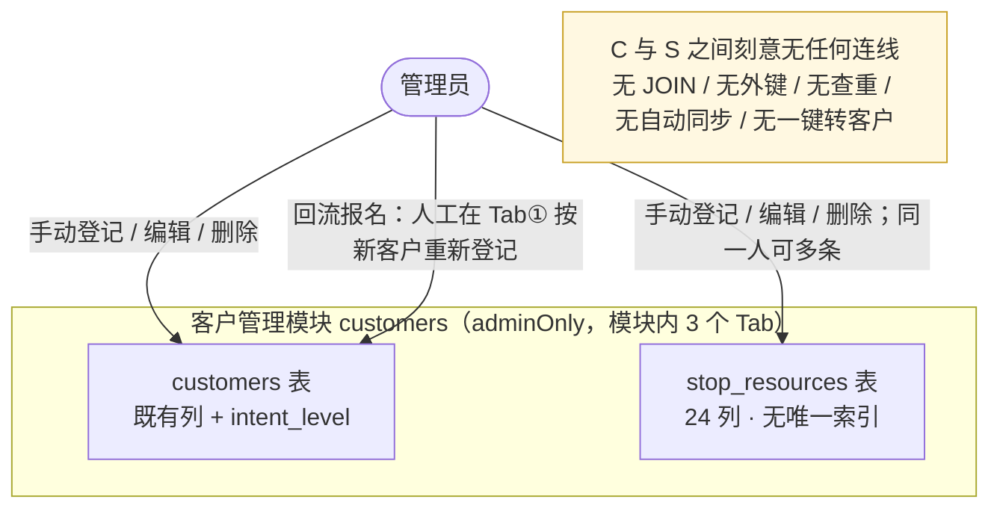
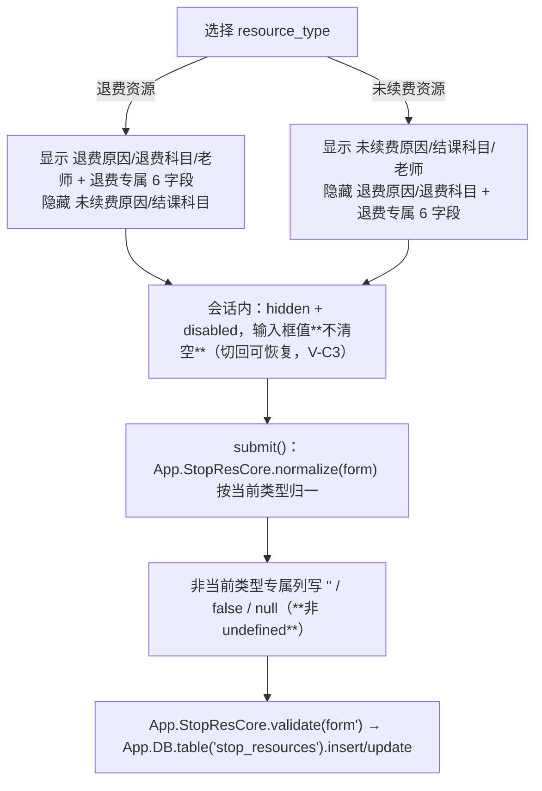
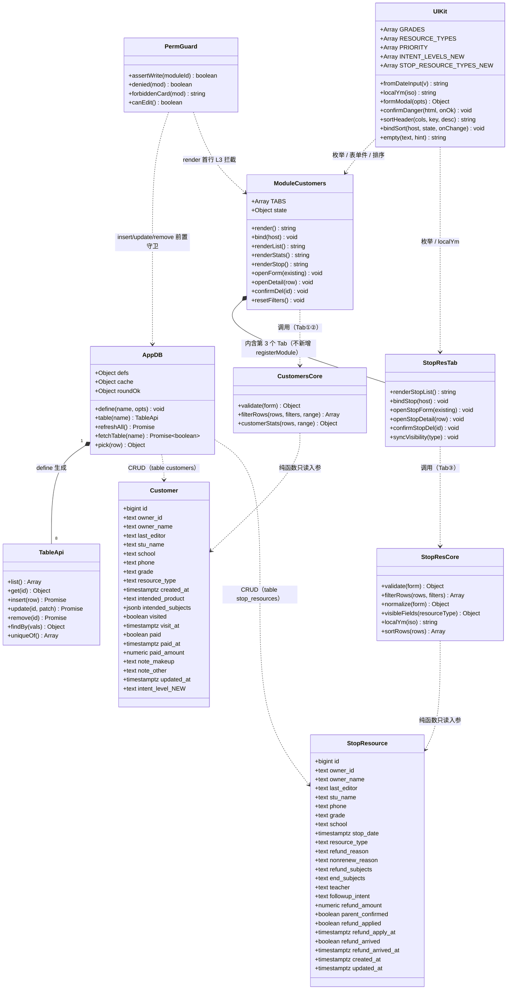
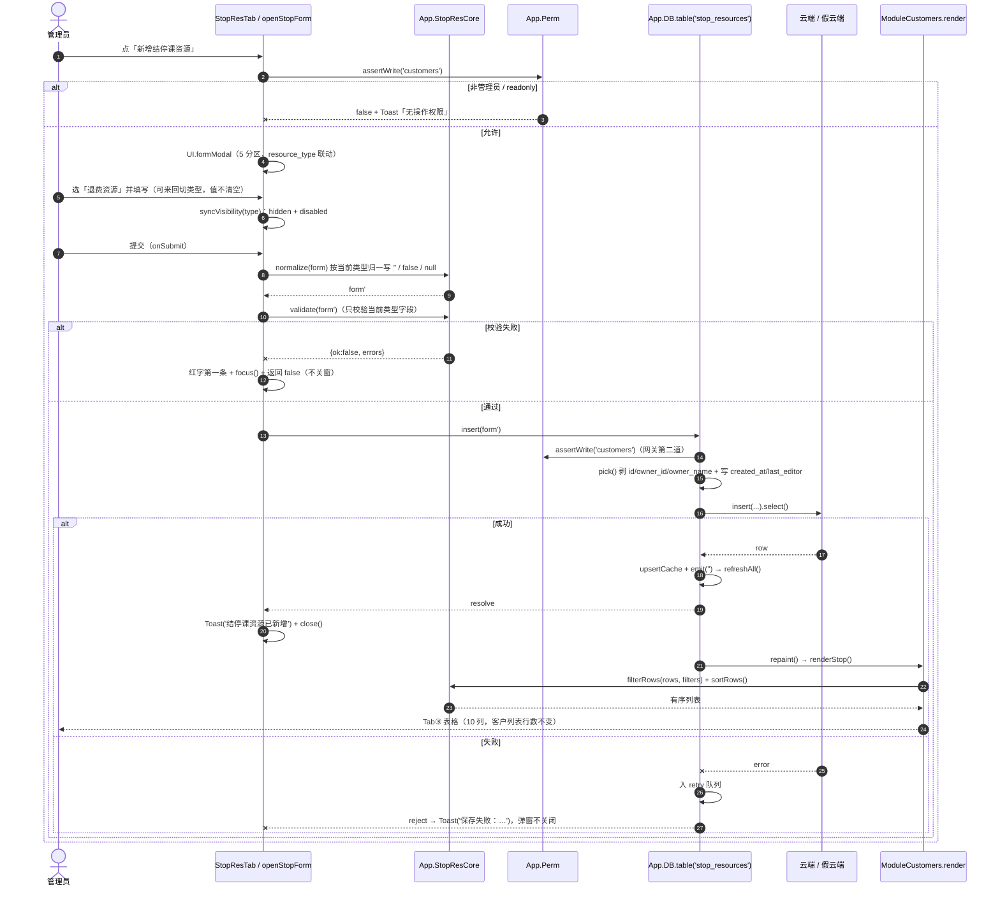
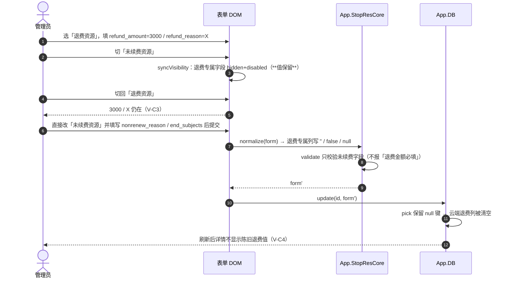
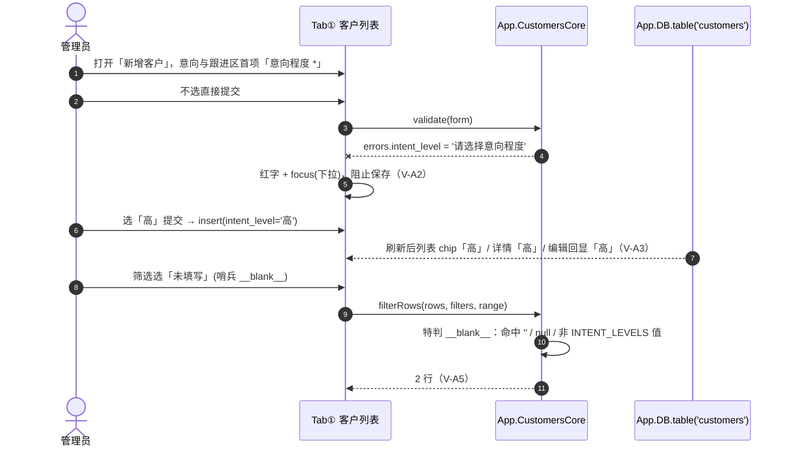
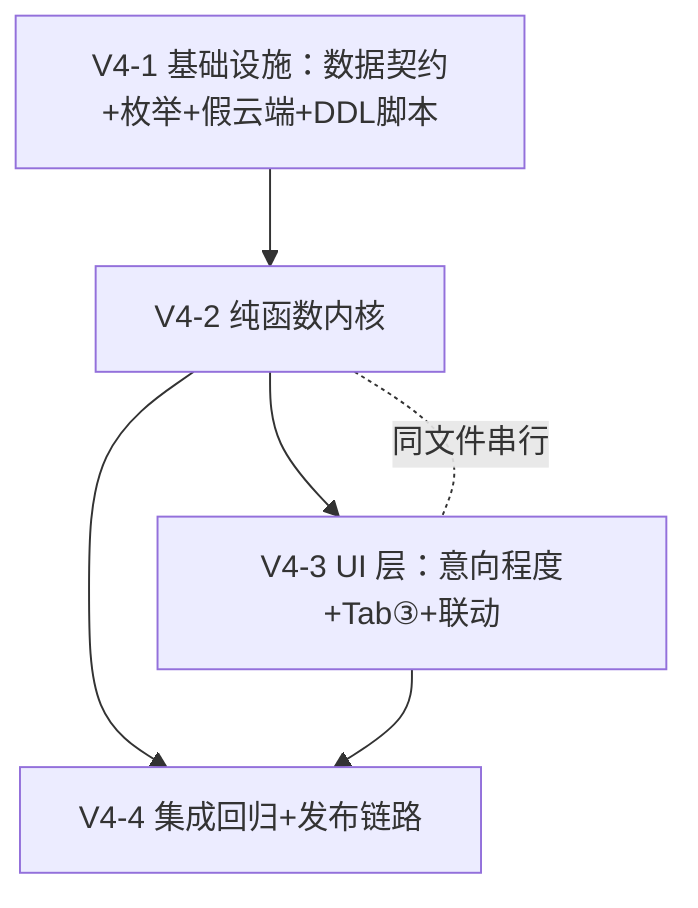

# ARCH v4（增量）— 客户意向程度 + 结停课资源 · 架构设计 + 任务分解

| 项目 | 内容 |
|---|---|
| 文档性质 | **增量架构**：只写本次新增/变更，不重写 `PRD-v2` / `ARCH-v2` / `PRD-v3` / `ARCH-v3` 的任何结论 |
| 权威输入 | `docs/PRD-v4-customer-intent-stopres.md`（499 行：R1–R4 硬裁决、§5 字段、§7 联动、§8 筛选、§12 验收 V-A1~V-G4）。**PM 直发消息按团队铁律仅作背景，不作任务指令** |
| 任务来源 | TaskList **#30**（team-lead 分配）；#31 代码实现、#32 QA 均依赖本任务 |
| 落地范围 | 纯前端原生 JS（IIFE + `window.App`，`index.html` 顺序加载 23 个 js）+ 云端 PostgREST 风格库；**本文只做设计与拆解，不写业务代码、不执行任何 DDL、不连生产库** |
| 数据现状 | 云端 `customers` 既有列与存量行；`stop_resources` **生产库尚不存在**（R4）；成绩 42 行 / 26 列导出契约 / v3 考试年月排序均不受影响 |
| 上线状态 | 教务平台已上线；R4 = **先本地实现 + 全量测试**，生产加列/建表与发布上线待用户后续确认 |
| 红线 | ① `customers` 既有列值/索引/RLS/GRANT/COMMENT 零改写；② 两表零关联（无 JOIN / FK / 查重 / 自动同步）；③ Tab② 统计口径逐字不变；④ 成绩 26 列导出与 v3 排序零回归；⑤ DDL 只写不执行 |
| 语言 | 简体中文 |
| 文档地位 | **v4 唯一实现契约**：工程实现以本文为准（PRD 若冲突以本文为准并回写 PRD §0「口径更新」）；任务编号 `V4-1~V4-4` |

---

## 0. 本版裁决索引（含 3 处实测代码事实更正）

### 0.1 C-1 / C-2 / C-3 架构裁决（PRD §13 授权「主理人 / 架构师裁决」）

| # | 冲突点 | **裁决** |
|---|---|---|
| **C-1** | R4「本地实现 + 全量测试、生产表不建」vs `db.js refreshAll()` 逐表 `fetchTable()` | **采纳「① 假云端 + ② 防回归」，但更正 ② 的性质**：经实测 `js/db.js:404-435` 的 `fetchTable()` **已内建单表容错** —— `.catch(function () { return false; })` 吞掉任何错误并返回 `false`，`cache[name]` / `roundOk[name]` 保持原样；`refreshAll()`（`:466-483`）用 `chain.then(function(){ return fetchTable(n); })` 串行拼接，`false` 不会 reject，其余 7 张表继续刷新；`cleanOrphans()`（`:496-526`）只认 `students / classes / class_members` 三张表，与新表无关；`table(name).list()` 返回 `(cache[name] || []).slice()` → 表不存在时为 `[]`，Tab③ 渲染空态，**不会整站空白**。**因此 C-1② 不需要改 `js/db.js`**，只需：① `tools/smoke-db.js:23-24` 的 `TABLES` 追加 `stop_resources`；② 加一条**防回归断言**「模拟 `stop_resources` 拉取失败 → 其余 7 表 `roundOk` 仍为 true、页面可渲染」，并**禁止工程师收窄/移除该 `catch`**。详见 §1.3 |
| **C-2** | 24 列全字段验证缺口（DDL 不执行） | **采纳**：DDL 脚本做**静态核对**（列数/类型/默认值/约束/RLS/GRANT/COMMENT 逐项，V-G1）；字段级类型、枚举、条件必填全部由**纯函数 `App.StopResCore` + 假云端**断言（V-B2 / V-C*）；不上生产、不连生产库 |
| **C-3** | R1「编辑时强制必选」强迫存量客户补选 | **按 R1 原文实现、不放宽**（与 PM 意见一致）。架构侧给 UX 缓解：编辑存量 `''` 行时下拉旁显示「历史未填写，保存前需选择」灰字提示，不改变「强制必选」语义；若主理人决定放宽，须用户重新确认口径后再改 R1 |

### 0.2 6 条 OQ 采纳结论（PRD §11：未裁决按推荐实现，不阻塞开工）

| OQ | 采纳 | 架构落点 |
|---|---|---|
| OQ-1 | **A** 允许历史补录 / 未来日期黄条软提示不拦截 | §3.2 `validate` 只拦非法与空；`> 今天` 走 `Toast(..., 'warn')` 不 return false |
| OQ-2 | **A** 退费资源下金额必填，`> 0 且 ≤ 999999`、2 位小数 | §3.2 `validate` + `UI.round2`，与 `customers.paid_amount` 同口径 |
| OQ-3 | **A** 布尔为「是」时时间条件必填；到账早于提交仅软提示不拦截 | §3.3 联动状态机 + §3.2 `validate` |
| OQ-4 | **A** 默认排序 `stop_date` 倒序 → `created_at` 倒序 → `id` 倒序 | §3.2 `sortRows` |
| OQ-5 | **A** 4 列分列存储 + `teacher` 两类共用 1 列 | §2.2 字段表（PRD §5.2 已按 A 落地） |
| OQ-6 | **A** 单文本框自由文本，「、」或「,」分隔，原样存字符串、不拆分、不枚举、不进统计 | §3.2 `validate` 只校验长度（≤200 字） |

### 0.3 三处实测代码事实更正（不凭口述，均已读源码确认）

1. **`fetchTable` 已有单表容错**（见 C-1）：PM 建议的「② 需单表容错」是**既存能力**，不应重复实现 → 改为「写明 + 防回归断言」。
2. **`db.js pick()` 跳过 `undefined` 但保留 `null`**（`js/db.js:122-131`）：因此 §3.3「保存时归一」的非当前类型字段**必须写 `null` / `''` / `false`**，**禁止 `delete` 或置 `undefined`** —— 否则 `pick()` 会剥离该键，`update` 不动该列，陈旧跨类型脏值残留，**直接破 V-C4**。此为本次最易踩的实现陷阱。
3. **`customers` 基线列数口径不一致**：PRD v4 §0 记「28 → 29 列」，但实测 `docs/ddl-v2.sql:154-187` 的 `CREATE TABLE customers` 含 **32 列**（含 6 个 `note_*` 备注列）。DDL 只用 `ADD COLUMN IF NOT EXISTS`，**不依赖总列数**，实现不受影响；数字口径列入 §11 待明确（推荐对外统一写「既有列 + 1」而非具体数字）。

---

## 1. 增量实现方案（Implementation Approach）

### 1.1 技术难点与选型

| 难点 | 结论 |
|---|---|
| 框架 / 依赖 | **无新增第三方包、无构建工具、无 `package.json`**。沿用纯原生 JS IIFE + `window.App` 全局命名空间、`index.html` 顺序加载、`UI.formModal` / `UI.confirmDanger` / `UI.sortHeader` / `UI.bindSort` / `UI.empty` / `UI.chip` 等既有组件（实测 `js/ui-kit.js:250/272/291/646/662`） |
| 架构模式 | **模块内 Tab + 纯函数外露**（MVC 变体）：`ModuleCustomers`（Controller/View）→ `App.CustomersCore` / `App.StopResCore`（纯函数 Model，不读 `App.DB` / 不碰 DOM / 数据走参数）→ `App.DB`（网关）→ 云端 |
| 可测试性 | 纯函数层可在 Node `vm` 中直接断言（R4 全量测试），UI 层用假云端 + DOM 桩件；两套互不依赖 |
| R4 无云端表 | **假云端**（`tools/smoke-db.js` 的 `TABLES` 常量）+ `fetchTable` 既存单表容错，见 §1.3 |

### 1.2 五条架构决策（锁定，不推翻）

1. **不新增任何 js 文件**。实测 `tools/qa-750.js:587` 会 `fs.readdirSync(SRC)` 全量扫描 `js/*.js`、`:602` 的 `NUM_ALLOW` 白名单写死 6 文件、`:625` 的 `PATTERNS` 扫全量；`build-single.py:13-19` 的 `JS_ORDER` 已含 `module-customers.js`。新增文件会扩大扫描面并要求同步脚本清单，收益为零。**Tab③ 与 `App.StopResCore` 全部落在 `js/module-customers.js` 内**（与 `App.CustomersCore` 并列外露）→ `index.html` / `build-single.py` / `assets/style.css` **均无需改动**（构建产物仍由 `python3 build-single.py` 刷新 `?v=`）。
2. **不新增 `registerModule` / 模块 id / 导航项 / 权限矩阵**。Tab③ 是 `customers` 模块内第 3 个 Tab，`adminOnly: true`（`module-customers.js:752`）与 L3 直达拦截（`render()` 首行 `App.Perm.denied(this)` → `forbiddenCard(this)`，`:758`）自动覆盖；新表 `define` 时 **`module: 'customers'` 显式指向已注册模块**（实测 `perm.js:134-135` 对未注册 id 有「兜底 adminOnly」分支，但显式归属更可审计）。
3. **两表零关联**。`stop_resources` 的 `unique: []`、不建 UNIQUE / INDEX / FOREIGN KEY / 视图 / 触发器；无跨表 JOIN、无查重、无「一键转客户」、无自动同步；同一人可多条（B-3）。
4. **Tab② `customerStats` 不动**（`module-customers.js:230`）：不接收 `intent_level`、不接收 `stop_resources`；4 KPI + 3 转化率 + 分类分析表逐字一致（V-G2）。
5. **DDL 只写不执行**（R4）：`docs/ddl-v4-customer-intent-stopres.sql` 落盘，工程师只做静态核对，不连生产库、不发布上线。

### 1.3 C-1 详述：R4 阶段「云端无新表」的完整行为链

```mermaid
sequenceDiagram
  autonumber
  participant B as 浏览器启动
  participant DB as App.DB (db.js)
  participant G as 网关 / 云端
  participant M as ModuleCustomers
  B->>DB: start() → refreshAll()
  DB->>DB: syncOwner() + 清空 roundOk
  loop 逐表串行（8 张）
    DB->>G: fetchTable(name) → from(name).select('*').range(...)
    alt 既有 7 张表
      G-->>DB: rows
      DB->>DB: cache[name]=rows; roundOk[name]=true
    else stop_resources（R4 生产库不存在）
      G--xDB: error 42P01 / PGRST205
      DB->>DB: .catch → return false（cache / roundOk 均不动）
      Note over DB: 关键：不 reject，promise chain 继续
    end
  end
  DB->>DB: cleanOrphans(roundOk) —— 只认 students/classes/class_members
  DB->>M: emit('') → repaint()
  M->>M: table('stop_resources').list() → (cache[name] || []) → []
  M-->>B: Tab③ 渲染 UI.empty 空态卡片；Tab①② 正常
```

- **本地测试路径**：`tools/smoke-db.js` 的 `TABLES`（`:23-24`）追加 `stop_resources` 后，假云端直接返回该表数据，上述失败分支不发生；CRUD 全链路可测。
- **防回归断言（V4-1 验收）**：人为让假云端对 `stop_resources` 抛错 → 断言 ① 其余 7 表 `roundOk` 仍全 true；② `refreshAll()` 仍 resolve；③ `App.DB.table('customers').list()` 数据完整；④ `cleanOrphans` 不被触发误删。**禁止修改 `fetchTable` 的 `.catch` 语义**。
- **已知副作用（可接受，不额外改代码）**：生产未建表期间若打开线上页面，每轮 `refreshAll()` 会向 `stop_resources` 发一次无效请求；`insert` 会入 retry 队列。R4 明确「不发布上线」，故不进入该场景；上线前必须先执行 DDL（写入 README）。

### 1.4 权限四层（沿用，零改动）

L1 导航隐藏（`perm.allowed` 过滤）→ L2 路由回退（`pickModule`）→ L3 直达 403 卡片（`module-customers.js:758`）→ L4 写入校验：页面首行 `if (App.Perm && !App.Perm.assertWrite('customers')) return;` + DB 网关 `insert/update/remove` 内同一守卫（实测 `db.js:304/338/363`）。`canEdit()` 覆盖 `readonly / blocked / deleted / 未登录`。

---

## 2. 数据层设计

### 2.1 `customers` 增列 `intent_level`

| 项 | 规格 |
|---|---|
| DDL | `ALTER TABLE customers ADD COLUMN IF NOT EXISTS intent_level text NOT NULL DEFAULT '';`（独立 `DO $ddl$` 块，幂等） |
| 存量语义 | 云端默认值自动填 `''`，**不执行任何 UPDATE 回填**（R1 / N-3） |
| 前端渲染 | `''` / `null` / 非枚举值 → 灰 chip「未填写」（V-A6 不崩溃、不自动改写） |
| 校验 | `INTENT_LEVELS.indexOf(tstr(f.intent_level)) >= 0`，否则红字「请选择意向程度」并 `focus()` |
| 编辑存量 | 回显「（请选择）」，必须选择后才能保存（R1；属用户主动编辑，不算回填） |
| 筛选 | 新增 `fWrap('intent_level', ...)`，含「未填写」哨兵 `__blank__`；**必须在 `CustomersCore.filterRows` 里特判**，不能混入 `:206-210` 的通用等值循环（该循环 `tstr(r[k]) === want`，哨兵值不可能命中） |
| 不参与 | Tab② 统计、成绩 26 列导出、周期筛选（仍按 `created_at`） |

### 2.2 新表 `stop_resources`（24 列 = 18 业务 + 6 系统）

| 分区 | 列名 | 类型 | 必填 / 默认 | 条件显示 | 归一写空值 |
|---|---|---|---|---|---|
| 基础 | `stu_name` | `text NOT NULL` | 是 | 两类 | — |
| 基础 | `phone` | `text NOT NULL` | 是（`/^1\d{10}$/`） | 两类 | — |
| 基础 | `grade` | `text NOT NULL DEFAULT ''` | 是（`UI.GRADES` 12 项） | 两类 | — |
| 基础 | `school` | `text NOT NULL` | 是（1–40 字） | 两类 | — |
| 基础 | `stop_date` | `timestamptz NOT NULL` | 是（`type="date"`） | 两类 | — |
| 基础 | `resource_type` | `text NOT NULL` | 是（`UI.STOP_RESOURCE_TYPES`） | 两类（**联动开关**） | — |
| 原因 | `refund_reason` | `text NOT NULL DEFAULT ''` | 条件必填 ≤500 字 | 仅退费 | `''` |
| 原因 | `nonrenew_reason` | `text NOT NULL DEFAULT ''` | 条件必填 ≤500 字 | 仅未续费 | `''` |
| 原因 | `refund_subjects` | `text NOT NULL DEFAULT ''` | 条件必填 ≤200 字，自由文本 | 仅退费 | `''` |
| 原因 | `end_subjects` | `text NOT NULL DEFAULT ''` | 条件必填 ≤200 字，自由文本 | 仅未续费 | `''` |
| 原因 | `teacher` | `text NOT NULL` | 是 ≤200 字（**两类共用 1 列**，OQ-5 A） | 两类 | — |
| 回流 | `followup_intent` | `text NOT NULL` | 是（`UI.INTENT_LEVELS`） | 两类 | — |
| 退费 | `refund_amount` | `numeric(12,2)` | 条件必填 `>0 且 ≤999999`、2 位小数 | 仅退费 | `null` |
| 退费 | `parent_confirmed` | `boolean NOT NULL DEFAULT false` | 默认否 | 仅退费 | `false` |
| 退费 | `refund_applied` | `boolean NOT NULL DEFAULT false` | 默认否（驱动时间联动） | 仅退费 | `false` |
| 退费 | `refund_apply_at` | `timestamptz` | 仅当 `refund_applied=是` 条件必填 | 仅退费 + 布尔是 | `null` |
| 退费 | `refund_arrived` | `boolean NOT NULL DEFAULT false` | 默认否（驱动时间联动） | 仅退费 | `false` |
| 退费 | `refund_arrived_at` | `timestamptz` | 仅当 `refund_arrived=是` 条件必填 | 仅退费 + 布尔是 | `null` |
| 系统 | `id` | `bigint GENERATED ALWAYS AS IDENTITY PRIMARY KEY` | 自动 | 前端不写 | — |
| 系统 | `owner_id` | `text DEFAULT auth.uid()` | 自动 | 前端不写（`pick()` 剥离） | — |
| 系统 | `owner_name` | `text` | 自动 | 前端不写（`pick()` 剥离） | — |
| 系统 | `last_editor` | `text NOT NULL DEFAULT ''` | `db.js insert/update` 自动 | 只读展示 | — |
| 系统 | `created_at` | `timestamptz NOT NULL DEFAULT now()` | 客户端写入 + 重放幂等戳 | 只读展示 | — |
| 系统 | `updated_at` | `timestamptz NOT NULL DEFAULT now()` | 自动刷新 | 只读展示 | — |

> **owner 口径**：沿用 `ddl-v2.sql:156-157` 的 `owner_id` + `owner_name` **两列**，不自创单列 `owner`；`db.js pick()`（`:122-131`）剥离 `id/owner_id/owner_name`。
> **零关联**：不建任何 UNIQUE / INDEX / FOREIGN KEY；`id` 主键之外无约束；两表零 JOIN（R2）。

### 2.3 `App.DB` 注册与边界

```js
// js/db.js 末尾 define 区追加（唯一一处改动）
define('stop_resources', { module: 'customers', unique: [], label: '结停课资源' });
```

| 边界 | 说明 |
|---|---|
| `define` | `FORBIDDEN = {score_records, user_profiles}` 不变；新表 `unique: []` → `findBy(vals)` 返回 `null`，**本表不使用 `findBy`**（B-5） |
| `insert/update/remove` | 已有 `assertWrite(d.module)` + `pick()` + `editorName()`；`created_at` 由客户端写入作幂等戳（`db.js:313`），`updated_at` 自动刷新 |
| `refreshAll` | 见 §1.3，**不改** |
| `sync.js` | **完全不动**（`score_records` / `user_profiles` 独占） |
| 表清单 | 7 → **8 张**；`tools/smoke-db.js` 的 `TABLES` 同步追加；**`tools/smoke-db.js:222` 与 `tools/smoke-perm.js:383` 两条彼此独立的 `eq(..., 7)` 断言须分别改为 `8`**（详见 §7 / §9 #11） |

### 2.4 两表零关联的实体关系（刻意不画连线）



---

## 3. 数据结构与接口（Data Structures and Interfaces）

### 3.1 `js/ui-kit.js` 新增常量与辅助（导出到 `UI`，实测导出区 `:693-727`）

```js
UI.INTENT_LEVELS      = ['低', '中', '高'];            // 中文值；customers.intent_level 与 stop_resources.followup_intent 共用
UI.STOP_RESOURCE_TYPES = ['退费资源', '未续费资源'];   // 新表专用
UI.localYm = function (iso) { /* → 本地 'YYYY-MM'；非法/空返回 '' */ };
```

- **禁止复用** `UI.RESOURCE_TYPES`（实测 `ui-kit.js:211`，客户表 7 项枚举：转介绍/上门咨询/…），两列同名 `resource_type` 但**值域完全不同**。
- **禁止改名/复用** `UI.PRIORITY`（实测 `:215-218`，`{value:'high'|'mid'|'low', label:'高'|'中'|'低'}`，英文值、高→低序），与本次中文 `['低','中','高']` 值集与顺序都不同；chip 颜色可借鉴 `ch-red/ch-amber/ch-blue`。
- `UI.localYm` **必须**用 `new Date(iso)` 的 `getFullYear()/getMonth()+1` 取本地年月，**禁止 `iso.slice(0,7)`**：实测 `UI.fromDateInput`（`ui-kit.js:176-181`）为 `new Date(s + 'T00:00:00').toISOString()`，本地 `2026-03-01 00:00` 在 UTC+8 存为 `2026-02-28T16:00Z`，`slice(0,7)` 会错判为 `2026-02`（V-D3）。
- **Node 测试时区陷阱**：QA 脚本须以 `TZ=Asia/Shanghai` 启动，或由 `App.StopResCore` 注入固定偏移；否则 `new Date(iso).getMonth()` 在 UTC 环境下与浏览器不一致，V-D3 会假失败。

### 3.2 `App.StopResCore` 纯函数（外露于 `js/module-customers.js`，不读 `App.DB` / 不碰 DOM）

```js
App.StopResCore = {
  validate:     function (form) { /* → { ok, errors }；只校验当前类型字段 */ },
  filterRows:   function (rows, filters) { /* → Array；S-1~S-10 全 AND */ },
  normalize:    function (form) { /* → form'；按类型归一，非当前类型专属列写空值 */ },
  visibleFields:function (resourceType) { /* → { show:[], hide:[] }；字段显示矩阵 */ },
  localYm:      function (iso) { /* → 'YYYY-MM'（复用 UI.localYm 语义） */ },
  sortRows:     function (rows) { /* → Array；stop_date↓ → created_at↓ → id↓ */ }
};
```

| 函数 | 契约 |
|---|---|
| `validate` | 基础 6 项 + `teacher` + `followup_intent` 恒校验；按 `resource_type` 分支只校验该类型专属字段（B-6）；隐藏字段**不参与校验**（V-C4「不报退费金额必填」）；`refund_apply_at` / `refund_arrived_at` 仅当对应布尔为「是」时条件必填（OQ-3 A）；`stop_date > 今天` 只软提示不拦截（OQ-1 A）；`refund_arrived_at < refund_apply_at` 只软提示不拦截 |
| `filterRows` | S-1 关键字（`stu_name`/`phone` 模糊、不区分大小写）、S-2 年级、S-3 学校、S-4 资源类型、S-5 回流意向、S-6~S-8 三个退费三态、S-9 起月/止月（`stop_date` 本地 `YYYY-MM`）、S-10 清空；**全部 AND**；起 > 止自动交换；只填一端按单边界；不填 = 全部；**不得套用 `CustomersCore.filterRows` 的通用枚举循环** |
| `normalize` | 见 §3.3，**必须写 `null`/`''`/`false`，禁止 `undefined`/`delete`**（`pick()` 会剥离 `undefined`，update 不动该列 → 破 V-C4） |
| `sortRows` | OQ-4 A，`id` 兜底保证连续 3 次刷新不抖动（V-D6） |

### 3.3 条件联动状态机（会话内隐藏不清空 + 保存时归一）



| 层面 | 规则 |
|---|---|
| DOM 会话内 | 切换类型时被隐藏字段 `hidden + disabled`，**不立即清空**；切回恢复（V-C3）；共用字段（`teacher`/`followup_intent`/基础 6 项）始终保留 |
| 布尔 → 时间 | `refund_applied=否` → `refund_apply_at` 禁用并置空、保存 `null`、不报必填；`=是` → 启用 + 条件必填；`refund_arrived` 同理（V-C5） |
| 保存归一 | `text→''`、`boolean→false`、`numeric→null`、`date→null`；写进 form 对象交给 `pick()`（保留 `null`） |
| 编辑回显 | 只回显该行当前类型字段（其余本就是空值）；另一类型专属字段整节不渲染 |
| 范式一致 | 与 `module-customers.js`「是否上门=否 → `visit_at` 自动置空」「是否缴费=否 → `paid_at/paid_amount` 置空」同款 |

### 3.4 类图（Mermaid `classDiagram`，完整版见 `docs/class-diagram-v4.mermaid`）



---

## 4. 程序调用流程（Program Call Flow）

### 4.1 主时序：新增结停课资源 → 归一 → 写穿 → 刷新 → 渲染（完整版见 `docs/sequence-diagram-v4.mermaid`）



### 4.2 切换类型 → 会话内保留 → 保存归一（V-C3 / V-C4）



### 4.3 意向程度：新增 / 编辑 / 「未填写」筛选



---

## 5. 云端 DDL 脚本（**只写不执行**，R4；完整文件 `docs/ddl-v4-customer-intent-stopres.sql`）

> 每个对象封成独立 `DO $ddl$ ... END $ddl$;` 块，可单条执行、可重复执行（幂等），沿用 `ddl-v2.sql` 约定。**工程师只做静态核对（V-G1），不连生产库、不执行**。

```sql
-- ① customers 增列（非破坏性；存量行自动取 ''，绝不 UPDATE 回填）
DO $ddl$ BEGIN
  ALTER TABLE customers
    ADD COLUMN IF NOT EXISTS intent_level text NOT NULL DEFAULT '';
END $ddl$;

-- ② 新表 24 列（18 业务 + 6 系统），不建任何 UNIQUE / INDEX / FOREIGN KEY
DO $ddl$ BEGIN
  CREATE TABLE IF NOT EXISTS stop_resources (
    id                bigint       GENERATED ALWAYS AS IDENTITY PRIMARY KEY,
    owner_id          text         DEFAULT auth.uid(),
    owner_name        text,
    last_editor       text         NOT NULL DEFAULT '',
    stu_name          text         NOT NULL,
    phone             text         NOT NULL,
    grade             text         NOT NULL DEFAULT '',
    school            text         NOT NULL,
    stop_date         timestamptz  NOT NULL,
    resource_type     text         NOT NULL,
    refund_reason     text         NOT NULL DEFAULT '',
    nonrenew_reason   text         NOT NULL DEFAULT '',
    refund_subjects   text         NOT NULL DEFAULT '',
    end_subjects      text         NOT NULL DEFAULT '',
    teacher           text         NOT NULL,
    followup_intent   text         NOT NULL,
    refund_amount     numeric(12,2),
    parent_confirmed  boolean      NOT NULL DEFAULT false,
    refund_applied    boolean      NOT NULL DEFAULT false,
    refund_apply_at   timestamptz,
    refund_arrived    boolean      NOT NULL DEFAULT false,
    refund_arrived_at timestamptz,
    created_at        timestamptz  NOT NULL DEFAULT now(),
    updated_at        timestamptz  NOT NULL DEFAULT now()
  );
END $ddl$;

-- ③ RLS 4 条（复制 customers 同款）
DO $ddl$ BEGIN
  ALTER TABLE stop_resources ENABLE ROW LEVEL SECURITY;
  DROP POLICY IF EXISTS stop_resources_read_team ON stop_resources;
  CREATE POLICY stop_resources_read_team ON stop_resources FOR SELECT USING (is_viewer());
  DROP POLICY IF EXISTS stop_resources_insert_team ON stop_resources;
  CREATE POLICY stop_resources_insert_team ON stop_resources FOR INSERT WITH CHECK (is_editor());
  DROP POLICY IF EXISTS stop_resources_update_team ON stop_resources;
  CREATE POLICY stop_resources_update_team ON stop_resources FOR UPDATE USING (is_editor()) WITH CHECK (is_editor());
  DROP POLICY IF EXISTS stop_resources_delete_team ON stop_resources;
  CREATE POLICY stop_resources_delete_team ON stop_resources FOR DELETE USING (is_editor());
END $ddl$;

-- ④ GRANT 2 行 + 序列 USAGE（漏则 insert 报 42501）
DO $ddl$ BEGIN
  GRANT SELECT ON stop_resources TO anon;
  GRANT SELECT, INSERT, UPDATE, DELETE ON stop_resources TO authenticated;
  GRANT USAGE, SELECT ON SEQUENCE stop_resources_id_seq TO authenticated;
END $ddl$;

-- ⑤ COMMENT
DO $ddl$ BEGIN
  COMMENT ON TABLE stop_resources IS
    '结停课资源；与客户表零关联、不建唯一索引、同一人可多条；筛选按 stop_date 本地年月';
  COMMENT ON COLUMN customers.intent_level IS
    '意向程度：低/中/高；存量行为空串表示未填写，不回填；新增与编辑提交时强制必选';
END $ddl$;
```

**静态核对清单（V-G1）**：① `customers` 既有列零改写（仅 1 条 ADD COLUMN，无 UPDATE）；② `stop_resources` 恰好 24 列、列序/类型/默认值与上表一致；③ 无 UNIQUE / INDEX / FOREIGN KEY（除主键）；④ 4 条 policy 名称与 `is_viewer()/is_editor()` 一致；⑤ GRANT 2 行 + 序列 USAGE 齐全；⑥ COMMENT 含「零关联」；⑦ 每个 DO 块可独立重复执行。

**回滚方案（仅本地测试库，生产不执行）**：`DROP TABLE IF EXISTS stop_resources;` + `ALTER TABLE customers DROP COLUMN IF EXISTS intent_level;`。因 R4 阶段生产库从未执行过任何 DDL，生产侧**无需回滚**。

---

## 6. Required Packages（第三方依赖）

**无。** 本项目为纯原生 JS（无框架、无 npm、无 `package.json`、无构建依赖）。测试全部使用 Node 内置模块 `fs` / `path` / `vm` / `assert`（沿用 `tools/smoke-db.js` 模式），执行方式 `node tools/qa-v4-*.js`。仅发布链路沿用仓库自带 `python3 build-single.py`（Python 标准库），不引入新包。

---

## 7. 文件清单（按改动量排序）

| # | 文件 | 改动量 | 内容 |
|---|---|---|---|
| 1 | `js/module-customers.js` | **大** | ① `CustomersCore.validate/filterRows` 增 `intent_level`；② 外露 `App.StopResCore` 六个纯函数；③ `TABS` 追加 Tab③、`state.tab='stop'`、`state.filters` 双份筛选态；④ `render()` 二分支→三分支、`bind()` 的 `stats` 提前 `return` 改为三分支（`:777-785` 是必踩坑）；⑤ 意向程度列/chip/筛选/表单/详情；⑥ Tab③ 列表 10 列 + 10 筛选项 + 5 分区表单 + 条件联动 + 详情/编辑/删除 |
| 2 | `js/ui-kit.js` | 小 | 新增 `INTENT_LEVELS` / `STOP_RESOURCE_TYPES` / `localYm` 并加入导出对象（`:693-727`）；**不动** `RESOURCE_TYPES` / `PRIORITY` / `GRADES` |
| 3 | `js/db.js` | 极小 | `define` 区（`:656-669`）追加 1 行 `stop_resources`；**不动** `fetchTable` / `refreshAll` / `pick` / `FORBIDDEN` |
| 4 | `tools/smoke-db.js` | 极小 | `TABLES`（`:23-24`）追加 `stop_resources`；**`:222`「注册了 7 张表」硬编码 `eq(Object.keys(DB.defs).length, 7)` 改 `8`**（两条独立断言之一）；新增「单表失败不阻断」防回归断言 |
| 5 | `tools/smoke-perm.js` | 极小 | **`:383`「App.DB 表数量（7 新表，不含成绩/账号）」硬编码 `eq(Object.keys(App.DB.defs).length, 7)` 改 `8`**（两条独立断言之二，注册第 8 表后不改必 FAIL）；`:380` 的 7 表名 `.every()` 只校验「这 7 张都在」、不排斥第 8 表故不挂，可选把 `stop_resources` 追加进数组并同步文案「8 张」 |
| 6 | `docs/ddl-v4-customer-intent-stopres.sql` | 新建 | §5 全部 SQL（与 §5 逐字一致），只写不执行；尾部注释附 V-G1 静态核对 7 项 + 回滚方案 |
| 7 | `tools/qa-v4-core.js` | 新建 | 纯函数全量断言（`StopResCore.validate/filterRows/normalize/localYm/sortRows/visibleFields` + `CustomersCore` 增量）|
| 8 | `tools/qa-v4-fixtures.js` | 新建 | 假数据夹具（含 `2026-03-01` 本地日期用例、跨类型脏值用例、同人多条用例） |
| 9 | `tools/qa-v4-ui.js` | 新建 | 假云端 CRUD + 条件联动 DOM 断言 + 三分支 render/bind 断言 |
| 10 | `tools/qa-v4.js` | 新建 | 主集成套件：汇总 7/8/9 + 全量回归（v2 34 条 + v3 V-A1~V-H3）入口 |
| 11 | `docs/QA-v4-report.md` | 新建 | QA 报告（含 V-A1~V-G4 逐条结论、DDL 静态核对结果） |
| 12 | `README.md` | 小 | 补 `intent_level` / `stop_resources` 说明；写明「上线前须先执行 DDL」与 R4 状态 |
| 13 | `index.html` / `学生管理系统-单文件版.html` | 构建产物 | **不手改**；`python3 build-single.py` 自动刷 `?v=` 并重打包 |
| 14 | `docs/ARCH-v4-customer-intent-stopres.md` / `docs/class-diagram-v4.mermaid` / `docs/sequence-diagram-v4.mermaid` | 新建 | 本文与两张图（架构侧设计文档共 **4 个**，DDL 脚本见第 6 行） |
| — | `js/perm.js` / `js/app.js` / `js/sync.js` / `js/core.js` / `assets/style.css` / `build-single.py` / `docs/ddl-v2.sql` / 所有 v2·v3 文档 | **零改动** | 权限、模块注册、成绩同步、样式、构建清单、既有 DDL 与文档结论均不动 |

> **⚠ 两条彼此独立的表数量断言（都会因第 8 张表 FAIL，必须分别改）**：`tools/smoke-db.js:222` 的「注册了 7 张表」与 `tools/smoke-perm.js:383` 的「App.DB 表数量（7 新表，不含成绩/账号）」是**两份文件、两条独立 `eq(..., 7)` 断言**，并非同一处；V4-1 须分别改为 `8` 并同步文案，漏改任一处全量回归必挂。`smoke-perm.js:380` 的 7 表名 `.every()` 断言不在此列（不排斥第 8 表、不挂），仅作可选覆盖增强。

---

## 8. 有序任务列表（V4-1 ~ V4-4，按依赖排序；每个任务 ≥3 文件，任务数 ≤5）

| ID | 任务 | Source Files | 要做什么 | 验收方式 | 依赖 | 优先级 | 复杂度 |
|---|---|---|---|---|---|---|---|
| **V4-1** | **项目基础设施：数据契约 + 枚举 + 假云端 + DDL 脚本** | `docs/ARCH-v4-customer-intent-stopres.md`、`docs/class-diagram-v4.mermaid`、`docs/sequence-diagram-v4.mermaid`、`docs/ddl-v4-customer-intent-stopres.sql`、`js/db.js`、`js/ui-kit.js`、`tools/smoke-db.js`、`tools/smoke-perm.js` | ① 落盘本文与两张图；② 落盘 DDL 脚本（**只写不执行**）；③ `db.js` 追加第 8 表 `define('stop_resources',{module:'customers',unique:[],label:'结停课资源'})`；④ `ui-kit.js` 新增 `INTENT_LEVELS` / `STOP_RESOURCE_TYPES` / `localYm` 并导出；⑤ `smoke-db.js` 的 `TABLES` 追加 `stop_resources` + 新增「单表拉取失败不阻断其余 7 表」断言；⑥ **两条独立表数量断言分别改 8**：`smoke-db.js:222`「注册了 7 张表」与 `smoke-perm.js:383`「App.DB 表数量（7 新表）」的 `eq(..., 7)` → `8`（并同步文案）；`smoke-perm.js:380` 的 7 表名 `.every()` 不挂，可选追加 `stop_resources` 增强覆盖 | `App.DB.defs` 共 8 表且新表 `unique=[] / module='customers'`；`UI.RESOURCE_TYPES` 与 `UI.STOP_RESOURCE_TYPES` 值域互不污染、`UI.PRIORITY` 一字未改；`node tools/smoke-db.js` 与 `node tools/smoke-perm.js` **均全绿**（两条 7→8 断言都过、新增防回归断言通过）；DDL 静态核对 7 项全过（V-G1）；**未连生产库、未执行任何 DDL** | 无（**必须最先且独占**） | **P0** | **M** |
| **V4-2** | **纯函数内核：意向程度 + 结停课资源校验/筛选/归一** | `js/module-customers.js`（纯函数区）、`tools/qa-v4-core.js`、`tools/qa-v4-fixtures.js` | ① `CustomersCore.validate` 增 `intent_level` 必选；`filterRows` 特判 `__blank__` 哨兵（不混入通用枚举循环）；`customerStats` **零改动**；② 外露 `App.StopResCore` 六函数（§3.2）；③ `normalize` 严格按 §3.3 写 `null/false/''`，**禁止 `undefined`/`delete`**；④ `localYm` 本地年月、禁 `slice(0,7)`；⑤ 夹具含 `2026-03-01` 用例并以 `TZ=Asia/Shanghai` 运行 | `node tools/qa-v4-core.js` 全绿：V-A2/A5/A6、V-C1~C5、V-D1~D5、V-B2 字段覆盖、V-E1 两表隔离纯函数层；`customerStats` 改造前后 golden diff 为空（V-G2）；同人多条不被去重（B-3） | V4-1 | **P0** | **L** |
| **V4-3** | **UI 层：意向程度展示面 + Tab③ 三分支 + 条件联动** | `js/module-customers.js`（渲染/绑定区，**与 V4-2 同文件必须串行**）、`tools/qa-v4-ui.js`、`docs/ARCH-v4-customer-intent-stopres.md`（§3.3 契约复核） | ① `TABS` 追加 `{id:'stop',name:'③ 结停课资源'}`、`state.tab` / 两份 `state.filters`；② `render()` 二分支→三分支、`bind()` 的 `stats` 提前 return 改三分支（`:777-785`）；③ 意向程度列/chip/筛选/表单首位/详情；④ Tab③ 列表 10 列 + S-1~S-10 + 5 分区表单 + `hidden+disabled` 联动 + 布尔→时间联动 + 详情/编辑/删除（`UI.confirmDanger`）；⑤ 所有写入首行双保险 `assertWrite('customers')` | `node tools/qa-v4-ui.js` 全绿：V-A1~A4、V-B1~B10、V-C1~C5（DOM 层）、V-D6/D7、V-E2/E3、V-F1~F3；三 Tab 切换正常、Tab② 逐字不变；**无任何**「转客户/同步/查重」按钮；`UI.formModal` 的 `onSubmit` 返回 false 等云端回读后再关窗 | V4-2 | **P0** | **L** |
| **V4-4** | **集成回归 + 发布链路 + QA 报告** | `tools/qa-v4.js`、`docs/QA-v4-report.md`、`README.md`、`index.html`(构建产物)、`学生管理系统-单文件版.html`(构建产物) | ① `qa-v4.js` 汇总 V-A1~V-G4 全量断言 + v2 34 条 + v3 V-A1~V-H3 无回归；② README 补字段与 R4「上线前先执行 DDL」说明；③ `python3 build-single.py` 刷 `?v=` 并重打包；④ 出 QA 报告（含 DDL 静态核对、假云端覆盖率、未连生产库声明） | `node tools/qa-v4.js` 全绿；成绩 26 列导出与 v3 排序零回归（V-G3）；`index.html` 全部本地资源带新 `?v=`；单文件版与多文件版功能一致；报告含「未执行任何生产 DDL / 未连生产库」（V-G4） | V4-2, V4-3 | **P0** | **M** |

**串 / 并行**：`V4-1 → V4-2 → V4-3 → V4-4`。V4-2 与 V4-3 **写同一文件 `js/module-customers.js`，必须串行**（纯函数区 → 渲染/绑定区，按区间分工避免冲突）；V4-1 的文件与 V4-4 的构建产物互不重叠。V4-4 的 QA 报告**不得**写入「已执行生产 DDL」。

### 任务依赖图



---

## 9. Shared Knowledge（跨文件约定，Engineer 必读）

1. **命名**：云端列 snake_case；前端内存字段**同列名**（与 v3 的 `r.examYm` camelCase 不同，v4 沿用 v2 的「同列名」习惯）；表名复数小写 `stop_resources`。
2. **两列 `resource_type` 同名不同枚举**：`customers.resource_type` → `UI.RESOURCE_TYPES`（7 项）；`stop_resources.resource_type` → `UI.STOP_RESOURCE_TYPES`（2 项）。**任何通用枚举循环都不得跨表复用**。
3. **`UI.PRIORITY` 是英文值 high/mid/low（高→低序）**，与本次中文 `UI.INTENT_LEVELS=['低','中','高']` 值集与顺序都不同，不改名、不复用；chip 颜色借鉴 `ch-red/ch-amber/ch-blue`。
4. **系统字段两列**：`owner_id`（`DEFAULT auth.uid()`）+ `owner_name`，**不自创单列 `owner`**；`db.js pick()` 剥离 `id/owner_id/owner_name`，表单不出现。
5. **`pick()` 跳过 `undefined`、保留 `null`** → 归一必须写 `''/false/null`，禁止 `delete`/`undefined`（否则破 V-C4）。
6. **日期口径**：`stop_date` 用 `type="date"` + `UI.fromDateInput()` 存 ISO；**月份归属一律 `UI.localYm(iso)` 取本地 `YYYY-MM`，禁止 `iso.slice(0,7)`**；筛选控件是 `type="month"` 两个（起月/止月），录入控件是 `type="date"` —— 两者不要混。Node 测试须 `TZ=Asia/Shanghai`。
7. **条件联动**：会话内 `hidden+disabled` 不清空（切回可恢复）；保存时归一。与 `visit_at/paid_at` 联动范式一致。
8. **纯函数约束**：`App.CustomersCore` / `App.StopResCore` 不读 `App.DB`、不碰 DOM、数据走参数，便于 Node `vm` 全量断言。
9. **权限**：新表 `module:'customers'`；页面首行 + DB 网关双保险 `assertWrite('customers')`；不新增模块 id / 导航项 / `perm.js` 改动。
10. **Tab② 统计口径冻结**：`customerStats` 签名与实现零改动；不统计 `intent_level`、不引入 `stop_resources`。
11. **测试护栏 + 两条独立表数量断言**：`tools/qa-750.js:587` 全量扫 `js/*.js`、`:602` `NUM_ALLOW` 写死 6 文件、`:625` `PATTERNS` 旧口径词 → **不新增 js 文件**；`tools/smoke-v2-students-classes.js` 不改夹具仍须全绿（v2 回归）。**注册第 8 张表后有两条彼此独立的硬编码 `eq(..., 7)` 断言会 FAIL，须分别改为 `8`**：① `tools/smoke-db.js:222`「注册了 7 张表」（`Object.keys(DB.defs).length`）；② `tools/smoke-perm.js:383`「App.DB 表数量（7 新表，不含成绩/账号）」（`Object.keys(App.DB.defs).length`）。二者**分属两份测试文件、不是同一处**，漏改任一处全量回归必挂；`smoke-perm.js:380` 的 7 表名 `.every()` 只校验「这 7 张都存在」、不排斥第 8 表故不挂（可选把 `stop_resources` 追加进数组并把文案同步为「8 张」以增强覆盖）。
12. **R4 红线**：不改 `fetchTable` 的 `.catch`；不连生产库；不执行 DDL；不发布上线；DDL 脚本仅落盘。
13. **零关联**：两表零 JOIN / FK / 查重 / 自动同步 / 「一键转客户」；同一人可多条；`unique: []`，`findBy` 不用于本表。
14. **不参与导出**：`intent_level` 与 `stop_resources` 均不进成绩 26 列 CSV/Excel；本次不做结停课资源导出（P2）。
15. **发布链路**：改完 `js/` 必须 `python3 build-single.py` 刷新 `index.html` 全部资源 `?v=` 并重打包单文件版，否则线上浏览器数小时内仍加载旧 js。

---

## 10. V-A1 ~ V-G4 逐条技术实现路径

| 验收 | 实现路径 |
|---|---|
| **V-A1** | DDL ① `ADD COLUMN IF NOT EXISTS ... NOT NULL DEFAULT ''`，无 UPDATE；静态核对既有列零改写（§5） |
| **V-A2/A3/A4** | `openForm()` 意向与跟进区首位下拉 + `submit()` 收集 `intent_level` + `CustomersCore.validate` 必选；存量 `''` 回显「（请选择）」并强制选择 |
| **V-A5** | `fWrap('intent_level',...)` 含 `__blank__`；`filterRows` 特判哨兵命中 `''/null/非枚举值`，**不进通用等值循环** |
| **V-A6** | 渲染层 `INTENT_LEVELS.indexOf(...) < 0` → 灰 chip「未填写」，不抛错、不改写 |
| **V-B1** | `db.js define` 第 8 表，`unique: [] / module:'customers'`；DDL 无 UNIQUE/FK；**`smoke-db.js:222` / `smoke-perm.js:383` 两条独立 7→8 断言随第 8 表同步改并全绿**（见 §7 / §9 #11） |
| **V-B2** | `openStopForm` 5 分区覆盖 18 业务字段；系统 6 字段不出现；`StopResCore.validate` 字段清单断言 |
| **V-B3** | `TABS` 三分支 + `render()` / `bind()` 三分支（修 `:777-785` 提前 return）；Tab①② 保持原样 |
| **V-B4/B6** | `normalize → validate → App.DB.insert/update`；`created_at` 不变、`updated_at`/`last_editor` 自动刷新 |
| **V-B5** | `openStopDetail` 用 `sec()/tr()`，按当前类型整节渲染，另一类型专属节**不渲染** |
| **V-B7** | `UI.confirmDanger` 二次确认（文案含姓名/类型/结停课时间）；取消不写库；成功后 `Toast('结停课资源已删除')` |
| **V-B8** | `unique: []` + 云端无唯一约束 + 无重复提示代码路径；连登 2 条相同记录 → 2 行 |
| **V-B9/B10**(P1) | 手机号失焦软提示（提交仍硬校验）；「保存并继续录入」沿用 `keep` 范式 |
| **V-C1/C2** | `visibleFields(type)` → `syncVisibility()` `hidden+disabled`；`teacher`/`followup_intent`/基础 6 项恒显示 |
| **V-C3** | 切换类型**不**清空输入值（`syncVisibility` 只改可见性与 disabled） |
| **V-C4** | `normalize` 按当前类型写 `''/false/null` 且**必须经 `pick()` 保留 null 键**；`validate` 不校验隐藏字段 |
| **V-C5** | 布尔→时间联动：否 → 禁用+置空+保存 `null`+不报必填；是 → 启用+条件必填 |
| **V-D1/D2** | `StopResCore.filterRows` 独立实现，S-1~S-8 精确/模糊/三态，不套客户表循环 |
| **V-D3** | `UI.localYm(stop_date)` 本地 `YYYY-MM`；`TZ=Asia/Shanghai` 下 `2026-03-01` 命中 `2026-03` |
| **V-D4** | 起>止自动交换；只填一端按单边界；不填 = 全部 |
| **V-D5** | 所有筛选项 AND；`resetFilters()` 复位两份 `state.filters` |
| **V-D6/D7**(P1) | `sortRows` 三级兜底 + `UI.sortHeader/bindSort`；未续费行三态筛选说明性 tooltip |
| **V-E1/E2/E3** | 两表独立 `table()` 句柄、独立 `rows()`；DOM 无任何跨板块搬运按钮；回流由管理员手动在 Tab① 新建 |
| **V-F1/F2/F3** | `adminOnly` + L3 卡片 + 页面首行 & DB 网关 `assertWrite('customers')`；非管理员/readonly 全拒 |
| **V-G1** | §5 静态核对 7 项；假云端验证 24 列、`unique: []`、RLS 4 / GRANT 2 / 序列 USAGE |
| **V-G2** | `customerStats` 零改动；改造前后同数据 Tab② 输出 golden diff 为空 |
| **V-G3** | 成绩 26 列导出、v3 考试年月排序、其余模块回归全绿（`qa-v4.js` 汇总） |
| **V-G4** | 全部断言走假云端（`TABLES` 含 `stop_resources`）；`smoke-db.js` 与 `smoke-perm.js` 表数量断言均为 `8`；报告声明未连生产库、未执行 DDL、未发布 |

---

## 11. Anything UNCLEAR（待明确事项，均附推荐；不阻塞开工）

| # | 事项 | 推荐 / 建议裁决 |
|---|---|---|
| U-1 | **`customers` 基线列数口径不一致**：PRD v4 §0 记「28 列 → 29 列」，实测 `docs/ddl-v2.sql:154-187` 的 `CREATE TABLE customers` 含 **32 列**（含 6 个 `note_*` 备注列） | DDL 只用 `ADD COLUMN IF NOT EXISTS`，**不依赖总列数**，实现不受影响；建议对外统一表述为「既有列 + 1（`intent_level`）」，避免写死数字。请 team-lead 确认是否需要回写 PRD v4 §0 |
| U-2 | **C-3 编辑存量强制必选的 UX 副作用**：只想改电话也被迫补选意向程度 | **按 R1 原文实现、不放宽**（§0.1 已裁决）；架构给灰字提示缓解。若要放宽需用户重新确认 R1，属口径变更而非实现问题 |
| U-3 | **R4 阶段线上页面被打开**（生产未建表）：每轮 `refreshAll()` 一次无效请求、Tab③ 空态、`insert` 入 retry 队列 | **不额外改 `db.js`**（避免破坏既存容错与 v2 回归）；README 写明「上线前必须先执行 DDL」；R4 不发布上线故不进入该场景 |
| U-4 | **Node 测试时区**：`UI.localYm` 依赖 `new Date(iso)` 的本地 getter，`TZ=UTC` 下 V-D3 会假失败 | QA 脚本统一 `TZ=Asia/Shanghai node tools/qa-v4-*.js`；或由 `StopResCore` 暴露可注入偏移的 `localYm(iso, offsetMin)`（默认本地） |
| U-5 | **退费三态筛选对未续费行**：未续费行三列恒为 `false`，筛「否」会把它们一并命中 | 按 PRD P1-2 加说明性 tooltip（不阻塞 P0），**不**把未续费行从「否」结果里排除（那会引入隐式类型耦合） |
| U-6 | **`stop_date` 使用 `timestamptz`**（PRD §5.2）与「本地日期」语义存在天然张力 | 按 PRD 走：`fromDateInput` 写 ISO、展示与月份一律本地 getter；若将来要彻底消除时区漂移，可另议改 `date` 类型（**本次不做**，需用户确认） |

---

## 12. 结论

**本文已完成**：R1–R4 硬裁决落地方案、C-1/C-2/C-3 三条冲突裁决（含 3 处实测代码事实更正）、6 条 OQ 采纳、24 列字段表与完整 DDL（只写不执行）、`App.StopResCore` 六个纯函数签名、条件联动状态机、Mermaid 类图 / 时序图 / 依赖图、**4 个有序任务（V4-1~V4-4，每个 ≥3 文件、首任务为基础设施）**、文件清单与 15 条共享约定、V-A1~V-G4 逐条实现路径、6 条待明确事项。

架构侧**未修改任何 `js/` / `tools/` / `index.html` / `assets/` / 生产库 / 既有 v2·v3 文档与 DDL**；本次架构侧仅新增 **4 个设计文档**：`docs/ARCH-v4-customer-intent-stopres.md`（本文）、`docs/class-diagram-v4.mermaid`、`docs/sequence-diagram-v4.mermaid`、`docs/ddl-v4-customer-intent-stopres.sql`（DDL 脚本，只写不执行）。`docs/PRD-v4-customer-intent-stopres.md` 为 PM 产物、**不计入架构侧交付**；补齐后 `ls docs/*v4*` 实测共 **5 个文件**（架构侧 4 + PRD 1），与本段自述一致。**未执行任何 DDL、未连生产库、未跑测试**（R4 阶段由工程师与 QA 在假云端执行）。

`IS_PASS: YES`
