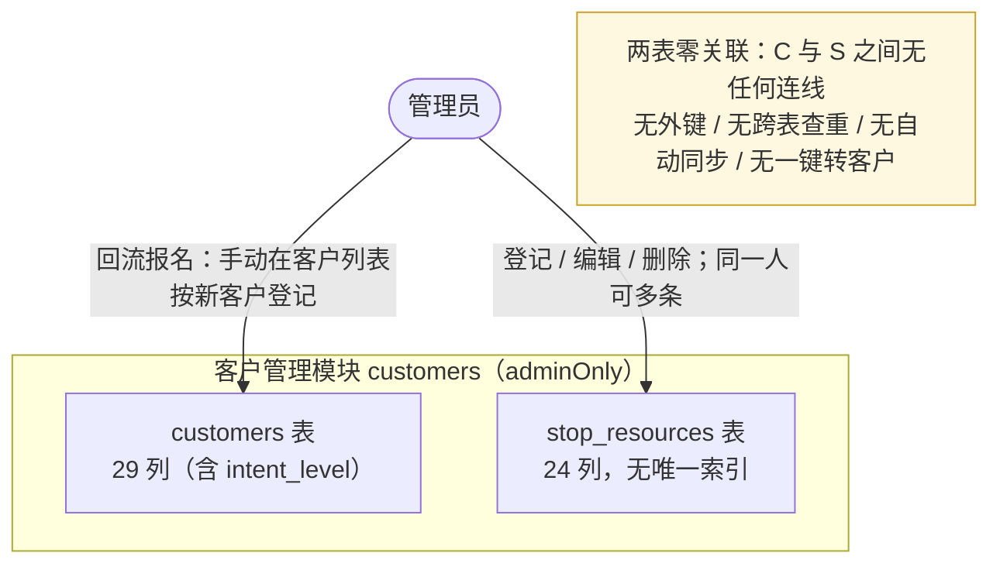
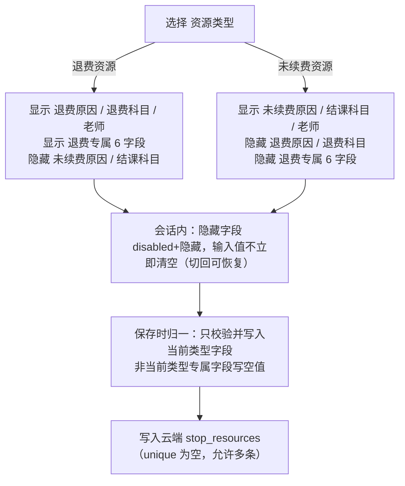
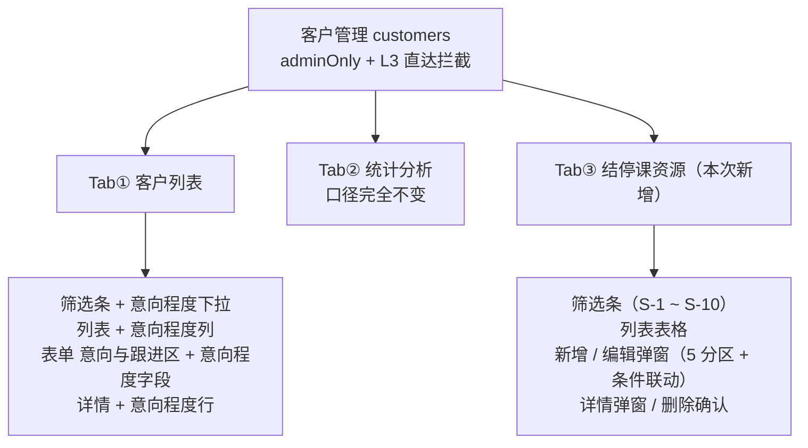

# PRD v4（增量）— 客户管理：意向程度 + 结停课资源子版块

| 项目 | 内容 |
|---|---|
| 版本 | **v4.0**（首次发布） |
| 文档性质 | **增量 PRD**：只写本次新增/变更，不重写 `docs/PRD-v2.md` / `docs/PRD-v3-exam-ym.md` / `docs/ARCH-v2.md` 的任何结论 |
| 上线状态 | 教务平台已上线；本次按 R4 **先本地实现 + 全量测试**，生产库加列/建表与发布上线待用户后续确认 |
| 关联文档 | `docs/PRD-v2.md`（§2.1 权限矩阵、§3.4 客户管理、§6.1 统计口径）、`docs/ARCH-v2.md`（§2.3 表清单）、`docs/ddl-v2.sql`（§④ customers 28 列 + RLS/GRANT/COMMENT）、`docs/PRD-v3-exam-ym.md`（增量文档结构参考） |
| 现有代码契约 | `js/module-customers.js`（825 行，2 Tab）、`js/db.js`（7 表 `define`）、`js/perm.js`（`assertWrite` / `denied`）、`js/ui-kit.js`（枚举 + 表单件） |
| 命名规范 | 云端列 snake_case；前端内存字段同列名；表名复数小写 |
| 数据口径 | 纯云端一份、多人共享（沿用 v2，不做本地模式） |
| 语言 | 简体中文 |

---

## 0. 本文定位与「口径更新」（追加说明，不改写原结论）

本次是全新需求，**与 v3「考试成绩年月」改造无任何关系**。相对 `PRD-v2` 的既有结论，以下为**增量追加**（原文字不改、不作废）：

| 既有结论位置 | 原结论 | v4 追加（增量） |
|---|---|---|
| `PRD-v2 §3.4` / `§5` | 客户管理 2 个 Tab：①客户列表 ②统计分析 | 追加 **Tab③ 结停课资源**；Tab② 统计口径**完全不变** |
| `ddl-v2.sql §④` / `ARCH-v2 §2.3` | `customers` 表 28 列 | 追加 **1 列** `intent_level`（28 → 29 列）；既有 28 列名/类型/约束零改动 |
| `js/db.js` 注册 7 张表 | students / classes / class_members / customers / daily_tasks / contract_prices / contracts | 追加第 **8 张表** `stop_resources`（`unique: []`，不建唯一索引） |
| `PRD-v2 §2.1` 权限矩阵 | 客户管理 adminOnly | **不变**；新子版块归属同一模块，不新增模块 id、不新增导航项 |
| `PRD-v2 §3.4 硬规则` | 客户与学生零关联 | **不变并加强**：结停课资源与客户列表同样零关联 |

> **不覆盖声明**：本文档所有「口径更新」以上表形式追加；`PRD-v2` / `ARCH-v2` / `ddl-v2.sql` 原文一字不改。DDL 脚本由架构/工程侧新建文件（建议 `docs/ddl-v4-customer-intent-stopres.sql`），**不写入 `ddl-v2.sql`**，且按 R4 **只写不执行**。

---

## 1. 产品目标与范围

**一句话：** 让管理员能标记客户「意向程度」并按其筛选，同时把「退费 / 结课未续费」这类结停课资源独立登记、独立查询，与客户列表彻底隔离。

三个正交目标：

1. **意向可分级**：客户信息新增必填「意向程度」（低/中/高），列表/详情/筛选都可见，存量数据不回填、显示「未填写」。
2. **结停课资源独立可管**：新增独立子版块与独立数据表，覆盖用户列出的全部登记字段 + 退费专属 6 字段，支持完整增/删/查/改 + 按客户信息与月份筛选。
3. **零串味**：两板块完全不联动、不查重、不建外键；同一人可在结停课资源里出现多条，回流报名由人工在客户列表重新登记。

### 1.1 本次明确不做（范围红线）

| # | 不做 | 说明 |
|---|---|---|
| N-1 | **统计分析 Tab② 口径不变** | 不新增意向程度分布、结停课资源统计、退费金额汇总等任何 KPI 或分类表；`customerStats` 纯函数不改签名、不改口径 |
| N-2 | 不改动成绩 / 合同 / 学生 / 班级 / 日常工作 / 账号管理等其他模块 | 含成绩 26 列导出契约、v3 考试年月排序，均不受影响 |
| N-3 | 不改 `customers` 既有 28 列的值、类型、索引、RLS、GRANT、COMMENT | 仅 `ADD COLUMN` 追加 1 列；既有行不执行任何 `UPDATE` 回填 |
| N-4 | 两板块不做任何联动 | 不自动同步、不跨表查重、不加「一键转新客户」按钮、不建外键、不建视图（R2 硬性裁决） |
| N-5 | 不做枚举化教师名单 / 科目下拉 | 科目与老师均自由文本手填（R3 硬性裁决） |
| N-6 | 不新增模块、不新增导航项、不改权限矩阵 | Tab③ 属 `customers` 模块内部 |
| N-7 | 不执行生产 DDL、不发布上线 | R4 硬性裁决；DDL 只落脚本 |
| N-8 | 不做结停课资源 CSV/Excel 导出、不做消息提醒、不做附件上传 | 列 P2，本次不实现 |

---

## 2. 已确认的硬性裁决（R1–R4，不再讨论、不列为 OQ）

| # | 裁决 | 落地要点 |
|---|---|---|
| **R1** | 存量客户无意向程度值 → 历史显示「**未填写**」，**不回填、不改历史数据**；仅**新增/编辑时强制必选**；筛选下拉保留「未填写」选项 | 云端列 `NOT NULL DEFAULT ''`（存量行自动取 `''`，无 UPDATE）；前端渲染 chip「未填写」；`validate` 在提交时强制校验 |
| **R2** | 两板块**完全不联动**：不自动同步、不跨表查重、不加「一键转新客户」、不建外键；回流时用户在客户列表**手动按新客户登记**；允许同一人多次出现在结停课资源里 | 新表 `unique: []`、**不建任何唯一索引**、不做任何重复提示（连软提示也不做，避免与「不查重」产生歧义）；两表零 JOIN |
| **R3** | 科目与老师**都手填**（自由文本），不做下拉枚举、不维护教师名单 | 单文本框，多值用「、」或「,」分隔，**原样存字符串**、不拆分、不做结构化统计 |
| **R4** | 本次**先本地实现 + 全量测试**；生产库加列/建表与发布上线待用户后续确认；**DDL 只写脚本不执行** | 本地测试用可编排的假云端（复用 `tools/smoke-db.js` 模式，表清单需追加新表）；不得连生产库、不得执行任何 DDL |

> **R1 的一处必然结果（需知悉，非歧义）**：编辑一条存量「未填写」客户时，因「编辑时强制必选」，用户必须选一个意向程度才能保存，该行 `intent_level` 会由 `''` 变为具体值。这属于「用户主动编辑写入」，**不算 R1 禁止的批量回填**。

---

## 3. 用户故事（管理员视角）

| # | 故事 |
|---|---|
| US-1 | As 管理员，我要给新客户标记低/中/高意向程度并被强制必选，这样跟进优先级能一眼看清。 |
| US-2 | As 管理员，我要按意向程度筛选客户、并且能把历史「未填写」的客户单独筛出来补录，这样不会漏掉存量数据。 |
| US-3 | As 管理员，我要在客户管理里直接切到「结停课资源」登记退费或结课未续费的学生，不用跑去别的模块，也不用担心污染客户列表。 |
| US-4 | As 管理员，我要登记退费资源时只看到退费相关字段、登记未续费资源时只看到结课相关字段，隐藏的字段不用来回清、也不会误存脏值。 |
| US-5 | As 管理员，我要同一学生在不同时间分别登记退费和结课未续费两条记录，系统不去重、不拦我。 |
| US-6 | As 管理员，我要按姓名/电话/学校/年级/资源类型/回流意向以及「结停课月份」筛选结停课资源，不用精确到具体哪一天。 |
| US-7 | As 管理员，结停课资源里的学生回来报名时，我要自己在客户列表按新客户重新登记一条，系统不自动帮我搬数据。 |

---

## 4. 权限口径

| 项 | 口径 |
|---|---|
| 模块可见性 | **沿用 `customers` 模块 `adminOnly: true`**。Tab③ 是该模块内的第 3 个 Tab，**不新增 `registerModule`、不新增模块 id、不新增导航项**，因此导航隐藏与 L3 直达拦截（`App.Perm.denied(this)` → `forbiddenCard(this)`）自动覆盖 Tab③ |
| 写入守卫 `module` 归属 | 新表注册为 `App.DB.define('stop_resources', { module: 'customers', unique: [], label: '结停课资源' })`——**`module` 显式指向已注册的 `'customers'`**，使 `App.Perm.assertWrite('customers')` 命中已注册模块的 `adminOnly` 判定；不要自造未注册的 module id（虽 `perm.js` 有「未注册 id 兜底 adminOnly」的兜底分支，但显式归属更可审计） |
| 页面层双保险 | 新增/编辑弹窗与删除确认首行沿用现有写法 `if (App.Perm && !App.Perm.assertWrite('customers')) return;`；DB 网关 `insert/update/remove` 内已有同一道守卫 |
| 账号状态 | `canEdit()` 仍生效：`readonly` / `blocked` / `deleted` / 未登录一律拒绝写入（由 `assertWrite` 统一处理，本次不改 `perm.js`） |
| 非管理员 | 整个「客户管理」模块（含 Tab③）不可见、不可直达、不可写，与 `PRD-v2 §2.1` 完全一致 |
| 云端 RLS（DDL 脚本内容，不执行） | 复制 `customers` 的 4 条 policy：`stop_resources_read_team`（`is_viewer()` 的 SELECT）、`insert_team` / `update_team` / `delete_team`（`is_editor()`）；两行 GRANT（`anon`=SELECT，`authenticated`=SELECT/INSERT/UPDATE/DELETE）+ `GRANT USAGE, SELECT ON SEQUENCE stop_resources_id_seq TO authenticated`（漏则 insert 报 42501）；`COMMENT` 标注「结停课资源；与客户表零关联、不建唯一索引、同一人可多条」 |

---

## 5. 字段清单（重点）

### 5.1 (a) `customers` 新增字段「意向程度」（1 列，28 → 29 列）

| 列名 | 中文标签 | 类型 | 必填 | 枚举 | 默认值 / 存量处理 | 校验规则 | 说明 |
|---|---|---|---|---|---|---|---|
| `intent_level` | 意向程度 | `text` | **新增与编辑提交时强制必选**（R1） | `低` / `中` / `高`（中文枚举值，与 `RESOURCE_TYPES` 等既有枚举风格一致） | 云端 `NOT NULL DEFAULT ''`；**存量 28 列行自动取 `''`，不执行任何 UPDATE 回填**；前端把 `''` / `null` / 非法值统一渲染为灰色 chip「**未填写**」 | `INTENT_LEVELS.indexOf(tstr(f.intent_level)) >= 0`，否则红字「请选择意向程度」并聚焦该下拉；`''` 与非法值视为未选择 | 新增枚举常量 `UI.INTENT_LEVELS = ['低','中','高']`；**不参与 Tab② 统计**；不进成绩 26 列导出 |

**衍生 UI 落点（同一字段的展示面）**

| 位置 | 规则 |
|---|---|
| 客户列表列 | 在「意向产品」列后新增「意向程度」列；低/中/高用 chip（低=蓝 `ch-blue`、中=琥珀 `ch-amber`、高=红 `ch-red`），空值=灰 chip「未填写」；支持表头排序 |
| 客户表单 | 「意向与跟进」分区**第一个字段**（在「意向产品」之前），label「意向程度 *」，下拉占位「（请选择）」，编辑存量时回显「（请选择）」且必须选择后才能保存 |
| 客户详情 | 「意向与跟进」分区首行新增「意向程度」，空显示「未填写」 |
| 客户列表筛选 | 新增「意向程度」下拉：`（全部）` / `低` / `中` / `高` / `未填写`。`未填写` 用哨兵值 `__blank__`，命中 `intent_level` 为 `''` / `null` / 非枚举值的所有行（需在 `CustomersCore.filterRows` 里特判，不能混入普通等值循环） |

### 5.2 (b) 新表 `stop_resources`「结停课资源」— 业务字段（18 列）

> 表名 **`stop_resources`**（复数小写 snake_case），中文标签「结停课资源」，`unique: []` **不建唯一索引**。
> **⚠ 命名冲突提示**：本表 `resource_type` 与客户表 `resource_type` 是**同名但不同枚举**的两列（客户表为 转介绍/上门咨询/… ，本表为 退费资源/未续费资源）。必须新定义 `UI.STOP_RESOURCE_TYPES`，**禁止复用 `UI.RESOURCE_TYPES`**；同理筛选逻辑不得直接套用 `CustomersCore.filterRows` 的通用枚举循环。

| 分区 | 列名 | 中文标签 | 类型 | 必填 | 条件显示规则 | 校验规则 | 枚举值 |
|---|---|---|---|---|---|---|---|
| 基础信息 | `stu_name` | 学生姓名 | `text` | 是 | 两类都显示 | 非空，1–20 字 | — |
| 基础信息 | `phone` | 联系电话 | `text` | 是 | 两类都显示 | `/^1\d{10}$/`（与客户表同口径；若机构需登记座机另议） | — |
| 基础信息 | `grade` | 年级 | `text`（下拉） | 是 | 两类都显示 | 必须命中 `UI.GRADES` 12 项 | `UI.GRADES` |
| 基础信息 | `school` | 学校 | `text` | 是 | 两类都显示 | 非空，1–40 字 | — |
| 基础信息 | `stop_date` | 结停课时间 | 日期（`timestamptz`，`type="date"` 录入） | 是 | 两类都显示 | 合法 `YYYY-MM-DD`；**必须按本地日期**读写与归属月份（见 §8） | — |
| 基础信息 | `resource_type` | 资源类型 | `text`（下拉） | 是 | 两类都显示，且是**条件联动开关** | 必须命中 `UI.STOP_RESOURCE_TYPES` | `退费资源` / `未续费资源` |
| 原因与科目 | `refund_reason` | 退费原因 | `text`（多行） | 条件必填 | **仅退费资源**显示 | 非空，≤500 字 | — |
| 原因与科目 | `nonrenew_reason` | 未续费原因 | `text`（多行） | 条件必填 | **仅未续费资源**显示 | 非空，≤500 字 | — |
| 原因与科目 | `refund_subjects` | 退费科目 | `text` | 条件必填 | **仅退费资源**显示 | 自由文本，≤200 字；多值「、」或「,」分隔，不拆分不枚举（R3） | — |
| 原因与科目 | `end_subjects` | 结课科目 | `text` | 条件必填 | **仅未续费资源**显示 | 同上（R3） | — |
| 原因与科目 | `teacher` | 老师 | `text` | 是 | 两类都显示（**共用一列**，见 OQ-5） | 自由文本，≤200 字；多值同上（R3） | — |
| 回流跟进 | `followup_intent` | 回流可跟进意向 | `text`（下拉） | **是（两类共同必填）** | 两类都显示 | 必须命中 `UI.INTENT_LEVELS` | `低` / `中` / `高` |
| 退费办理 | `refund_amount` | 退费金额 | `numeric(12,2)` | 条件必填 | **仅退费资源**显示 | > 0 且 ≤ 999999，2 位小数（与客户表 `paid_amount` 同口径，见 OQ-2） | — |
| 退费办理 | `parent_confirmed` | 家长是否确认退费 | `boolean` | 默认 `false`（有默认值即视为已填） | **仅退费资源**显示 | `true` / `false` | 是 / 否 |
| 退费办理 | `refund_applied` | 是否提交退费申请 | `boolean` | 默认 `false` | **仅退费资源**显示，并驱动 `refund_apply_at` 联动 | `true` / `false` | 是 / 否 |
| 退费办理 | `refund_apply_at` | 退费提交时间 | 日期（`timestamptz`，`type="date"`） | 条件必填 | **仅退费资源**且 `refund_applied = 是` 时启用 | 合法日期；「否」时禁用并自动置空（见 §7） | — |
| 退费办理 | `refund_arrived` | 退费是否到账 | `boolean` | 默认 `false` | **仅退费资源**显示，并驱动 `refund_arrived_at` 联动 | `true` / `false` | 是 / 否 |
| 退费办理 | `refund_arrived_at` | 退费到账时间 | 日期（`timestamptz`，`type="date"`） | 条件必填 | **仅退费资源**且 `refund_arrived = 是` 时启用 | 合法日期；「否」时禁用并自动置空；不早于提交时间仅软提示（见 OQ-3） | — |

**用户原始需求字段覆盖核对（逐字）**：学生姓名 ✓ / 联系电话 ✓ / 年级 ✓ / 学校 ✓ / 结停课时间（精确到年月日）✓ / 资源类型（退费资源、未续费资源）✓ / 退费原因、未续费原因 ✓ / 退费科目、结课科目 ✓ / 老师 ✓ / 回流可跟进意向（低/中/高，两类共同必填）✓ / 退费金额 ✓ / 家长是否确认退费 ✓ / 是否提交退费申请 ✓ / 退费提交时间 ✓ / 退费是否到账 ✓ / 退费到账时间 ✓。**18 个业务字段全部覆盖，无遗漏**。

### 5.3 (b) 新表 `stop_resources` — 系统字段（6 列）

> 与 `ddl-v2.sql` 的 7 张表**完全同款**（`db.js` 的 `pick()` 会剥离 `id` / `owner_id` / `owner_name`，前端不写）。

| 列名 | 中文标签 | 类型 | 必填 | 校验 / 写入规则 | 说明 |
|---|---|---|---|---|---|
| `id` | 主键 | `bigint GENERATED ALWAYS AS IDENTITY PRIMARY KEY` | 自动 | 只读，前端不写 | 删除按 `id` |
| `owner_id` | 创建者 id | `text NOT NULL DEFAULT auth.uid()` | 自动 | 只读，前端不写 | 与 `score_records` / `customers` 同款 |
| `owner_name` | 创建者名称 | `text` | 自动 | 只读，前端不写 | 同上 |
| `last_editor` | 最后修改人 | `text NOT NULL DEFAULT ''` | 自动 | `db.js` 的 `insert/update` 自动 `editorName()` 写入 | 7 表都有此列，已核对 |
| `created_at` | 登记（录入）时间 | `timestamptz NOT NULL DEFAULT now()` | 自动 | **由客户端写入并作为重放幂等戳**（`db.js insert` 现有机制）；`update` 永不回写；**只读展示** | 与 `customers.created_at` 同语义；**不是**筛选依据（筛选按 `stop_date`） |
| `updated_at` | 最后修改时间 | `timestamptz NOT NULL DEFAULT now()` | 自动 | `insert/update` 自动刷新 | 同上 |

**合计 24 列**（18 业务 + 6 系统）。

> **关于需求里的「owner」**：v4 任务书列举的系统字段含 `owner`，而本库 `ddl-v2.sql` / `score_records` 的既有风格是把创建者拆成 **`owner_id`（`DEFAULT auth.uid()`）+ `owner_name` 两列**（见 §5.3 第 2、3 行），二者合起来即需求所指的 `owner`。为与 7 张既有表严格同款，本表沿用拆分写法，**不自创单列 `owner`**；`db.js` 的 `pick()` 会同时剥离这两列，前端不写、只读展示时可合并呈现。

### 5.4 枚举常量清单（`js/ui-kit.js` 新增，导出到 `UI`）

| 常量 | 值 | 用于 |
|---|---|---|
| `UI.INTENT_LEVELS` | `['低','中','高']` | `customers.intent_level` 与 `stop_resources.followup_intent` **共用同一常量**（值集相同、语义不同、两表不联动） |
| `UI.STOP_RESOURCE_TYPES` | `['退费资源','未续费资源']` | `stop_resources.resource_type`。**不可复用 `UI.RESOURCE_TYPES`** |

> 现有 `UI.PRIORITY` 为 `{value:'high'|'mid'|'low', label:'高'|'中'|'低'}`（英文值、高→低序），**与本次中文枚举值不同、顺序相反，不复用、不改名**；chip 颜色可借鉴其 `ch-red/ch-amber/ch-blue` 映射。

### 5.5 数据表建议（产品视角的实体与关系，不写 SQL）

| 实体 | 关键字段 | 唯一键 | 关联关系 |
|---|---|---|---|
| `customers`（改） | 既有 28 列 + `intent_level` | 无（`unique: []`，同手机号允许多次咨询） | 与 `students` 零关联（v2 既有）；与 `stop_resources` **零关联**（R2） |
| `stop_resources`（新） | 18 业务列 + 6 系统列 | **无**（`unique: []`，不建唯一索引、不建外键） | 与 `customers` 无任何 JOIN / 外键 / 查重；同一人可多条 |

> 图中 `customers` 与 `stop_resources` 之间**刻意不画任何连线**，即 R2「两板块完全不联动」；二者唯一的联系是管理员的**人工**操作（回流时手动在客户列表新建一行）。

**DDL 脚本应包含的产品级内容（只写脚本、不执行，R4）**：① `ALTER TABLE customers ADD COLUMN IF NOT EXISTS intent_level text NOT NULL DEFAULT ''`（非破坏性、不回填存量）；② `CREATE TABLE IF NOT EXISTS stop_resources (...)` 24 列 + `id` 自增主键，**不建任何 UNIQUE / INDEX / FOREIGN KEY**；③ 4 条 RLS policy（`DROP POLICY IF EXISTS` 再 `CREATE`，幂等）；④ 两行 GRANT + 序列 USAGE；⑤ `COMMENT ON TABLE`；⑥ 每个对象封成独立可单条执行的语句（沿用 `ddl-v2.sql` 的 `DO $ddl$` 约定）。**以上为内容要求，本文档不提供 SQL 文本**，由架构师在 `ARCH-v4` / DDL 脚本中给出。

---

## 6. 业务规则

| # | 规则 | 可验收要点 |
|---|---|---|
| B-1 | **两表隔离**：`stop_resources` 与 `customers` 独立表单、独立数据、独立表；不共享任何字段、不做跨表查询 | 新增结停课资源后客户列表行数不变；反之亦然 |
| B-2 | **不联动**：无自动同步、无跨表查重、无「一键转新客户」按钮、无外键、无视图 | 页面上不存在任何跨板块跳转/搬运按钮；DOM 无相关入口 |
| B-3 | **允许多条**：同一学生（同姓名/同电话）可在不同时间节点出现多条退费或多条结课未续费记录；**不去重、不唯一约束、不做重复软提示** | 连续登记 2 条完全相同基础信息的记录 → 2 行都在、无提示 |
| B-4 | **回流手动登记**：结停课资源回来报名时，管理员在 Tab① 客户列表**手动按新客户**新建一条；系统不搬运、不预填、不关联 | 回流登记后结停课资源原记录仍在、不被标记/改写 |
| B-5 | **不建唯一索引**：`App.DB.define` 的 `unique: []`；云端无 UNIQUE 约束 | 与 `customers` / `daily_tasks` 同款；`findBy` 返回 `null`（无唯一键可命中），不用于本表 |
| B-6 | **条件必填按类型判定**：隐藏字段不参与校验，只校验当前选中类型的字段 | 见 §7 |
| B-7 | **系统字段自动**：`created_at / updated_at / last_editor / owner_*` 由 `db.js` 与云端维护，表单不出现、不手填（详情只读展示） | 与客户模块现有行为一致 |
| B-8 | **Tab② 统计口径不变**：`customerStats` 不接收、不统计 `intent_level` 或任何 `stop_resources` 数据 | 改造前后 Tab② 的 4 KPI + 3 转化率 + 分类分析表逐字一致 |

---

## 7. 条件联动规则明细（含隐藏字段值处理）

### 7.1 资源类型 → 字段显示矩阵

| 字段组 | `退费资源` | `未续费资源` |
|---|---|---|
| 基础信息 6 项（`stu_name/phone/grade/school/stop_date/resource_type`） | 显示 | 显示 |
| `refund_reason`、`refund_subjects` | **显示 + 必填** | **隐藏** |
| `nonrenew_reason`、`end_subjects` | **隐藏** | **显示 + 必填** |
| `teacher`（共用） | 显示 + 必填 | 显示 + 必填 |
| `followup_intent`（共用） | 显示 + 必填 | 显示 + 必填 |
| 退费专属 6 项（`refund_amount` / `parent_confirmed` / `refund_applied` / `refund_apply_at` / `refund_arrived` / `refund_arrived_at`） | **显示**（布尔默认否；两个时间按布尔联动） | **隐藏** |

### 7.2 隐藏时字段值如何处理（**已拍板**）

| 层面 | 规则 | 理由 |
|---|---|---|
| **编辑会话内（DOM）** | 切换 `resource_type` 时，被隐藏字段只做 `hidden + disabled`，**不立即清空输入框的值**；用户切回原类型时输入恢复 | 防止误点下拉导致已填内容丢失 |
| **保存时（校验与归一）** | 按**当前选中的** `resource_type` 只校验、只写入该类型的字段；**非当前类型的专属字段一律写空值**：`text → ''`、`boolean → false`、`numeric → null`、`date → null` | 保证库中不出现「未续费资源却带着退费金额」这类跨类型脏值；后续改类型也不会读到陈旧值 |
| **共用字段** | `teacher` / `followup_intent` / 基础信息 6 项在切换类型时**始终保留** | 语义与类型无关 |
| **编辑既有记录回显** | 只回显该行当前类型的字段值（其余本就是空值），不显示另一类型的空字段 | 与「保存时归一」自洽 |
| **对比既有范式** | 与 `module-customers.js` 中「是否上门=否 → `visit_at` 自动置空」「是否缴费=否 → `paid_at/paid_amount` 自动置空」的联动范式一致 | 复用团队既有习惯，降低实现成本 |

### 7.3 布尔 → 时间联动（退费专属）

| 触发 | 行为 |
|---|---|
| `refund_applied = 否`（或切换为否） | `refund_apply_at` 禁用并自动置空；保存时写 `null`；不为该时间字段报必填错误 |
| `refund_applied = 是` | `refund_apply_at` 启用且**条件必填**，格式须为合法 `YYYY-MM-DD` |
| `refund_arrived = 否`（或切换为否） | `refund_arrived_at` 禁用并自动置空；保存时写 `null` |
| `refund_arrived = 是` | `refund_arrived_at` 启用且**条件必填** |
| 两个时间都有值时 | 若 `refund_arrived_at < refund_apply_at`，**黄条软提示「到账时间早于提交时间，请确认」但不拦截保存**（见 OQ-3） |

### 7.4 空态与异常

| 场景 | 表现 |
|---|---|
| 结停课资源表无任何数据 | 卡片空态「还没有结停课资源。点右上『新增结停课资源』录入第一条。」（复用 `UI.empty`） |
| 筛选无结果 | 「没有符合条件的结停课资源」+「清空筛选」按钮 |
| 新增/编辑校验失败 | 表单底部红字显示第一条错误文案并 `focus()` 到对应控件（现有 `openForm` 范式） |
| 云端写入失败 | `Toast('保存失败：…')`，弹窗不关闭；`db.js` 入重放队列（现有机制） |
| R4 阶段云端表尚未创建 | **本地测试必须走假云端**；前端 `fetchTable` 对新表拉取失败时不得阻断 `customers` 与其余 7 张表的刷新（见 §13 冲突点 C-1） |
| 删除 | `UI.confirmDanger` 二次确认「确定删除结停课资源 <b>姓名</b>（资源类型 · 结停课时间）吗？删除后不可恢复。」；**删除不影响客户列表任何行** |

---

## 8. 筛选口径

### 8.1 Tab③「结停课资源」筛选（按客户信息 + 时间）

> 「根据客户信息进行筛选」= 按**结停课资源记录自身的客户信息字段**筛选（ stu_name / phone / grade / school / resource_type / followup_intent / 退费三态），**不跨到 `customers` 表**（R2）。

| # | 筛选项 | 控件 | 值域 | 作用字段 | 交互 / 优先级 |
|---|---|---|---|---|---|
| S-1 | 关键字 | 文本框 | 姓名 / 电话模糊包含（不区分大小写） | `stu_name`、`phone` | `U.onCommitted` 绑定（输入法安全）；P0 |
| S-2 | 年级 | 下拉 | `UI.GRADES` 12 项 + `（全部）` | `grade` 精确等值 | `change` 即时重渲染；P0 |
| S-3 | 学校 | 文本框 | 自由文本模糊包含 | `school` | `U.onCommitted`；**不做下拉枚举**（学校为自由文本）；P0 |
| S-4 | 资源类型 | 下拉 | `退费资源` / `未续费资源` + `（全部）` | `resource_type` 精确等值 | `change`；P0 |
| S-5 | 回流可跟进意向 | 下拉 | `低` / `中` / `高` + `（全部）` | `followup_intent` 精确等值 | `change`；P0 |
| S-6 | 家长是否确认退费 | 三态下拉 | 全部 / 是 / 否 | `parent_confirmed` | `change`；P0（仅对退费资源行有意义，未续费行该列为 `false`） |
| S-7 | 是否提交退费申请 | 三态下拉 | 全部 / 是 / 否 | `refund_applied` | `change`；P0 |
| S-8 | 退费是否到账 | 三态下拉 | 全部 / 是 / 否 | `refund_arrived` | `change`；P0 |
| **S-9** | **结停课月份** | **两个 `type="month"`（起月 / 止月，均可选）** | `YYYY-MM` | **`stop_date` 的本地年月** | 精确到月份、**不提供具体日期选择**；起止可只填一端；起 > 止 时自动交换；P0 |
| S-10 | 清空筛选 | 按钮 | — | 全部复位 | 与现有 `resetFilters()` 同款；P0 |

**S-9 月份归属口径（重要，防跨月错判）**：`stop_date` 以 `type="date"` 录入、`UI.fromDateInput()` 转 ISO 存储（本地 00:00 → UTC 可能落到前一天）。因此月份筛选与展示**必须用 `new Date(ts)` 的 `getFullYear()` / `getMonth()+1` 取本地 `YYYY-MM`**，**禁止**对 ISO 字符串直接 `slice(0,7)`（例：本地 `2026-03-01 00:00` 在 UTC+8 存为 `2026-02-28T16:00Z`，`slice(0,7)` 会错得 `2026-02`）。

### 8.2 Tab①「客户列表」筛选增量

| 增量 | 规则 |
|---|---|
| 新增「意向程度」下拉 | `（全部）` / `低` / `中` / `高` / `未填写`（R1）。`未填写` 哨兵 `__blank__` 命中 `intent_level` 为 `''` / `null` / 非枚举值的所有行 |
| 既有 9 个筛选项 | `kw / resource_type / grade / intended_product / visited / paid / yellow_form / referral_claimed / period(from,to)` **完全不变**，行为与改造前逐字一致 |
| 周期筛选 | 仍按既有 `created_at` 口径，**不受本次影响**；不与意向程度筛选耦合 |

### 8.3 筛选组合

- 所有筛选项为 **AND** 关系；同一筛选项单值。
- 筛选在纯函数层实现（建议新增 `App.StopResCore = { validate, filterRows }`，与 `App.CustomersCore` 同款：不读 `App.DB` / 不碰 DOM / 数据走参数），便于 Node 全量测试（R4）。
- 筛选后列表排序见 OQ-4；表头可点排序沿用 `UI.sortHeader` / `UI.bindSort`。

---

## 9. UI 设计（文字描述，复用现有卡片式视觉，不重新设计风格）

### 9.1 Tab 结构

| 项 | 规则 |
|---|---|
| Tab 追加位置 | `TABS` 数组**末尾追加** `{ id: 'stop', name: '③ 结停课资源' }`，位于 ②统计分析之后；`state.tab` 新增取值 `'stop'`；`render()` 由二分支改为三分支；`bind()` 中 `stats` 的 `return` 提前分支需相应调整，避免 Tab③ 的绑定被跳过 |
| 模块注册 | **不新增** `registerModule`；仅改 `module-customers.js` 内部 TABS / state / render / bind |
| 视觉 | 沿用 `.card` / `.toolbar` / `.tbl-wrap` / `.chip` / `.form-grid` / `UI.formModal` / `UI.confirmDanger`，不新增配色与组件 |

### 9.2 客户表单 / 列表 / 详情增量

| 位置 | 增量 |
|---|---|
| `openForm()` 「意向与跟进」分区 | **首位**插入「意向程度 *」下拉（`UI.INTENT_LEVELS` + 占位「（请选择）」）；`submit()` 的 form 对象新增 `intent_level: q('intent_level')`；`validate()` 新增必选校验 |
| `renderList()` 筛选工具条 | 新增 `fWrap('intent_level', '意向程度', ...)`，含「未填写」选项 |
| `renderList()` 表格列 | 「意向产品」列后新增「意向程度」列（chip）；`cols` 增加可排序项 |
| `openDetail()` 「意向与跟进」分区 | 首行新增「意向程度」 |
| `resetFilters()` / `state.filters` | 新增 `intent_level: ''` |

### 9.3 Tab③「结停课资源」列表

| 项 | 规则 |
|---|---|
| 筛选条 | 单张 `.card` 内 `.toolbar`：关键字 / 年级 / 学校 / 资源类型 / 回流意向 / 三个退费三态 / 起月 / 止月 / 清空筛选 / 右侧「新增结停课资源」主按钮 / 区间文案 |
| 表格列（10 列） | 姓名 / 联系电话 / 年级 / 学校 / **结停课时间（YYYY-MM-DD）** / 资源类型（chip） / 回流可跟进意向（chip） / 退费金额（仅退费资源显示金额，未续费显示「—」） / 登记时间 / 操作（详情 · 编辑 · 删除） |
| 退费进度 | 不上独立列；在「详情」内完整展示 6 个退费专属字段，避免列表过宽 |
| 默认排序 | 见 OQ-4（推荐 `stop_date` 倒序 → `created_at` 倒序 → `id` 倒序兜底） |
| 同一人多条 | 逐行平铺，不去重、不分组、不折叠（B-3） |

### 9.4 新增 / 编辑弹窗（5 分区 + 条件联动）

| 分区 | 字段 |
|---|---|
| ① 基础信息 | 学生姓名* / 联系电话* / 年级* / 学校* / 结停课时间*（date） / 资源类型*（联动开关） |
| ② 原因与科目（条件） | 退费原因 + 退费科目 **或** 未续费原因 + 结课科目；老师（共用） |
| ③ 退费办理（条件，仅退费资源） | 退费金额* / 家长是否确认退费 / 是否提交退费申请 / 退费提交时间（布尔联动） / 退费是否到账 / 退费到账时间（布尔联动） |
| ④ 回流跟进 | 回流可跟进意向*（低/中/高） |
| ⑤ 系统信息（仅编辑时只读） | 登记时间 / 最后修改 / 最后修改人 |

- 条件显示/隐藏与隐藏值处理严格按 §7；`UI.formModal` 提交，沿用「校验失败聚焦 + Toast + 成功后云端回读再关窗」范式。
- **无任何**「转为客户」「同步到客户列表」「查重」按钮或提示（R2）。
- 多科目/多老师输入框 placeholder：「多个科目用、或逗号分隔，如：数学、物理」；不做枚举、不拆分（R3）。

### 9.5 详情 / 编辑 / 删除

| 操作 | 规则 |
|---|---|
| 详情 | 复用 `openDetail()` 的 `sec()/tr()` 结构，分区展示当前类型字段 + 系统信息；另一类型专属字段**整节不渲染**；空值显示「—」 |
| 编辑 | 同新增弹窗，回显当前类型字段；`created_at` 只读展示 |
| 删除 | `UI.confirmDanger` 二次确认，成功后 `Toast('结停课资源已删除')`；不影响客户列表 |

---

## 10. 需求池（P0 必须 / P1 应该 / P2 可选，每条附验收标准）

### P0（缺一不可上线）

| # | 需求 | 验收标准（详见 §12） |
|---|---|---|
| P0-1 | `customers` 新增 `intent_level` 列（DDL 脚本，非破坏性、不回填存量） | V-A1、V-A6 |
| P0-2 | 客户表单/列表/详情新增意向程度，新增与编辑提交时强制必选 | V-A2、V-A3、V-A4 |
| P0-3 | 客户列表新增意向程度筛选，含「未填写」 | V-A5 |
| P0-4 | 新增表 `stop_resources`（24 列、`unique: []`、RLS 4 条 + GRANT + 序列 USAGE + COMMENT，DDL 只写不执行） | V-G1、V-B1 |
| P0-5 | `js/db.js` 注册第 8 张表，`module: 'customers'`；`App.StopResCore` 纯函数外露 | V-B1、V-F2 |
| P0-6 | `ui-kit.js` 新增 `INTENT_LEVELS` / `STOP_RESOURCE_TYPES` 两个枚举常量并导出 | V-A2、V-B2 |
| P0-7 | 客户管理页追加 Tab③「结停课资源」，三分支 render/bind 正确 | V-B3 |
| P0-8 | 结停课资源列表 + 10 筛选项（含按 `stop_date` 本地 `YYYY-MM` 的月份筛选） | V-D1 ~ V-D5 |
| P0-9 | 结停课资源新增/编辑弹窗（5 分区 + 18 业务字段全覆盖） | V-B2、V-B4 |
| P0-10 | 条件联动：按资源类型显示/隐藏 + 保存时归一写空值 + 布尔→时间联动 | V-C1 ~ V-C5 |
| P0-11 | 详情 / 编辑回显 / 删除二次确认（含文案） | V-B5、V-B6、V-B7 |
| P0-12 | 完整 CRUD 走云端，`created_at/updated_at/last_editor` 自动；允许多条、无重复提示 | V-B8、V-E1 |
| P0-13 | 权限：沿用 adminOnly、L3 直达拦截、`assertWrite('customers')` 双保险 | V-F1 ~ V-F3 |
| P0-14 | Tab② 统计口径与其余模块零回归 | V-G2、V-G3 |
| P0-15 | 本地全量测试（假云端），不连生产库、不执行 DDL | V-G4 |

### P1（应该）

| # | 需求 | 验收标准 |
|---|---|---|
| P1-1 | 结停课资源列表表头点击排序（复用 `UI.sortHeader` / `UI.bindSort`） | V-D6 |
| P1-2 | 退费三态筛选在「未续费资源」行上的说明性 tooltip（避免用户困惑为何筛不出） | V-D7 |
| P1-3 | 表单内手机号格式即时软提示（不拦截，仅提示） | V-B9 |
| P1-4 | 结停课资源新增/编辑支持「保存并继续录入下一条」 | V-B10 |

### P2（可选，本次不实现）

| # | 需求 | 说明 |
|---|---|---|
| P2-1 | 结停课资源 CSV/Excel 导出 | 不影响成绩 26 列导出契约；需另定列结构 |
| P2-2 | 结停课资源统计卡（按类型/月份/回流意向汇总） | **不得并入 Tab②**（N-1），若做须新开 Tab④ 并另行评审 |
| P2-3 | 科目/老师结构化拆分并按科目统计 | 与 R3「都不做枚举、都手填」冲突，需用户明确改口径后才可做 |

---

## 11. 待确认问题（OQ，仅列 R1–R4 之外的真歧义，均附推荐答案；未裁决按推荐实现，不阻塞开工）

| # | 问题 | 选项 | **推荐** |
|---|---|---|---|
| **OQ-1** | **结停课时间是否允许历史补录 / 未来日期？** 用户未提下限与上限 | A 允许任意过去日期（历史补录），未来日期**黄条软提示不拦截**／ B 只允许不晚于今日，未来日期硬拦截／ C 完全不限制 | **A**。教务存在补录去年结停课、以及预排未来结课时间两类真实场景；软提示兼顾防误填与不阻断。校验：非法/空必拦，`> 今天` 仅提示 |
| **OQ-2** | **退费金额是否必填？边界？** 用户说「需填写」但未给「金额待定」场景 | A 退费资源下必填，`> 0 且 ≤ 999999`、2 位小数／ B 选填，允许空或 0（未核定） | **A**。与 `customers.paid_amount` 校验同口径，实现零成本；金额待定走「退费原因/备注」文字说明，避免 `0` 与「未填」语义混淆 |
| **OQ-3** | **时间字段联动约束**：两个时间是否只在布尔为「是」时必填？「到账时间不得早于提交时间」如何处置？ | A 条件必填 + 早于时软提示不拦截／ B 条件必填 + 早于时硬拦截／ C 两个时间始终必填 | **A**。与 `module-customers.js` 中 `visit_at`/`paid_at` 联动范式一致；现实中存在「先到账、后补申请」的补录情形，硬拦截会卡住真实数据 |
| **OQ-4** | **结停课资源列表默认排序** | A `stop_date` 倒序 → `created_at` 倒序 → `id` 倒序／ B `created_at` 倒序（与现有客户列表一致）／ C `stu_name` 中文序 | **A**。业务最关心「最近发生结停课的资源」；同日多条用登记时间 + id 兜底保证稳定不抖动 |
| **OQ-5** | **「原因 / 科目」是否按类型分列存储？「老师」是否两类共用一列？** 用户原文「退费原因 或 未续费原因」「退费科目、老师 或 结课科目、老师」可理解为动态标签的单列，也可理解为 4 个独立列 | A 分列存储（`refund_reason` / `nonrenew_reason` / `refund_subjects` / `end_subjects`），`teacher` 两类共用 1 列／ B 单列 + 动态标签（`reason` / `subjects`），切换类型时清空 | **A**（本文档 §5.2 已按 A 落地）。理由：数据语义不随 UI 标签漂移、无「改类型后旧原因被重新贴标签」风险、条件显示规则可逐列验收；代价是 4 个稀疏列，可接受 |
| **OQ-6** | **多科目 / 多老师的录入格式**：R3 只说「手填」，未定分隔符与是否拆分 | A 单文本框自由文本，「、」或「,」分隔，**原样存字符串、不拆分、不枚举、不进统计**／ B 拆成 jsonb 数组 | **A**。最贴合 R3「都手填、不做下拉枚举、不维护教师名单」；结构化会引入枚举/校验复杂度，且本次无任何按科目统计的需求 |

---

## 12. 验收清单（可测 Given / When / Then）

### A. 意向程度

- **V-A1** Given 生产库 `customers` 28 列、含存量行 When 应用 DDL 脚本 Then 变为 29 列且新增列 `intent_level text NOT NULL DEFAULT ''`；**所有存量行该列为 `''`**，且未执行任何 `UPDATE`；既有 28 列值、索引、RLS、GRANT、COMMENT 逐项不变
- **V-A2** Given 打开「新增客户」When 查看「意向与跟进」分区 Then 第一项为「意向程度 *」下拉，选项 `低/中/高` + 占位「（请选择）」；不选择直接提交 → 阻止保存、红字「请选择意向程度」、焦点落在该下拉
- **V-A3** Given 新增客户选「高」并保存 When 刷新页面 Then 云端该行 `intent_level='高'`，列表/详情/编辑回显均为「高」
- **V-A4** Given 一条存量「未填写」客户 When 打开编辑、只改电话后提交 Then 阻止保存并要求选择意向程度；选择「中」后保存成功，该行 `intent_level='中'`（属用户主动编辑，不算批量回填）
- **V-A5** Given 5 条客户（低/中/高各 1、未填写 2） When 分别选 `低` / `中` / `高` / `未填写` / `（全部）` Then 命中行数分别为 1 / 1 / 1 / 2 / 5；`未填写` 同时命中 `''`、`null` 与非法值行
- **V-A6** Given 非法值 `intent_level='高高'`（外部直写） When 打开列表与详情 Then 显示「未填写」或「异常」chip，不崩溃、不自动改写

### B. 结停课资源 CRUD

- **V-B1** Given 加载完成 When 检查 `App.DB.defs` Then 共 8 张表，新增 `stop_resources` 且 `unique=[]` / `module='customers'`；云端表 `stop_resources` 无任何 UNIQUE / FOREIGN KEY 约束
- **V-B2** Given 打开新增表单 When 逐项核对 Then 用户原始需求列出的 18 个业务字段全部存在且标签逐字对应；系统 6 字段不在表单中出现
- **V-B3** Given 进入客户管理 When 查看顶部 Tab Then 依次为「①客户列表 / ②统计分析 / ③结停课资源」；点 Tab③ 渲染正确、Tab①② 仍正常
- **V-B4** Given 选择「退费资源」并填齐全部必填项 When 保存 Then 云端新增 1 行，18 业务列 + 6 系统列值正确；`created_at/updated_at/last_editor` 自动有值
- **V-B5** Given 一行退费资源 When 点「详情」 Then 5 分区分区展示，退费专属 6 字段齐全；不渲染未续费专属字段
- **V-B6** Given 一行退费资源 When 点「编辑」改 `refund_amount` 并保存、刷新 Then 新值持久化，`created_at` 不变、`updated_at` 刷新
- **V-B7** Given 一行结停课资源 When 点「删除」→ 取消 Then 行数不变；再次删除 → 确认 Then 行数 −1、客户列表行数不变、出现「结停课资源已删除」提示
- **V-B8** Given 同一姓名+电话连续登记 2 条内容完全相同的记录 When 保存两次 Then 表中 2 行都在，**无任何重复提示**、无去重
- **V-B9**（P1）Given 输入 `123` 手机号 When 失焦 Then 仅出现软提示，提交时仍按 `/^1\d{10}$/` 硬校验
- **V-B10**（P1）Given 使用「保存并继续录入」 When 保存成功 Then 基础字段按既有连续录入范式保留/清空并新开空白表单

### C. 条件联动

- **V-C1** Given 选「退费资源」 When 查看表单 Then 显示 退费原因 / 退费科目 / 老师 + 退费专属 6 字段；未续费原因 / 结课科目隐藏
- **V-C2** Given 选「未续费资源」 When 查看表单 Then 显示 未续费原因 / 结课科目 / 老师 + 回流可跟进意向；退费原因 / 退费科目 / 退费专属 6 字段**全部隐藏**
- **V-C3** Given 在退费资源下填了「退费金额 3000 / 退费原因 X」When 切换为「未续费资源」再切回「退费资源」 Then 会话内输入值仍在（未被切换动作清空）
- **V-C4** Given 在退费资源下填了 3000 When **直接改为「未续费资源」并保存** Then 该行 `refund_amount/refund_reason/refund_subjects` 等退费专属列全为空值（`null`/`''`/`false`），`nonrenew_reason/end_subjects` 为所填值；不报「退费金额必填」错误
- **V-C5** Given 退费资源且 `refund_applied=否` When 在 `refund_apply_at` 填了日期后提交 Then 该时间自动置空、保存为 `null`、不报必填；改「是」后该时间启用且必填；`refund_arrived` 同理

### D. 筛选

- **V-D1** Given 5 条不同年级/学校/资源类型/回流意向的记录 When 单项筛选 S-2 ~ S-5 Then 每次只命中对应行
- **V-D2** Given 关键字筛 `张` / 学校筛 `实验` When 应用 Then 分别按 `stu_name`/`phone` 与 `school` 模糊命中，互不干扰
- **V-D3** Given `stop_date` 为 `2026-03-01`（本地）的一条记录 When 按起月 `2026-03`、止月 `2026-03` 筛选 Then **命中**（验证按本地 `YYYY-MM` 而非 ISO `slice(0,7)`）
- **V-D4** Given 起月 `2026-05`、止月 `2026-03` When 应用 Then 自动交换为 `2026-03 ~ 2026-05`，命中该区间全部记录；只填一端时按单边界过滤；不填 = 全部
- **V-D5** Given 组合筛选（年级 + 资源类型 + 月份） When 应用 Then 为 AND 关系；点「清空筛选」全部复位
- **V-D6**（P1）Given 点击表头「结停课时间」 When 连续刷新 3 次 Then 排序稳定不抖动，同值按 `created_at` + `id` 兜底
- **V-D7**（P1）Given 未续费资源行 When 使用退费三态筛选 Then 有说明性提示且不报错

### E. 两表隔离 / 回流

- **V-E1** Given 新增 1 条结停课资源（与新客户同姓名同电话） When 查看客户列表 Then 行数与内容完全不变；反之新增客户后结停课资源列表也不变
- **V-E2** Given 任意结停课资源 When 检查页面 Then 不存在「转为客户」「同步到客户列表」「一键登记」等按钮；不存在跨表查重提示
- **V-E3** Given 结停课资源里的学生回流报名 When 管理员在 Tab① 手动新增新客户 Then 生成一条全新客户记录，结停课资源原记录仍在、未被标记或改写

### F. 权限

- **V-F1** Given 非管理员登录 When 查看导航与手输 `#/customers` Then 客户管理不可见 / 输出 403 卡片；Tab③ 无独立 URL、无法绕开
- **V-F2** Given `readonly` 管理员 When 尝试新增/编辑/删除结停课资源 Then `assertWrite('customers')` 拒绝、`Toast('无操作权限')`、无任何写入
- **V-F3** Given 直接调用 `App.DB.table('stop_resources').insert(...)`（控制台） When 非管理员执行 Then 被 DB 网关守卫拒绝（不依赖 DOM 隐藏）

### G. 范围与数据红线

- **V-G1** Given 应用 DDL 脚本（本地测试库） When 检查 Then `customers` 既有 28 列值零改写；`stop_resources` 24 列、无唯一索引、RLS 4 条 / GRANT 2 行 / 序列 USAGE 齐全
- **V-G2** Given 改造前后同一份 `customers` 数据 When 打开 Tab② 统计分析 Then 4 KPI、3 转化率、按资源类型分类分析表**逐字一致**；页面不出现意向程度或结停课资源统计
- **V-G3** Given 成绩 / 合同 / 学生 / 班级 / 日常工作 / 账号模块 When 回归 Then 功能与展示零变化；成绩 26 列导出、v3 考试年月排序不受影响
- **V-G4** Given R4 交付阶段 When 执行全量测试 Then 全部走假云端（表清单含 `stop_resources`），**未连生产库、未执行任何生产 DDL、未发布上线**；DDL 脚本仅落盘

---

## 13. 交付说明与需主理人裁决的冲突点

- 本文档为**增量 PRD**，不含代码；**未修改任何 `js/` / `tools/` / `index.html` / 生产库 / 既有 v2、v3 文档结论**。
- 工程实现以 §5（字段清单）、§7（条件联动）、§8（筛选口径）、§9（UI）为准；QA 直接引用 §12 编号 V-A1 ~ V-G4。
- 权威实现契约以架构师即将产出的 `ARCH-v4` 为准；若与本文档冲突，以架构文档为准并回写本文档「口径更新」。

**需要主理人 / 架构师裁决的冲突点（3 条，均不阻塞 PRD 定稿）**

| # | 冲突点 | 说明与我的建议 |
|---|---|---|
| **C-1** | **R4「本地实现 + 全量测试、生产表不建」与 `js/db.js` 现有 `refreshAll()` 强依赖云端表存在相冲突**：`refreshAll()` 遍历 `Object.keys(defs)` 逐表 `fetchTable()`，新表一旦 `define` 就会去云端拉取，而 R4 阶段云端根本没这张表 → 拉取报错 | 需架构师定：① 本地测试用假云端（复用 `tools/smoke-db.js`，其 `TABLES` 常量追加 `stop_resources`）；② 前端 `fetchTable` 对「表不存在」类错误需**单表容错、不阻断其余 7 张表刷新**，避免本地打开页面整站空白。**建议按 ①+② 双管**，并把它列入 ARCH-v4 的显式任务 |
| **C-2** | **产品「24 列全字段」与「DDL 不执行」之间的验证缺口**：字段级类型/枚举/条件必填无法在生产库验证 | 建议 QA 用假云端 + 纯函数 `App.StopResCore` 做全量断言（V-B2/V-C*），DDL 脚本另做静态核对（V-G1），不上生产 |
| **C-3** | **R1「编辑时强制必选意向程度」带来的 UX 副作用**：管理员只想改一个电话，也被迫给存量客户补选意向程度（§2 已说明属用户主动编辑、不算回填） | 若主理人认为不可接受，可选「编辑存量时允许保留未填写」的例外口径——但这会与 R1 字面裁决冲突，**需用户重新确认**；我当前按 R1 原文实现，不擅自放宽 |

---

> **交付回报要点**：文件路径 `docs/PRD-v4-customer-intent-stopres.md`；需求池 15 条 P0 + 4 条 P1 + 3 条 P2 = **22 条**；字段清单 `(a) 1 列 + (b) 18 业务列 + 6 系统列 = 25 行字段定义**；OQ 6 条（全部附推荐，未裁决按推荐实现）；需裁决冲突点 3 条（C-1 最关键）。
